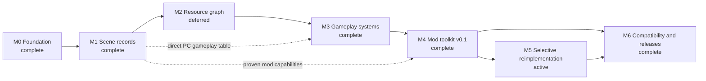

# Project Roadmap history through 2026-09-26

Historical snapshot of [[Project Roadmap]] before the September 26 review. The body
below is preserved, including superseded claims, old process IDs and
consumed permissions. It is evidence of earlier notes, **not a current work
queue or runtime binding**. Use [[Current State#Current task handoff]] and
[[Environment Status#Current runtime handoff]] for current instructions.
2026-09-26 - Codex - Project review and Vault cleanup records the review.

<!-- preserved-body:start -->

## 2026-09-16: guard intermittent eastern-path terrain camera wrap

[[EXP-20260916-011 - Terrain camera range guard for horizontal bands]] reproduces broad horizontal bands at the user spot and traces admitted western terrain through native signed-word narrowing. Both tree and grass contribute. A scoped visual guard leaves all729 CD files/source/collision exact; whole-EXE inverse restores EXP010. All92 final frames are viewed,154 selected checks pass/7130 deselected, and the exact3.588s Up replay is clear. 2026-09-16 - Codex - Guard terrain camera overflow on the eastern path owns closure; appearance/banking, wider clipping/angles/corners and performance stay pending.

## 2026-09-11: Training distance, panorama and grass boundary

[[EXP-20260911-013 - Twofold distance and Training performance]] measures the
2x shared distance: matched60s trials show31.23/31.25 FPS with similar CPU.
Wider view and other-level performance remain outside the measured scope.
[[EXP-20260911-014 - Training flower panorama and wall cutoff]] subsequently confirms entrance-to-far-wall clipping still occurs
at2x; distant flowers are panorama art. [[EXP-20260911-015 - Training grass uses secondary background geometry]] subsequently
identifies the distant grass representation. [[EXP-20260911-016 - Training grass boundary near and distant representations]] confirms its
detailed near meshes and actual collision boundary; both geometry and camera
are quarter-scaled in the distant pass.

## Latest completed PC engine investigation checkpoint, 2026-09-08

[[EXP-20260908-016 - Manual seed ownership and native scattering]] adds the user's complete moved-seed terrain cycle with actual sampled
queue/plant/selection/carry owners, plus native fixed-slot and seed-repulsion
discriminators.152 bounded native cases pass. Live actor release/publication and
general state/world/memory acceptance remain open in [[PC Large-Level Engine Roadmap]].

## Current rendering continuation, 2026-09-07

[[EXP-20260907-010 - General render distance preview]] installs user-approved
1.5× terrain/scenery distance, propagated by Blender Build.48 tests, native
initializer/primary-packet checks and resident verification pass. Game588527 is
OPEN; old550760 CLOSED, both editors preserved. [[PC general render distance]]
records tuning/restoration. Further expansion deferred at the user's request;
2× broad rendering/performance acceptance remains open. Earlier follow-ups below
record their historical state and are superseded by this entry.

Current follow-up: [[EXP-20260907-009 - Mushroom render distance diagnosis]] identifies
the polygon cutoff and offline range options. No installation or milestone change;
[[PC scenery render distance]] records the implementation choices.

# Project Roadmap

## Immediate terrain authoring continuation (2026-09-06)

EXP-20260906-007 closes the observed mushroom gate: type5 -> PLANTTER record8, separate seed collider, two-byte marker restoration, paired native exclusion/bounce/return and fresh normal-input runtime with five sampled bounces. The banked varied LEVEL.DAT is now live with that repair; next is user play and boundary-appearance feedback. Keep other templates/high0x104 disabled and the stripped control intact. Another plant regression requires its own PC mapping; this is not a general plant-isolation policy. [[PC seed and mushroom collision state]]; [[2026-09-06 - Codex - Mushroom collision restoration and varied grass]].

## User-selected playable composition, 2026-09-05

The user chose a small usable area from the working pieces rather than repeating
the box/blob demonstrations. [[EXP-20260905-004 - Playable ramp and box area]]
now supplies deck -> ramp -> banked box -> ramp -> deck, modeled in six paired
routes and traversed twice live with normal input, plus jump/landing and step-off.
A reproducible builder and fresh playable copy are available. Next is user play
and feedback before adding another piece. This local elevated fixture does not
resolve the separate EXP-003 prop-aware source100 route or generic authoring.
Validation remains terrain-only; no R2q/full-suite rerun for this work.

## 2026-09-05 terrain priority update

[[EXP-20260905-003 - Shared floor return discriminator and stitched patch]] now
reproduces EXP-005's return fall offline and live and demonstrates a bounded
connected six-cell repair with paired render heights. This supersedes prior
instructions to start by reproducing that return. Next compare a normal-input
route around unchanged props across source99/source100, then broaden finite
velocity/pose coverage. The 16/16 isolated model result is not 16/16 complete-scene
or live coverage: retail/stitched are 13/16 complete-scene and the extra live seam
route was blocked. Keep rigid EXP-005, flat EXP-006 and banked box fixtures intact.

## Current terrain/collision sequencing — 2026-09-04

Per the user's request for a more productive terrain/collision route, advance
offline Track C independently of the R2q renderer calibration chain (DEC-226).
[[EXP-20260904-001 - Original PC lateral collision and descriptor-store probes]]
establishes a player-connected lateral-response branch with original-instruction
synthetic controls, plus bounded direct descriptor stores. The real-cell step
is now completed by
[[EXP-20260904-002 - Retail collision admission and separate XZ barriers]]:
original loading/buckets for Level01 and Level03, real steep-triangle admission
and deflection, and a separate kind`0x101` X/Z barrier response.

DEC-227's grammar and grounded-contact step is complete in
[[EXP-20260904-003 - Barrier grammar and landing-seeded grounded movement]]:
canonical kind`0x101` reader, corpus coverage, exact ordered candidate checks,
and obstacle controls after original landing establishes ground contact.

DEC-228's first authored fixture now has live evidence:
[[EXP-20260904-004 - Translated barrier live collision proof]] demonstrates a
size-preserving barrier relocation with loaded-payload verification and a
restored-file walking control. [[PC barrier translation prototype]] provides
the bounded edit and offline reproduction; this is not a full terrain writer.

DEC-229's floor fixture and runtime step are complete in
[[EXP-20260904-005 - Raised floor and visible ground pairing]]: original landing/walking
prediction, live raised floor and jumps, plus a fixed visible-ground companion
with matching-camera changed/restored controls. [[PC floor translation prototype]]
records the supported rigid operation and its limits.

The user subsequently reported falling through EXP-005's patch on return.
Its measured coordinate/pixel effects remain valid, but reliable traversal and
complete grouping are not established. DEC-231 introduces an isolated flat deck
and distinct block in [[EXP-20260904-006 - Flat deck and solid block test]]; original controls
and two live jump-off-return cycles pass. The user confirms block landing/contact,
but reports visible legs through it while standing behind it. DEC-232 records a
render-depth-offset discriminator in [[EXP-20260904-007 - Deck visibility and inherited depth offset]].
[[EXP-20260904-008 - Block depth offset runtime comparison]] now confirms the bounded cause and repair
by one-byte removal/restoration at matching player/camera state. DEC-233 keeps
that explicit field choice and regression for new geometry.

The user's subsequent side-view residual limits EXP-008 to a partial repair.
[[EXP-20260904-009 - Paused side-view depth interpolation]] preserves the
already-triggered paused game and finds a large-face depth-order error in
original drawing instructions. DEC-234 prioritizes a finer-mesh comparison at
that exact pose. The user subsequently authorized its two in-place writes;
[[EXP-20260904-010 - Paused subdivision live comparison]] removes the255 prior
inversion-point fragments and reproduces them on exact restoration, with9
matched-state captures. DEC-235 retains this result while requiring remaining
edge/other-view validation. At EXP-010 close, the same user game was paused with
the original mesh restored. The later banking audit is clean, so no live failure
pose remains available.

[[EXP-20260904-011 - Box top diagonal edge discriminator]] selects alternate
top diagonals on the same 4x4 vertices/faces. Its original drawing output wins
all 259 prior analytic comparisons. The subsequent authorized four-write
[[EXP-20260905-001 - Box top diagonal live comparison]] completes DEC-237:
six residuals disappear/return with alternate/control restoration; all 255
earlier fixes remain hidden, with 15 matching-state captures and exact paired
ROI restoration. At experiment close, the original mesh was restored in the
same paused user game; the later banking audit is clean.
DEC-238's next movement/view step is completed at a finite scope in
[[EXP-20260905-002 - Box movement and occluding-view validation]]: five valid
reversal sweeps, 518 grounded samples and 107 captures, plus jump/top/step-off
contact. The new paused occluding-edge diagnostic has no reconstructed depth
inversion. Preserve the rejected original-location south route; its guarded
retry succeeds in the stationary placement only. DEC-239 retains these bounded
regressions without choosing a universal diagonal or mesh-size rule.

Next, isolate the old patch's
return-traversal failure and implement consistent shared boundary heights,
normals and bounds (DEC-230). Keep the deck and old rigid fixture as distinct
regressions. General authoring and independent-review gates remain open.

Preserve R2q-032's source/activation bank and all predecessors. Its incomplete
finalization remains a separate deferred task; no R2q successor, runtime arm,
mapping recovery, or new wrapper invocation is authorized by this pivot.
See [[New-level authoring roadmap (terrain, collision, materials)]].

## Purpose

This is the canonical execution roadmap for the ABLPC project. It translates
the mission in [[Project Charter]] into an ordered path toward practical,
evidence-backed modding of the Windows PC game.

The roadmap is deliberately evidence-gated. A milestone advances when its exit
criteria are demonstrated, not when a percentage or calendar estimate looks
plausible. “Reverse engineer the whole game” is never a work packet.

## Relationship to other Vault notes

- [[Project Charter]] defines mission, scope, authority, and non-goals.
- This roadmap defines outcomes, ordering, gates, and the active work packet.
- [[Current State]] records the concise present-tense snapshot and exact next
  action.
- [[Known Unknowns]] records unresolved questions and resolved unknowns.
- MOCs index evidence, dossiers, experiments, and implementation notes.
- Session notes in [[Session Index]] preserve chronology.

Do not copy detailed findings into this roadmap. Link their evidence and change
roadmap status only when a result changes sequencing, readiness, or scope.

## North-star outcomes

1. **Reproducible knowledge:** important PC claims are address-, offset-, hash-,
   run-, or experiment-backed and survive agent handoff.
2. **Safe Linux modding:** a user can inspect, compose, validate, stage, launch,
   and remove mods without changing `originals/` or distributing game content.
3. **Useful game changes:** scene placements, assets, and gameplay data can be
   changed through documented formats and controlled tests.
4. **Selective compatibility:** independently implemented components replace
   original behavior only when their contracts are understood and regression
   tested. A full engine rewrite is an option, not an assumed prerequisite.
5. **Honest platform scope:** Wine/Linux is the primary supported runtime.
   Windows 98 is an optional historical discriminator when a material
   compatibility question requires it.

## Operating model

Milestones describe dependency order, not a ban on bounded parallel evidence
work. M4 can absorb proven capabilities incrementally; it exits only after the
workflow is useful beyond a single research demonstration. M4 is the primary
practical-modding destination. M5 is optional and does not gate a Wine-scoped
M6 release when the original executable remains the runtime.

`EXP-20260813-055` correctly superseded M2.39's premature deferral and
`EXP-20260813-056` completes its exact slot-2/slot-3 census. The second
adversarial audit in `EXP-20260813-057` then rejects the new deferral: slot 63
was explicitly retained and excluded, while exact arithmetic supplies the
omitted classification of `0x0059C30C` as fixed-pool slot 25. Both feed exact
generic header readers. `EXP-20260813-058` completes their bounded reader
disposition with reader-time zero reachable but no M1-derived value or direct
gate. Independent `EXP-20260813-059` accepts M2.41 and finds no exact finite
PC-native successor retained in the already cited evidence. M2 is deferred
with its causal exit gate and `KU-023` unchanged. `EXP-20260814-060` produced
the M4.1 worker result; independent `EXP-20260814-061` rejects its complete-
output-preflight claim. `EXP-20260814-062` completes exact corrective worker
packet M4.3, and independent `EXP-20260814-063` accepts it at the deterministic
planned-path/type boundary. `EXP-20260814-064` completes the exact M4.5 worker
composition/conflict implementation. Fresh-context `EXP-20260814-065` rejects
acceptance: canonical span sorting can reverse edits inside one independently
valid input and make a disjoint pair fail combined revalidation. Exact
corrective packet M4.7 is worker-complete in `EXP-20260814-066` and
independently accepted in `EXP-20260814-067`. Exact receipt-validated sparse-
overlay removal packet M4.9 is worker-complete in `EXP-20260814-068`, but
fresh-context `EXP-20260814-069` rejects its complete-preflight claim. Exact
corrective packet M4.11 is worker-complete in `EXP-20260814-070`; exact
fresh-context `EXP-20260814-071` rejects M4.11 acceptance because a proper
parent traversed to reach the overlay root can be a mount alias without
matching the exact root/descendant plan. Exact corrective packet M4.13 is
worker-complete in `EXP-20260814-072`, but fresh-context
`EXP-20260814-073` rejects M4.14 because a hidden lower alias covered by a
distinct ordinary top filesystem still taints the shared ancestry pathname.
`EXP-20260814-074` completes exact corrective worker packet M4.15 by excluding
only covered same-path parent-stack records from alias comparison. Exact
fresh-context `EXP-20260814-075` preserves that correction but rejects M4.16:
Linux reused a freed numerically lower mount ID for a newer uncovered bind,
and numeric-ID ordering omitted the alias before destructive removal. Exact
corrective packet M4.17 is worker-complete in `EXP-20260814-076` and accepted
by exact fresh-context `EXP-20260814-077`. Exact versioned-compatibility packet
M4.19 is worker-complete in `EXP-20260814-078`, but fresh-context
`EXP-20260814-079` rejects M4.20 because substring-only authority checks accept
effective competing launcher/implementation declarations and a contradictory
Environment row. Exact corrective packet M4.21 is worker-complete in
`EXP-20260814-080`, but fresh-context `EXP-20260814-081` rejects M4.22 because
effective post-declaration shell/Python mutations and duplicate manifest keys
still pass. Exact same-read machine-authority pin correction M4.23 is worker-
complete in `EXP-20260814-082` and independently accepted by
`EXP-20260814-083`; exact deterministic single-manifest dry-run report M4.25
is worker-complete in `EXP-20260814-084` and independently accepted by
`EXP-20260814-085`; exact M4.27 milestone-closure evidence audit rejects
milestone closure in `EXP-20260814-086`. Exact receipt-sufficiency worker
M4.28 is complete in `EXP-20260814-087`, but exact fresh-context verifier
M4.29 rejects its parent-path consistency claim in `EXP-20260814-088`.
Exact component-stable receipt acquisition correction M4.30 is worker-complete
in `EXP-20260814-089`, but fresh-context M4.31 rejects its descriptor-release
claim in `EXP-20260814-090`. Exact corrective M4.32 is worker-complete in
`EXP-20260814-091` and accepted by exact M4.33 in `EXP-20260814-092`.
M4.34 rejects the clean-copy lifecycle ledger; M4.35 adds manifest-driven
restoration, M4.36 rejects case collisions, and M4.37 closes them. Exact M4.38
accepts that lifecycle boundary in `EXP-20260814-097`. M4.39 is worker-
complete on strict v0.2 statement alignment in `EXP-20260814-098`; exact
independent M4.40 rejects final closure in `EXP-20260814-099`. Exact M4.41
closes those regular-file checker failures in `EXP-20260814-100`, but exact
M4.42 rejects its resolved-path selected-version claim in
`EXP-20260814-101`: the default active path can link to the historical selected
file and validate v0.1. Exact M4.43 closes that worker boundary in
`EXP-20260814-102`. Independent M4.44 accepts the correction and complete
ledger in `EXP-20260814-103`; M4 is Complete only at its documented asset-free,
current-x86_64-Linux, explicit-unsupported boundary.
`EXP-20260814-105` initially accepted M6, but independent hard-truth audit
`EXP-20260814-106` rejects closure at exact clean HEAD `61ab0f9`: normal use of
an installed Python wrapper creates unlisted bytecode and invalidates the
complete inventory, installed release roots can be substituted by symlinks,
and a dangling `state.json` symlink is treated as absent. M6 is Active again
with only the exact installed-lifecycle correction recorded below. The first
correction is rejected by `EXP-20260814-108`; the state-locked second
correction in `EXP-20260814-109` is independently accepted by
`EXP-20260814-110`. M6 is Complete at that exact asset-free, Fedora/Wine,
launcher-readiness, local-state-trust boundary.
`EXP-20260815-132` supplies the worker reconciliation of all four M3 exit gates
and reproduces the five exact gameplay recipe outputs plus their inverse
receipts. Independent `EXP-20260815-133` retains those technical results but
rejects closure because the durable Training receipts do not prove the prior
explicit authorization required for their target-state changes and
breakpoints. `EXP-20260815-134` completes that exact corrective worker with two
fresh, explicitly authorized, breakpoint-free Training receipts, and
`EXP-20260815-135` independently accepts the raw traces, helper boundary,
recipes, and complete four-gate ledger. M3 is Complete at those bounded
Training and Level03 results; no successor milestone activates automatically.
`EXP-20260816-153` later activates M5 deliberately, by auditing candidate
modules against the entry gate and admitting exactly one; M2 stays deferred
with its causal gate unchanged.

### Status vocabulary

| Status | Meaning |
|---|---|
| Complete | Every exit gate is supported by cited evidence or tests. |
| Active | The milestone owns the single canonical next work packet. |
| Planned | Direction is useful, but entry gates are not yet satisfied. |
| Blocked | A named external dependency prevents meaningful progress. |
| Deferred | Deliberately outside the critical path until a revisit condition occurs. |

### Work-packet rules

- Keep one active milestone and one exact next work packet in this note and
  [[Current State]].
- Ask one bounded question that available evidence can discriminate.
- Cite the exact PC executable or file hash and at least one PC locator.
- Define the expected observation and what competing interpretations it
  distinguishes.
- Prefer two independent evidence forms for important claims.
- End with reviewable evidence, updated unknowns, and a specific follow-up.
- Extend parsers or reimplementation only after the relevant behavior or layout
  is demonstrated.
- Obtain explicit approval before debugger changes to memory, registers, code,
  execution, or breakpoints, as required by [[Agent Operating Manual]].

## Roadmap status

| Milestone | Status | Outcome | Evidence or entry point |
|---|---|---|---|
| M0 — Research and runtime foundation | Complete | Reproducible PC evidence and a fast Linux loop | `EXP-20260811-001` through `EXP-20260812-008` |
| M1 — Scene records and reusable payloads | Complete | Explain and safely edit the scene-selection-to-payload path | [[M1 Tool Support Matrix]] |
| M2 — Resource dependency graph and one editable asset family | Deferred | Trace one level placement through loaded resources to rendered content | [[EXP-20260813-059 - Independent M2.41 disposition hard-truth audit]]; causal gate retained |
| M3 — Gameplay and level-logic systems | Complete | Identify and edit selected actors, interactions, collision, triggers, camera, and progression | [[EXP-20260815-135 - Independent M3 ratchet acceptance audit]]; all four gates accepted after exact authorization correction |
| M4 — Mod toolkit v0.1 | Complete | Deliver a non-destructive, composable Linux mod workflow | [[EXP-20260814-103 - Independent M4.43 selected-path and milestone-closure hard-truth audit]]; 9/9 capabilities and 5/5 exit gates at the documented boundary |
| M5 — Selective reimplementation | Active | Replace only well-specified components with independently written code | [[EXP-20260816-171 - Independent M5.8 grain-gate resolver audits]] accepts the second optional module at exact `dfd3af3`; no third module is admitted |
| M6 — Compatibility validation and releases | Complete | Publish reproducible Wine-scoped tools/mods with honest compatibility claims | [[EXP-20260814-110 - Independent M6 state-locked lifecycle acceptance audit]]; all four exit gates accepted at the documented boundary |

## M0 — Research and runtime foundation

**Status:** Complete.

### Outcome

Establish immutable source provenance, a reviewable evidence system, static
analysis, a reproducible Wine/Linux runtime, deterministic visual capture, and
one safe edit-test vertical slice.

### Completed gates

- Exact original media and PC executable identities are recorded. Evidence:
  `EXP-20260811-001` and `BIN-97c95ba5572dce63`.
- Ghidra import/export and PC-native baseline maps are reviewable outside the
  tool database. Evidence: `EXP-20260811-002` and `EXP-20260811-003`.
- The unchanged executable reaches playable Training under Wine. Evidence:
  `EXP-20260811-004` and `EXP-20260812-005`.
- Hardware-rendered 4:3 Linux presentation is reproducible. Evidence:
  `EXP-20260812-007` and [[Wine Linux Play Baseline]].
- A bounds-checked `LEVEL*.DAT` prefix parser, manifest workflow, staged-copy
  workflow, tests, and a visible original-executable modification exist.
  Evidence: `EXP-20260812-006`.
- Native hardware watchpoints and individual scene-record mutations have a
  successful bounded use case. Evidence: `EXP-20260812-008`.

## M1 — Scene records and reusable payloads

**Status:** Complete.

### Outcome

Establish a bounded PC-native model for how 20-byte scene records reference
payloads and reusable content, then expose only confirmed or explicitly
candidate fields through safe tooling.

### Work packages

1. **M1.1 — Shared payload-target structure (complete):** Training targets
   `0x111E4` and `0x1319C`, their positive-count structures, relocations,
   consumer path, and same-dispatch corpus boundary are recorded in
   `EXP-20260812-009`.
2. **M1.2 — Reference population (complete):** `EXP-20260812-010` accepts both
   guarded reciprocal Training rebinds under Direct3D and confines each
   phase-matched change to its independently identified placement region.
3. **M1.3 — Record selection/payload fields (complete):** `EXP-20260812-011`
   separates the three record-center fields from dispatch-`0x49` payload
   placement; `EXP-20260812-012` demonstrates the positive `+0x0C` visibility
   bound. Earlier evidence already bounds `+0x0E` flags/sentinel and relocated
   `+0x10` payload.
4. **M1.4 — Cross-file validation (complete):** `EXP-20260812-013` binds the
   `ant hill` menu selection to the exact Level 01 DAT and accepts byte-local
   record-center and target-rebind edits under Direct3D. Neither is visible at
   the starting camera; the cross-file difference is retained explicitly.
5. **M1.5 — Tooling promotion (complete):** [[M1 Tool Support Matrix]] aligns
   the parser, filtered inspector, fail-closed manifest schema, 18 synthetic
   tests, exact Training/Level 01 recipes, CLI help, and no-game-bytes author
   workflow with the demonstrated M1 boundary.

### Exit gates

- Record-to-payload fixups and payload boundaries are described with file
  offsets and executable addresses.
- At least one shared target and one contrasting target are traced from file
  bytes through a PC consumer and a visible result.
- Supported edits round-trip losslessly outside their exact intended bytes and
  are accepted by the original executable on at least two level files.
- Contradictory layouts or behaviors are recorded rather than normalized away.
- [[PC LEVEL DAT prefix]], function dossiers, tests, and user-facing tool notes
  agree on the supported boundary.

## M2 — Resource dependency graph and one editable asset family

**Status:** Deferred; causal exit gate retained.

### Outcome

Connect scene-level references to the files and runtime objects they cause the
PC executable to load, and safely inspect and replace one useful resource
family end to end.

### Work packages

1. **M2.1 — Content census (complete):** `EXP-20260812-014` records a
   metadata-only census of the exact derived PC tree, reconciles every explicit
   Training and Level 01 load path, and selects the repeatedly observed
   `CD/PLANTS` basename pairs as a bounded caller-trace candidate.
2. **M2.2 — Loader callers and consumers (complete):**
   `EXP-20260812-015` maps the shared plant base-path selector, distinct `.ANM`
   and `.ALL` loader call sites, first consumers, and arena-size boundaries.
3. **M2.3 — Plant request origin (complete):** `EXP-20260812-016` binds
   Training plant IDs 4, 10, and 6 to exact type-`0x3F` top-table bytes in the
   same `LEVEL1.DAT`, and proves that table is separate from M1 scene-record
   and positive-target ranges.
4. **M2.4 — Bounded resource tooling (complete):** `EXP-20260812-017` maps the
   first-level `.ANM` consumer, adds a lossless bounds-checked inspector with
   synthetic invalid fixtures, and validates all 11 PC plant files.
5. **M2.5 — ANM-only replacement validation (complete):**
   `EXP-20260812-018` confirms that exact plant 10 `.ANM` bytes are accepted as
   plant 04 with plant 04 `.ALL` unchanged, but finds no stable visible change
   at the tested Training start camera.
6. **M2.6 — Paired replacement validation (complete):**
   `EXP-20260812-019` confirms that the exact equal-size plant 10 `.ANM`/`.ALL`
   pair is accepted at the plant 04 paths, but finds no stable visible change
   at the tested Training start camera.
7. **M2.7 — Request suppression and visible-mask bridge (complete):**
   `EXP-20260812-020` corrects the selector-cursor model, suppresses only the
   second `0x2B` occurrence, confirms exact plant 10 request omission and
   `NextLife`, and finds no stable start-camera mask beyond control variance.
8. **M2.8 — Runtime consumer-to-placement bridge (complete):**
   `EXP-20260812-021` resolves plant 10's exact ANM slot and two-entry runtime
   range, then records bounded negative read windows for the pointer surface
   during each M1 record-124–126 direct dispatch-to-renderer path.
9. **M2.9 — Plant 10 downstream object consumer (complete):**
   `EXP-20260812-022` records a 71.708-second post-title negative for the two
   exact entry `+0x20` dwords and adjusted first-entry dword.
10. **M2.10 — Plant 10 late-initialization consumer boundary (complete):**
    `EXP-20260812-023` records exact negative windows from a plant-specific
    guarded `0x00445B01` through `0x004679C7` and the natural title.
11. **M2.11 — Plant 10 entry-head consumer boundary (complete):**
    `EXP-20260812-024` records matched negative windows for both entries'
    exact `+0x00/+0x04/+0x08` dwords through batch return and into post-title
    gameplay.
12. **M2.12 — Plant 10 entry-head +0x0C consumer boundary (complete):**
    `EXP-20260812-025` records a same-run negative for both exact nonzero
    dwords through guarded batch return and a no-input title.
13. **M2.13 — Plant 10 entry +0x2E gate boundary (complete):**
    `EXP-20260812-026` records a same-run negative for both exact words through
    guarded batch return and a no-input title.
14. **M2.14 — Plant 10 entry +0x28 boundary (complete):**
    `EXP-20260812-027` records a same-run negative for both exact zero-valued
    words through guarded batch return and a no-input title. M2.9–M2.14 now
    bound every exact field populated by `0x00448010` and its guarded caller
    for at least one explicit interval, without assigning field meanings.
15. **M2.15 — Plant 10 post-title selected-entry event (complete):**
    `EXP-20260812-028` records zero access stops for both exact plant 10
    `+0x2E` words from the natural title through `NextLife`, adds a separate
    30.026628-second no-input post-`NextLife` negative, and records exact
    candidate reader `0x0044CE3E` inactive in a separate 10.014330-second
    control. Two later caller-gate arms are retained but rejected after raw
    GDB output records an unresolved `SIGSEGV` at the instrumented PC.
16. **M2.16 — Fresh-session selected-entry caller chain (complete):**
    `EXP-20260812-029` runs the exact fresh simultaneous four-point arm. It
    reaches `0x0044D79A` once, then raw GDB records `SIGSEGV` at that PC while
    the schema-1 harness continues and reports `target_reached`; Wine opens its
    debugger and the game-only survival frame is a fatal-error dialog. The arm
    is accepted only as a fault reproduction, not caller/callee/data evidence.
17. **M2.17 — Unexpected-signal-safe debugger control (complete):**
    `EXP-20260812-030` makes unexpected fatal signals structured terminal
    results, adds a configurable independent post-detach survival receipt,
    proves safe `nopass` detach on an injected fixture, preserves routine Wine
    signals, and reproduces the prior safe four-stop game watch under required
    survival checks.
18. **M2.18 — Adjacent caller-gate continuation discriminator (complete):**
    `EXP-20260812-031` arms only adjacent `0x0044D794` in a fresh schema-2
    hardware run. It stops once, then receives structured `SIGSEGV` at that
    same PC. Cleanup/detach and five resumed/untraced samples pass, and a later
    game-only frame shows live Training because `nopass` suppresses delivery.
    Per the packet stop rule, no fresh exact arm follows. Together with the
    independent exact-`0x0044D79A` reproductions, this bounds a nearby-region
    continuation limitation without assigning game semantics.
19. **M2.19 — Direct visible plant-family outcome (complete):**
    `EXP-20260812-032` runs fresh unchanged/replacement/unchanged Direct3D arms
    along one timestamped Training trajectory. The controls match exactly at
    11/12 same-index samples; sparse replacement residuals follow animated and
    camera-transition edges, with no stable replacement-local region. The
    plant-04/10 direct visible-outcome route is retired under the stop rule.
20. **M2.20 — Training character-family discriminator (complete):**
    `EXP-20260812-033` accepts exact one-path
    `CHARS/FLICK.ALL <- CHARS3/FLICKD.ALL` under fresh matched Direct3D arms.
    An 18-way all-phase comparison retains a repeated local difference on the
    input-controlled central figure at all four anchors, confirming a bounded
    loaded-file-to-render link without assigning `.ALL` layout or identity.
21. **M2.21 — Character request and first-consumer trace (complete):**
    `EXP-20260812-034` binds the exact ID-zero request, loader call
    `0x00448079`, first consumer `0x00448010`, and retained destination range
    `[0x005A9660, 0x005A9DE0)` without assigning `.ALL` fields.
22. **M2.22 — Character retained-range first-use bridge (complete):**
    `EXP-20260813-035` binds the first direct ID-zero reader in one normal
    update to `0x00402DC0 -> 0x00445FF0`. The nearest M1-coordinator-side
    range reader, `0x0044C440`, executes before the record root is loaded or
    any 20-byte record is enumerated, ruling out a direct M1 bridge in that
    exact branch/order window.
23. **M2.23 — Shared-entry render-lineage discriminator (complete):**
    `EXP-20260813-036` proves distinct retained-entry/M1 source walks and their
    exact convergence on one hardware `0x80`-stride submission arena and
    list-head topology, without promoting source identity.
24. **M2.24 — ID-zero stream-difference localization (complete):**
    `EXP-20260813-037` maps all 24 exact retained intervals, finds entry 8
    unchanged and entries `{0-7, 9-23}` changed, and classifies all 2,102
    retained differences as lying in record spans reached by both identical
    bounded walks.
25. **M2.25 — Per-entry submission-arena delta capture (complete, bounded
    negative):** fresh matched Direct3D arms find the conditional arena
    inactive for all 23 candidates; `EXP-20260813-038` records the result.
26. **M2.26 — Direct3D renderer-path reconciliation (complete):**
    `EXP-20260813-039` proves the arena is selector-1 native-software output
    and selector-2 Direct3D instead reaches separate batch builders and the
    device `DrawIndexedPrimitive` edge.
27. **M2.27 — Direct3D retained-entry batch provenance (complete):**
    `EXP-20260813-040` statically bounds both selected families and every
    reachable in-call flush/reset edge, then accepts fresh hardware-rendered
    control/replacement/control metadata-only arms. Replacement vertex/index
    counts outside both controls reduce the 23-entry set to exact candidates
    `{1,2,4,5,6,7,9,10,14,15,18,19,20}`; no selected entry flushes in-call.
28. **M2.28 — Changed-record form localization (complete):**
    `EXP-20260813-041` proves that all 145 changed records in the 13-entry set
    reach their selected builder in every retained cycle, then narrows the
    count-relevant boundary to 18 entry/form groups and 124 exact records.
    Three single-record groups have individually discriminated bounded append
    outcomes; 121 record identities remain aggregate alternatives.
29. **M2.29 — Per-record Direct3D append discriminator (complete):**
    `EXP-20260813-042` maps exact append/no-append boundaries and accepts fresh
    payload-free per-record arms. Only entry 7/file offset `0x0A6C`/form
    `0x3C` differs outside both controls, with outcome pattern `0/1/0`.
30. **M2.30 — Exact `0x0A6C` builder-input localization (complete):**
    `EXP-20260813-043` maps all 12 exact differences to four separate
    post-admission vertex-record inputs. No differing byte reaches an
    admission decision; M2.29's `0/1/0` receipt is therefore arm-local rather
    than a source-stable append-decision attribution.
31. **M2.31 — Exact `0x0A6C` admission-state localization (complete;
    offline):** `EXP-20260813-044` reduces the physical non-source union to 23
    locations, the exact mode-2 path to 12 ordered logical rejection slots,
    and proves existing safe data-watch boundaries can support a payload-free
    first-reject receipt.
32. **M2.32 — Exact `0x0A6C` admission-predicate receipt (complete; temporal
    ambiguity preserved):** `EXP-20260813-046` live-validates schema 6 and
    finds prediction/count agreement in all three fresh arms, but their append
    pattern is `0/0/1`, not M2.29's `0/1/0`. The unchanged controls disagree;
    no source-stable first-reject/replacement-pass result is selected.
33. **M2.33 — Exact `0x0A6C` consecutive-cycle stability bound (complete):**
    `EXP-20260813-047` fixes and fixture-proves the three-cycle envelope;
    freshly authorized `EXP-20260813-048` accepts one unchanged process at
    816 stops and observes reject/pass/reject (`0/1/0`) with prediction/count
    agreement and all safety/redaction gates. The two rejects share slot 7
    but not an active-state digest.
34. **M2.34 — M2 exit-gate reconciliation (complete; offline only):**
    `EXP-20260813-049` supports three gates at their exact boundaries and
    retains one blocker: no PC-native edge makes an M1 scene record or positive
    target select the ID-zero `CHARS/FLICK.ALL` resource path. The `.ANM`
    multi-file/synthetic result is not generalized to `.ALL`, and the corrected
    software arena is not used as a Direct3D bridge.
35. **M2.35 — M1 positive-target Direct3D resource-selector slice (complete;
    negative; offline only):** `EXP-20260813-050` classifies the exact M1 call
    inputs and all ten inline selector-2 Direct3D allocation arms. Page/list,
    root, flush, index, vertex-base, and emitted-record inputs derive from the
    M1 target/command stream, exact caller inputs, renderer globals, local
    derived scratch, or existing batch state—not ID-zero header
    `0x005B18E0`, retained range `[0x005A9660,0x005A9DE0)`, or exact selected-
    resource state.
36. **M2.36 — Generic resource-index producer census (complete; negative;
    offline only):** `EXP-20260813-051` resolves every thunk caller and native
    index expression. Six readers are confined to the pre-coordinator update,
    `0x00444EF0` is resource initialization with exact index 11, and sole
    coordinator-local reader `0x00448350` executes before the M1 root load and
    record walk. Neither the selected-record nor positive-target closure
    contains a candidate; no M1-derived ID-zero selection is proved.
37. **M2.37 — M2 dependency-gate disposition (complete; offline only):**
    `EXP-20260813-052` retains the gate because merging the separate M1 and
    ID-zero renderer-facing chains would remove the required causal selection
    edge. It selects one finite alternative in `0x0044CA00`: at most 20
    signed selector words, where exact value `-103` would address ID-zero
    header `0x005B18E0`.
38. **M2.38 — Signed source-record selector provenance (complete; negative;
    offline only):** `EXP-20260813-053` classifies four zero-only writer
    paths and sole nonzero writer `0x00467E60`. Its 20-entry image table holds
    only positive selectors and no `0xFF99`; both writer call sites consume a
    separate fixed `0x84`-stride pool, with the normal-update call occurring
    before M1 coordinator entry. No M1 record/payload-derived signed `-103`
    selector is proved, so the candidate is retired without opening another
    family.
39. **M2.39 — Continuation scope disposition (complete; offline only):**
    `EXP-20260813-054` keeps the causal exit gate and `KU-023` unresolved,
    but its deferral conclusion is superseded by `EXP-20260813-055`. The
    audit found that the disposition confused "no successor had been ranked"
    with "no finite candidate exists" and overlooked exact persistent index
    inputs already retained by M2.36. Its gate-retention and M4.1 technical
    boundary survive; exclusive M4.1 activation does not.
40. **M2.40 — Fixed-pool index producer census (complete; bounded causal
    negative; offline only):** `EXP-20260813-056` classifies the complete
    first-dword store set as pool clear `0x0041C430`, retained-source copy
    `0x0041BD24`, and conditional removal zero `0x0041BBBA`. Initial clear
    zero cannot pass the reader gates, while late removal zero is statically
    reader-reachable. Its inputs derive from separate `LEVEL.RAW` type-`0x23`
    source fields and fixed-pool state, not an M1 record, relocated payload,
    or positive target. The exact candidate is retired without widening.
41. **M2.41 — Residual fixed-pool index reader disposition (complete; bounded
    causal negative; offline only):** `EXP-20260813-057` rejects the second
    premature deferral. Exact
    arithmetic places `0x0059C30C` and `0x0059D6A4` at fixed-pool slots 25
    and 63; both first dwords feed exact generic header readers, and M2.40
    explicitly excluded their consumer paths. `EXP-20260813-058` proves slot
    25 zero can reach its ID-zero lookup initially or one update after removal;
    slot 63 zero is excluded at two `I == 0x23` calls but can reach three
    state-gated calls. No proven value or direct gate derives from M1.
42. **M2.42 — Independent M2.41 disposition hard-truth audit (complete;
    ACCEPT; offline only):** `EXP-20260813-059` independently reproduces the
    exact slot-25/slot-63 reader, gate, update-order, and M1-intersection
    results. It separately audits the stronger premise and finds no exact
    finite PC-native successor retained in the already cited evidence. This
    is not a whole-program absence proof. M2 is deferred with its unmet causal
    gate unchanged, and exact M4.1 is active.

### Exit gates

- A reviewable dependency path links a level record/payload, one or more PC file
  paths, loader addresses, runtime consumers, and a rendered or behavioral
  outcome.
- The selected format is tested across multiple files plus synthetic invalid
  inputs.
- One replacement or parameter edit is accepted by the original executable and
  is distributable as instructions/patch metadata without bundled game assets.
- Unknown sections remain preserved and visibly labeled unknown.

## M3 — Gameplay and level-logic systems

**Status:** Complete. M3.1 through M3.5 retain their exact technical behavior,
recipe, and Level03 results. `EXP-20260815-132` supplied the worker closure;
`EXP-20260815-133` rejected its Training authorization provenance;
`EXP-20260815-134` supplied the exact two-arm correction; and
`EXP-20260815-135` independently accepts all four gates. No generic gameplay
tooling, checkpoint semantics, deterministic input replay, or successor
milestone is promoted.

### Outcome

Identify enough PC-native gameplay data and code paths to author meaningful
level changes rather than visual placement changes alone.

### Candidate work streams

- actor or entity lifecycle;
- player state and input consumption;
- collectibles, counters, and inventory;
- collision and traversal surfaces;
- triggers, scripted transitions, and checkpoints;
- camera volumes or camera behavior;
- level goals, completion, and progression;
- save/load effects relevant to mod validation.

These labels are research questions, not confirmed subsystem names.

### Entry strategy

Choose the first stream by a concrete level edit desired by the researcher. Map
one observed behavior backward through a controlled runtime event, data access,
and static caller chain. Do not begin by naming every update-loop function.

The researcher's first concrete edit was one extra collectible grain in
Training. That goal admits a direct PC gameplay-table route through
`0x0044BB70`, `0x00456A90`, and `0x00417720`; it does not require or resolve
M2's separate scene-placement-to-resource identity bridge.

### M3.1 — Exact Training 51st grain vertical slice

**Status:** Complete at the bounded 51-record and isolated-new-pickup boundary.

`EXP-20260814-111` inserts one selector-`0x14` record into the exact Training
type-`0x3F` table, relocates 556 known file-relative fields, verifies an exact
inverse, boots the unchanged executable through the required Direct3D path,
and records only the new adjacent record consumed while the grain counter
increments `0 -> 1`. The output contains 51 collectible records.

This packet did not claim that the HUD/current count reaches 51. That separate
boundary is resolved by M3.2. It does not widen M1/M4's generic manifest
grammar, close M2, or complete M3.

### M3.2 — Retained/displayed 51 and original 50 milestone

**Status:** Complete at the bounded `51/50` bonus boundary.

`EXP-20260814-112` runs controlled `49 -> 50` and `50 -> 51` pickups. The
first reaches the original exact-50 event; the second skips it and retains 51.
The existing HUD produces decimal digits `(5,1)` without a patch. A reversible
three-byte executable recipe then raises only the end-tally retention cap to
51 and changes its completion branch from exactly 50 to unsigned at least 50.
Runtime evidence sets the completion flag, reaches the bright
completion/emblem path at animated count 50, and visibly continues to `51/50`.

The original exact-50 event, `/50` goal denominator, and completion/emblem
presentation remain intact. Replacing emblem artwork or redefining the level
goal would be a separate authored mod, not unfinished work in this packet.

### M3.3 — Training FLIK letter transformations

**Status:** Complete at the bounded move/duplicate/remove and repeated-
completion boundary.

`EXP-20260814-113` identifies the four singleton type-`0x3F` letter selectors
`0x10`–`0x13`, their mask-bit branches in `0x00417720`, and their separate
non-`0x14` initialization route in `0x00456A90`. A hash/layout-locked
transformation can move, duplicate, or remove those records while preserving
unknown bytes, relocating the exact 556 known file-relative fields, reparsing,
and reconstructing its input byte-for-byte.

The accepted demo duplicates all four existing selectors into new nearby
positions. The unchanged Direct3D executable loads type-`0x3F` count 67, and
each moved copy independently consumes while changing the common letter mask
from zero to bit `1`, `2`, `4`, or `8`; each original counterpart remains
intact. Exact selector-to-visible-glyph identity was not separately
discriminated, so individual conclusions remain selector-addressed.

The same runtime also confirms a necessary data-only boundary: collecting a
duplicate after mask `0x0F` retriggers the existing completion/reward path and
increments byte `0x0059D9B0` again. M3.3 documents that behavior rather than
silently patching it. One-shot duplicate completion is a distinct executable-
behavior goal.

### M3.4 — Training FLIKFLIK HUD and completion

**Status:** Complete at the exact eight-slot one-shot `FLIKFLIK` boundary.

`EXP-20260815-114` pairs the accepted M3.3 eight-letter DAT with a composed,
hash-locked executable recipe. Original records 50–53 retain bits `1/2/4/8`;
appended records 63–66 receive bits `16/32/64/128`. The reward gates now use
an explicit incomplete-to-`0xFF` transition byte: exact final-hash runtime
evidence shows `0x7F -> 0xFF` rewards once and an already-complete pickup does
not retrigger.

The in-level HUD and level-complete tally render centered `FLIKFLIK`. The
tally uses a complete eight-bit popcount table, displays `8/8`, preserves the
accepted `51/50` grain result, and reuses the existing emblem without changing
its artwork. The executable recipe changes 29 exact spans, retains applicable
base relocations, PE headers, sections, and file size, and proves exact inverse
reconstruction through the M3.2 intermediate to retail.

This is an exact vertical slice, not an arbitrary-word or arbitrary-slot
engine. Other words, lengths, glyph families, levels, persistence semantics,
or new emblem art require a new concrete goal.

Independent `EXP-20260815-115` accepts this exact M3.4 boundary after fresh
build/inverse, machine-code/PE/state, runtime-linkage, CLI-refusal, full-suite,
and clean-tree review.

### M3.5 — Level03 type-1 candidate respawn-row discriminator

**Status:** Complete at the explicit split-evidence disposition in
`EXP-20260815-131`. The row-6 consumer is causally accepted through
`EXP-20260815-117`; `EXP-20260815-129` confirms a natural first-pit-to-row-7
reset; and `EXP-20260815-131` maps descriptor 572 as the sole rows-6/7
result-1 region. Natural row-6 selection and broader semantic classification
are not claimed. `EXP-20260815-130` remains the authority rejecting
write-assisted teleport past the closed gate as a natural substitute.

The bounded question is whether Level03 type-1 row 6 feeds the conditional
nearest-row initializer at `0x00432930` during an ordinary death/reset.
`0x0041C8CC` can set the selector's state bit, and the selector writes authored
X/Z shifted left by five while terrain-recomputing Y. Multiple other PC
functions consume type 1, so the table is not named as checkpoints or as a
bespoke respawn structure.

The exact source-hash recipe changes only row-6 X at file offset `0x4A4` from
`15678` to `15806`. If that row is selected, static PC code predicts a
`+4096` runtime X difference, unchanged Z, and terrain-recomputed Y. The
matching committed PS1 result in `XPORT-20260815-002` selected this
discriminator only; it is not PC evidence.

The narrower natural row-6 requirement is explicitly disposed, not silently
treated as observed. The accepted row-6 source/candidate outcome and natural
upstream result-1 path are independent evidence forms. EXP-131's PC-native
geometry shows no second row-6-near result-1 descriptor, while the sole
rows-6/7 descriptor crosses their nearest boundary and both natural contacts
occur on its row-7 side. Controller access to its lower-Z row-6 portion remains
unknown. A negative or contradictory result remains retained rather than
resolved by renaming the table or importing PS1 semantics.

`EXP-20260815-119` partially resolves CAP-002 with a PC-native exact-window
keyboard recorder and two fresh accepted hardware-selector replays. The next
M3.5 arm should use that worker to record the user's Level03 route through
deliberate material-1 contact and pair repeated accepted replays with the
existing read-only state trace. Wall-clock input offsets are not engine-frame
synchronization; retain divergence rather than treating replay as causal by
itself.

`EXP-20260815-120` removes the manual PID/display/window setup through a
fixture-validated companion Recording menu around the unchanged pinned
launcher. `EXP-20260815-121` live-confirms exact discovery and recording but
rejects the current manual-delay path for long gameplay: after one disclosed
missing-renderer-Down compensation, 306/306 events and the full hardware gates
still diverge at Level Select without loading Training. Correct the companion
to share a fresh game-state/log anchor across record and replay before using it
for the Level03 route. This changes CAP-002 status, not M3.5 evidence or scope.

`EXP-20260815-122` completes that corrective worker packet offline. Companion
1.1.0 now defaults record and replay to a fresh
`--- Start LevelSelect ---` log marker, displays backend-confirmed arming/start
transitions, preserves the recorded post-marker neutral interval, separates
last-saved from next-output paths, and retains exact process-group cleanup
after launcher-leader exit. The marker is still provisional until a fresh live
user record/replay visibly and log-independently reaches the intended route;
M3.5 and KU-057 remain unchanged until that evidence exists.

`EXP-20260815-123` supplies that first live pair and narrows the result. The
shared marker reproduces Hardware mode and enters Training in a fresh replay,
which corrects EXP-121's menu divergence. All 300 events dispatch and the log
loads `gfx\training.raw` plus `level07\level1.raw`, but the user observes later
gameplay desynchronization. A first gameplay-looking input occurs only 1.338
seconds after level-confirmation Return while the single schedule spans the
entire level load. Level Select is therefore retained only as a menu/level-
entry anchor. Before KU-057, discriminate a movie anchored to the first
post-initialization `NextLife`, treating renderer and level selection as setup.

`EXP-20260815-124` supersedes that immediate next-step ordering with direct
target-window evidence. In a fresh replay, the timestamped PC log places the
first gameplay `z` about 954 ms after `NextLife`, so direct loss during loading
is not supported. More importantly, simultaneous exact-window echo records
304 normalized events for the 300-event source, including two inserted
`Right` up/down pairs, and measures multiple 15-39 ms transition/hold changes.
The accepted receipt timestamps before a synchronous send subprocess and does
not measure target arrival. Before KU-057 or another anchor change, correct
the delivery backend, require source/echo sequence and close-timing fidelity,
and A/B replay the immutable movie. Retain `NextLife` only as a later phase
discriminator if gameplay still diverges after that gate.

`EXP-20260815-125` completes that delivery discriminator and exposes a second
boundary. Persistent X11/XTEST plus mandatory exact-window echo reproduces all
300 source events in two fresh arms below 0.52 ms maximum target drift, yet one
arm returns to Level Select and the other remains in Training. Exact input is
therefore no longer the active CAP-002 defect, but wall-clock input alone is
not deterministic gameplay. Companion 1.4.0 makes first post-initialization
`NextLife.` the default gameplay anchor and future log-anchored receipts carry
post-anchor raw-log and `ROUTINE` checkpoints. Before KU-057, record a new user
movie at that anchor and require two fresh exact-input receipts, matching
runtime-log checkpoints, and the existing task-specific read-only state trace.
Do not convert the old movie or claim engine-frame synchronization.

The researcher then chose to suspend replay determinism and manually drive the
next live route. `EXP-20260815-126` reaches the red mushroom/upper corridor;
its later-corrected auxiliary/reset-coordinate X/Z comes within about 36,378
units of a tuple EXP-131 later corrects to descriptor 572's base, not 571's,
and is not current-position evidence. A raw
flag-`0x0002`, counter-`4 -> 3` transition probably matches user-observed
damage, but current collision value remains 0 and neither reset bit `0x10` nor
nonzero `NextLife` appears. The arm ended before target-height contact, so it
is a bounded negative and does not resolve KU-057.

`EXP-20260815-127` adds a PC-native read-only coordinate steering aid and
accepts exact-target sampling plus joined cleanup. Its unexercised
`0x0059D960` live-coordinate interpretation is superseded by
`EXP-20260815-128`: a controlled Training jump and static PC instructions
confirm current live XYZ at `0x0059D910`, a retained preceding tuple at
`0x0059D920`, and an auxiliary/reset-coordinate triple at `0x0059D960`.
Companion 1.5.0 now places the corrected compact X/Y/Z overlay inside the owned
Gamescope display. The next manual M3.5 arm may use it while retaining a
separate 100 ms evidence trace. This correction does not change M3.5 or close
CAP-002; the overlay is not atomic or engine-frame evidence.

`EXP-20260815-129` completes the missing natural upstream discriminator at the
first grain-gate pit. Two ordinary falls produced current descriptor/value
`572/1`, flags `0x14`, `NextLife=2`, and the same row-7-like endpoint. The
user-confirmed black-spider death instead produced `543/0`, so descriptor 571
and the spider are retired as the route target. Access used one explicitly
authorized grain-byte write `1 -> 10`; no other target write occurred, and
the pit/spider events themselves were ordinary input. Both pit approaches
funnel to row 7, so repeating that pit cannot satisfy the remaining natural
row-6 discriminator. KU-057 is narrowed accordingly.

`EXP-20260815-131` completes the offline geometry discriminator and uses this
packet's explicit disposition alternative. The EXP-118 scanner began rows at
runtime descriptor `+0x10`; its X/Y/Z labels therefore belonged to the next
descriptor. Exact `TERRAIN.ALL` records map nine result-1 regions to the 18
type-1 rows, with descriptor 572 the sole rows-6/7 region. Its bounds cross the
row-6/row-7 nearest boundary, but both natural contacts lie on the row-7 side
and no distinct row-6 candidate exists. M3.5 is complete without claiming a
natural row-6 event or checkpoint semantics. This made final exit-gate
reconciliation—not another Tunnels pit probe—the next packet; M3.6 records the
worker closure and M3.7 records the sole independent-audit correction.

### M3.6 — Milestone exit-gate reconciliation

**Status:** Complete only through the M3.7 correction and independent
`EXP-20260815-135` acceptance. EXP-132's direct worker closure remains
historically rejected by EXP-133.

The offline audit identifies three separate behavior dossiers with both
PC-runtime and static/data evidence: Training grain/count/completion, Training
letter-mask/reward/HUD behavior, and Level03 nearest-row reset selection. It
also reproduces the exact hashes and inverse receipts for the Training
51-grain DAT, 51/50 executable, duplicate-letter DAT, `FLIKFLIK` executable,
and Level03 row-6 DAT recipes. Their five focused asset-free suites pass 25/25.
The complete repository gate passes 576 tests with Vault 382/0/0, all five M4
anchors valid, and zero tracked-file violations.

Load and play evidence comes from the accepted Direct3D and controlled-runtime
arms. Failure handling is retained through the incomplete-drive regression,
fail-closed wrong-input/path/overlap cases, and rejected debugger-fault arms.
Restoration is exact at the byte boundary: every recipe writes a fresh work
copy and proves inverse reconstruction while leaving source files and
`originals/` untouched.

The boundary is explicit: DAT edits own record population, authored positions,
selectors, and the tested Level03 row; executable logic owns terrain
initialization, nearest-row selection, counters, masks, HUD/tally layout, and
completion conditions. The 51/50 and eight-slot goals require exact reversible
executable patches. No generic word/checkpoint/trigger editor, deterministic
route replay, save persistence, or selective replacement module follows from
that result.

Independent `EXP-20260815-133` reproduces every recipe/output/inverse, the
25 focused tests, the 9-test terrain parser suite, the retained Level03 raw
receipts, and all 576 repository tests. It rejects only the first exit gate:
EXP-111 through EXP-114 disclose target-state changes and breakpoints, but the
cited durable experiment/receipt/session records do not prove the explicit
prior authorization required by the operating manual. EXP-116 establishes
the project precedent that such an arm is diagnostic until corrected.

### M3.7 — Approval-compliant Training runtime receipts

**Status:** Complete; independently accepted in `EXP-20260815-135`.

After explicit prior approval of every exact target-state change and any
breakpoint or execution-control use, reproduce one isolated appended-grain
pickup under the retail executable and one moved duplicate-letter mask pickup
under the retail executable in fresh exact Direct3D processes. Record exact
executable/DAT hashes, before/after state, target survival, and complete
process/sink cleanup. Do not continue from the known faulting breakpoint sites,
change any recipe or static conclusion, infer old approval, reopen Level03, or
widen the behavior claims. A validated durable artifact proving the exact
prior approval may replace its corresponding rerun. Request a fresh independent
closure audit after the focused/full/Vault/M4/tracked gates pass.

`EXP-20260815-134` supplies the exact worker correction. In two fresh retail-
executable Direct3D processes, one approved 24-byte current-plus-preceding XYZ
write collected only appended grain entry 62 (`grain 0 -> 1`) and one collected
only moved duplicate-letter entry 63 (`mask 0 -> 1`). Each read-only observer
retained 791 samples, zero read failures, unchanged comparison records,
`NextLife=0`, terminal target survival, exact hashes, and complete scoped
cleanup. No debugger, breakpoint, register, code, auxiliary, counter, mask,
reward, or live-record write was used.

`EXP-20260815-135` independently rehashes both arm trees, parses every accepted
sample, reproduces the helper binary from its reviewed C source, and confirms
the exact authorization, mutation, isolation, survival, and cleanup boundary.
It also reproduces all five recipes, 25/25 focused and 9/9 terrain tests, and
the 576-test/Vault/M4/tracked gates. Engine adoption of the target into
auxiliary is retained as a later response, not mislabeled as a direct write.

### Exit gates

- At least three selected gameplay behaviors have bounded dossiers combining PC
  runtime and static/data evidence.
- At least two behaviors can be modified independently through safe data edits
  or a documented reversible patch mechanism.
- Baseline and mod regression scenarios cover load, play, failure handling, and
  restoration.
- The boundary between data-driven behavior and executable logic is documented
  well enough to prioritize future work.

`EXP-20260815-132` supports all four rows at the worker boundary.
`EXP-20260815-133` independently retains rows two through four and rejects row
one on missing durable Training authorization provenance.
`EXP-20260815-134` supplies the approval-compliant worker evidence for row one,
and `EXP-20260815-135` independently accepts the corrected complete ledger.
M3 is Complete. M2 and M5 remain Deferred under their independent entry gates,
and partial CAP-002 replay work remains a separate tooling task.

## M4 — Mod toolkit v0.1

**Status:** Complete. Exact independent M4.44 accepts M4.43 and the fully
reconciled 9/9-capability, 5/5-exit-gate ledger in `EXP-20260814-103`, only at
the documented asset-free, current-x86_64-Linux, explicit-unsupported
boundary. `KU-051` and `KU-052` remain resolved at their exact demonstrated
boundaries. `EXP-20260814-104` supplies a second independent post-closure
`ACCEPT` after a separate 663-assertion matrix and full ledger reconstruction;
it does not widen M4 or activate a successor milestone.

### Outcome

Turn research utilities into a coherent, non-destructive workflow usable by
someone who is not reproducing the reverse-engineering session manually.

### Required capabilities

- inspect supported formats and executable/data compatibility;
- compose declarative manifests and detect conflicting byte/field edits;
- validate exact input hashes and supported format versions;
- dry-run changes and report affected files, records, and byte ranges;
- stage a complete work copy or sparse overlay without touching originals;
- launch the tested Wine/Gamescope configuration;
- emit receipts sufficient to reproduce and remove a mod;
- test parsers with synthetic fixtures and a user-owned local corpus;
- document limitations, unsupported fields, and runtime scope.

### Exit gates

- At least two useful mod classes are demonstrated, including one beyond simple
  scene-position editing.
- Two independently created manifests can be composed or produce a clear,
  deterministic conflict report.
- Install, validation, launch, and removal are documented and tested from a
  clean derived work copy.
- No original binary, asset, disc image, dump, or machine state is packaged.
- A versioned compatibility statement names supported hashes and Wine scope.

### M4.1 — Exact whole-file replacement manifest boundary

**Status:** Complete at the exact replacement boundary. M4.2 returned
`REJECT`; M4.3 corrected the deterministic output plan, and M4.4 accepted that
correction in `EXP-20260814-063`.

**Bounded question:** Can the existing manifest/staging workflow express the
exact accepted `CHARS/FLICK.ALL <- CHARS3/FLICKD.ALL` replacement as an
asset-free, fail-closed operation over user-owned work-copy files while
preserving exact source/destination hashes, deterministic receipts, and all
existing M1 operations?

**Evidence boundary:** `EXP-20260812-033` proves only that one exact equal-size
replacement is accepted and visibly contributes under Direct3D;
`EXP-20260813-049` proves its paths, hashes, staging instructions, and
asset-free distribution boundary are reviewable. The exact destination hash is
`a2f23220392d7fb4880bbab7acab9393fe6da059961d620e7b85c8df3f4f4ac6` and
the exact replacement-source hash is
`6e5afb4f9ea649bc305fdafeb027aece25914b27a017d04841bf4298634079a4`.
[[M1 Tool Support Matrix]] defines the existing manifest safety and receipt
contract.

**First pass:** design the smallest versioned schema extension or operation
that names an in-work-copy replacement source and destination, requires exact
hashes for both, preserves the source tree, writes only the destination in the
overlay/staged tree, and emits input/replacement/output hashes in the receipt.
Add synthetic success, wrong-hash, unsafe-path, same-path, collision, staging,
and existing-operation compatibility tests. Do not include game bytes, parse
or edit `.ALL`, infer compatibility, assign resource identity, launch the
game, or consult PS1.

**Done when:** synthetic tests prove byte-exact replacement and fail-closed
guards; existing M1 tests remain green; CLI/docs state the user-owned-file and
exact-recipe boundary; and a local corpus check confirms that the demonstrated
recipe resolves the two expected hashes without committing either asset.

**Worker result:** Schema 2 now supports exactly one opaque
`replace-whole-file` edit with exact source/destination hashes, complete
preflight, sparse/staged output, deterministic input/replacement/output
receipts, and unchanged schema-1 M1 behavior. Synthetic tests cover the packet
matrix, and the ignored local corpus resolves and applies the exact recipe.
This initial worker result was not accepted: M4.2 found the fixed receipt and
deterministic output-parent failures outside the claimed complete preflight.
M4.3 supplies the worker correction, and independent M4.4 accepts it at the
deterministic planned-path/type boundary in `EXP-20260814-063`.

### M4.2 — Independent M4.1 hard-truth audit

**Status:** Complete; `REJECT` in `EXP-20260814-061`.

**Bounded question:** Does independent fresh-context review support every
M4.1 claim at its exact schema, hash, path, preflight, sparse/staging, receipt,
M1-compatibility, and asset-free distribution boundary, and—if it does—what
one exact remaining M4 packet is the smallest evidence-backed successor?

**Evidence boundary:** Review [[EXP-20260814-060 - Exact whole-file replacement manifest boundary]], [[M4 Exact Whole-file Replacement]], schema and CLI code,
the tracked exact manifest, synthetic tests, existing M1 tests, and the ignored
local hash/application check. `EXP-20260812-033` and `EXP-20260813-049` remain
the acceptance and distribution anchors. No `.ALL` semantics, general
compatibility, game launch, other replacement pair, M2 reopening, or cross-port
evidence is in scope.

**First pass:** James must start in fresh context, reread [[START HERE]] and
the complete required Obsidian startup sequence, inspect the clean M4.1 commit,
and actively attempt to falsify the worker result. Reproduce the focused and
full validation; audit wrong-hash/late-failure atomicity, path and symlink
containment, same-path/collision ordering, sparse and staged locality,
deterministic receipt fields, schema-1 and schema-2 M1 compatibility, and the
no-game-bytes boundary. Do not change implementation code merely to broaden
the feature.

**Stop rule:** Return `ACCEPT` only if every M4.1 done condition survives. On
acceptance, name exactly one next M4 packet derived from a still-unmet written
M4 exit gate, with its bounded question, locators, first pass, stop rule, and
done condition. Return `REJECT` only with one exact bounded corrective packet
in that same form; vague composition/launcher/toolkit work is not actionable.

**Done when:** the independent verdict, evidence, limitations, next exact
packet (or corrective packet), required Vault updates, intentional commit, and
clean Git tree are recorded. The next worker must reread the startup sequence
before acting on the verdict, per `DEC-20260814-055`.

**Result:** The exact schema/hash, ordinary sparse/staged, deterministic-
receipt, schema-1/schema-2 M1, local-corpus, and no-game-bytes claims survive.
Complete output preflight and containment do not. A valid `apply` follows an
existing `output/.ablpc` symlink and writes the fixed receipt outside the
requested root while returning success. A valid two-entry apply can write the
first destination before a later non-directory parent raises
`FileExistsError`; a valid stage can copy and modify a tree before a source
`.ablpc` file blocks receipt creation. A forced directory destination also
fails only after an earlier write. All four synthetic reproductions are
recorded in `EXP-20260814-061` and reduce to one output-plan defect.

### M4.3 — Complete planned-output containment preflight correction

**Status:** Complete; worker correction in `EXP-20260814-062`, independently
accepted by M4.4 in `EXP-20260814-063`.

**Bounded question:** Can `apply` and `stage` validate containment and the
deterministically writable filesystem topology of every planned destination
plus `.ablpc/receipt.json` before any output mutation, while retaining the
exact schema-2 replacement, schema-1/schema-2 M1 behavior, and local recipe?

**Exact locators and inputs:** immutable worker commit
`adccedaba084e5bcd24faf54f5f0c28728ac2f58`;
`apply_manifest` at `reimplementation/ablpc/manifest.py:42`;
`stage_manifest` at line 65; `_write_prepared` at line 207;
`_safe_output_file` at line 423; `_validate_output_plan` at line 433;
`_validate_staged_output_plan` at line 452; `_atomic_write` at line 577; the
four synthetic reproductions in
`EXP-20260814-061`; existing `tests/test_manifest.py` and
`tests/test_level_dat.py`; tracked exact manifest
`mods/chars-flick-all-from-chars3-flickd-all.json`; and the ignored local
corpus paths/hashes recorded in M4.1/M4.2.

**First pass:** build one complete output plan before writing. Validate the
fixed receipt with the same or stronger containment rules as manifest
destinations; reject symlinked or non-directory ancestors, directory/symlink
destinations even under `--force`, and stage-source topology that would make
the copied receipt path unwritable. Add regressions for the outside-receipt
symlink, later destination-parent blocker, forced directory destination, and
staged `.ablpc` blocker, with
explicit assertions that no earlier destination, outside receipt, receipt, or
staged tree remains. Re-run the focused/full suites, all three schema-2 M1
operations, and exact ignored local recipe.

**Stop rule:** do not change manifest schema or receipt fields, add general
transaction/rollback semantics for unpredictable I/O failures, add another M4
capability, parse `.ALL`, infer compatibility or identity, launch the game,
reopen M2, or consult PS1. If correction requires one of those expansions,
stop and record the exact blocker.

**Done when:** all four reproductions fail closed with `ManifestError` before
any output mutation or outside-root write; ordinary sparse/staged, force-file
replacement, deterministic receipt, schema-1/schema-2 M1, and exact local-
corpus checks remain green; docs state the corrected deterministic-topology
boundary; required Vault updates are committed; and Git is clean for the next
independent ratchet round.

**Worker result:** `EXP-20260814-062` records one complete planned-write
preflight for every manifest destination plus `.ablpc/receipt.json`, with
`lstat`-based ancestor/final-type checks and stage-source topology validation
before `copytree`. All four M4.2 cases now raise `ManifestError` before
mutation. A positive forced regular-file case and adjacent output-root symlink
case also pass; the focused suite is 47/47, the complete suite is 235/235, and
the exact ignored local recipe retains its hashes, sparse locality, receipt,
and source preservation. The claim is limited to deterministic planned-path/
type preflight, not rollback for unpredictable permission, storage, copy/I/O,
or concurrent-race failures.

### M4.4 — Independent M4.3 hard-truth audit

**Status:** Complete; `ACCEPT` in `EXP-20260814-063`.

**Bounded question:** Does independent review support every M4.3 correction
claim at the deterministic planned-path/type, no-mutation, schema/M1, receipt,
and exact-recipe boundary, and—if it does—what one remaining M4 packet is the
smallest exit-gate-backed successor?

**Exact locators and inputs:** the clean M4.3 worker commit containing
[[EXP-20260814-062 - Complete planned-output containment preflight correction]];
parent audit commit `18b4368`; `apply_manifest`, `stage_manifest`,
`_write_prepared`, `_safe_output_file`, `_validate_output_plan`,
`_validate_staged_output_plan`, `_validate_planned_file`, `_resolved_root`, and
`_atomic_write` in `reimplementation/ablpc/manifest.py`; the seven M4.3 tests in
`tests/test_manifest.py`; the four original reproductions in
`EXP-20260814-061`; existing schema-1/schema-2 M1 tests; and the tracked exact
manifest plus ignored local corpus hashes.

**First pass:** James must start in fresh context, reread [[START HERE]] and
the complete required Obsidian startup sequence, inspect the immutable worker
diff, and attempt to falsify it. Independently reproduce all four M4.2 cases
with explicit absence checks. Audit adjacent requested-output-root,
planned-ancestor, final destination, fixed receipt, staging-source, existing-
receipt, and `--force` regular/non-regular topology cases. Re-run the focused
and complete suites, schema-1/schema-2 M1 operations, exact ignored local
recipe, receipt determinism, source preservation, tracked-file audit, and
no-game-bytes boundary. Confirm docs do not claim general rollback.

**Stop rule:** do not change implementation, schema, or receipt fields; add
another M4 capability; request general transaction/rollback work for
unpredictable I/O; parse `.ALL`; infer compatibility or identity; launch the
game; reopen M2; or consult PS1. Return `REJECT` only with one exact bounded
corrective packet containing locators, question, first pass, stop rule, and
done condition.

**Done when:** return `ACCEPT` only if every M4.3 condition survives, then name
exactly one next M4 packet derived from an unmet written exit gate. Otherwise
return `REJECT` with exactly one actionable correction. Record the verdict,
evidence, limitations, required Vault updates, intentional commit, and clean
Git tree. The next worker must repeat the startup refresh before acting.

**Result:** Independent review of immutable commit `adcceda` reproduces all
four M4.2 cases plus 22 adjacent topology cases with explicit source/blocker
snapshot equality and earlier/outside/receipt/staged-output absence. The
focused suite passes 47/47, the complete suite 235/235, explicit M1 schema
applications 6/6, and the exact local recipe 2/2 with deterministic receipts
and preserved source hashes. The 14-path worker diff is text-only and tracked-
file/Vault checks pass. Documentation consistently limits the correction to
deterministic planned-path/type preflight and explicitly excludes rollback for
unpredictable I/O/races. M4.4 therefore returns `ACCEPT` and activates exact
M4.5 below.

### M4.5 — Deterministic two-manifest composition and byte-conflict report

**Status:** Worker-complete in `EXP-20260814-064`; independent M4.6 rejected
acceptance in `EXP-20260814-065`; corrective M4.7 is complete and independently
accepted by M4.8 in `EXP-20260814-067`.

**Unmet exit gate:** Two independently created manifests can be composed or
produce a clear, deterministic conflict report.

**Bounded question:** Can exactly two independently authored existing
schema-1/schema-2 manifests be resolved against one immutable source tree and
combined into one existing-schema manifest when their claimed destination
write spans are disjoint, while any overlapping byte claim or opaque whole-
file collision fails before manifest emission with a deterministic asset-free
conflict report?

**Exact locators and inputs:** `build_parser` and `main` at
`reimplementation/ablpc/cli.py:20-110`; `load_manifest`, `_prepare_manifest`,
`_validate_manifest`, `_apply_level_dat_edits`, `_validate_output_plan`, and
`_write_prepared` in `reimplementation/ablpc/manifest.py`; `SceneRecord.offset`,
`PayloadTargetReference`, `set_record_payload_target_offset`,
`set_record_position`, and `set_record_field_0c` at
`reimplementation/ablpc/level_dat.py:37-54,322-424`; existing
`tests/test_manifest.py` and `tests/test_level_dat.py`; same-file disjoint
tracked manifests `mods/training-primary-record-124-target-111e4.json` and
`mods/training-primary-record-125-field-0c-zero.json`; different-file schema-2
manifest `mods/chars-flick-all-from-chars3-flickd-all.json`; and synthetic
same-byte/opaque-file collision fixtures. `EXP-20260814-063` is the accepted
topology/schema/receipt baseline.

**First pass:** add `compose LEFT RIGHT --source-root ROOT` for exactly two
input manifests. Verify both independently against the same exact source bytes;
normalize Windows paths and source hashes; canonicalize input order independent
of CLI argument order by validated canonical-JSON digest; and derive half-open
claimed write spans only from the existing offset-located operations
(`position`: 12 bytes, `field-0c`: 2 bytes, payload-target field: 4 bytes,
opaque replacement: the whole destination).
Merge same-file entries only when format/hash agree and spans are disjoint;
select schema 2 iff either input is schema 2; derive the combined manifest name
from the ordered canonical-input digest; sort files/edits canonically; and emit
the existing-schema combined manifest as deterministic JSON on stdout.
Reject any overlapping span, opaque replacement sharing a destination, case-
insensitive collision, existing replacement-source/destination collision,
source-hash/format/path mismatch, or unsupported edit before manifest emission;
leave stdout empty on failure. The stderr conflict report must be deterministic
JSON that canonically names both input manifests, the normalized destination,
and exact half-open overlapping span without game bytes. Prove that saving the
emitted JSON and applying/staging it produces expected bytes and the ordinary
receipt through the accepted M4.4 path, while single-manifest behavior remains
unchanged.

**Stop rule:** do not accept more than two input manifests, add an arbitrary
dependency/order solver, reinterpret semantic fields, change existing schema
or receipt fields, add a general dry-run/removal/launch capability, parse
`.ALL`, infer compatibility or identity, launch the game, reopen M2, or consult
PS1. Stop and record one exact blocker if deterministic composition requires
one of those expansions.

**Done when:** synthetic disjoint same-file and different-file pairs compose
byte-identically under reversed input order; applying and staging the combined
existing-schema manifest matches independently calculated byte-local results
with source preservation; overlapping M1 spans and any opaque same-destination
pair yield byte-identical deterministic conflict reports, empty stdout, and no
filesystem output; existing focused/full, schema-1/schema-2 M1, exact
replacement, receipt, topology, Vault, and no-game-bytes
gates remain green; docs state the exact two-manifest limit; required Vault
updates are committed; and Git is clean for fresh-context M4.6.

**Worker result:** `compose LEFT RIGHT --source-root ROOT` now orders two
existing schema-1/schema-2 inputs by canonical-JSON digest, derives exact
12-byte position, 2-byte field-`0x0C`, 4-byte payload-target, and opaque whole-
destination claims, and emits one sorted existing-schema manifest only for
disjoint cross-manifest spans. Reversed successful and conflicting inputs are
byte-identical. Conflicts return compact asset-free JSON with canonical input
names/digests, normalized destination, kind, and exact half-open overlap when
applicable; stdout remains empty and no output tree is created. Synthetic
apply/stage results match independently calculated bytes, 58 focused and 246
complete tests pass, and tracked same-file plus M1/schema-2 different-file
local pairs preserve source hashes and sparse locality. Exact limitations and
hashes are recorded in `EXP-20260814-064`. This result is not independently
accepted.

### M4.6 — Independent M4.5 hard-truth audit

**Status:** Complete; `REJECT` in `EXP-20260814-065`.

**Bounded question:** Does immutable M4.5 worker evidence support every claim
at the exact two-input, canonical-order, byte-span, conflict-output, existing-
schema apply/stage, accepted M4.4, and asset-free boundary, and—if so—what one
remaining M4 packet is the smallest exit-gate-backed successor?

**Exact locators and inputs:** the clean M4.5 worker commit containing
`EXP-20260814-064`; `build_parser`/`main` in
`reimplementation/ablpc/cli.py`; `ManifestCompositionConflict`,
`compose_manifests`, `_manifest_claims`, `_composed_file_entry`,
`_raise_composition_conflict`, `_prepare_manifest`, and `_validate_manifest`
in `reimplementation/ablpc/manifest.py`; `SceneRecord.offset` and
`PayloadTargetReference` in `reimplementation/ablpc/level_dat.py`; the 11
M4.5 tests plus accepted manifest/LEVEL/topology tests; the three tracked
manifests named in M4.5; and `EXP-20260814-063/064`.

**First pass:** James must start in fresh context, reread [[START HERE]] and
the complete required Obsidian startup sequence, inspect only the immutable
worker commit, and attempt to falsify it. Independently derive all four claim
spans from synthetic parsed offsets; test reversed argument order for same-file
and different-file success, all M1 overlap forms, and opaque same-destination
conflict. Audit case-insensitive path handling, normalized hashes, format/path/
hash mismatch, cross-manifest replacement-source/destination collision,
canonical input identity/name, file/edit ordering, schema selection, empty
stdout, deterministic JSON, and absence of filesystem output/game bytes.
Save emitted JSON, then apply and stage it against independent synthetic bytes
and compare to separately calculated results with source preservation and the
ordinary receipt. Re-run the focused/full suites, accepted M4.4 topology and
schema gates, both tracked local composition pairs, exact opaque recipe,
Vault lint, tracked-file audit, and clean-tree checks.

**Stop rule:** do not change implementation, schema, or receipt fields; accept
more than two inputs; request a general dependency/order solver; begin dry-run,
removal, launch, or compatibility work; parse `.ALL`; launch the game; reopen
M2; consult PS1; or broaden M4.3 into transaction/rollback work. Return
`REJECT` only with one exact bounded correction containing locators, question,
first pass, stop rule, and done condition.

**Done when:** return `ACCEPT` only if every M4.5 condition survives, then name
exactly one next M4 packet derived from a still-unmet written exit gate.
Otherwise return `REJECT` with exactly one actionable correction. Record the
verdict, evidence, limitations, required Vault updates, intentional commit,
and clean Git tree. Any next worker must repeat the startup refresh before
acting.

**Result:** Independent review of immutable commit `8419402` reproduces the
58/58 focused and 246/246 complete suites, exact 12/2/4-byte and opaque
conflicts, 28/28 accepted topology cases, 6/6 M1 schema applications, saved
apply/stage equality, both tracked local pairs, the exact opaque recipe, and
the asset-free boundary. Acceptance nevertheless fails. A bounds-valid
synthetic left manifest applies only in its authored payload-target-then-
position order; a right field-`0x0C` claim is disjoint. Both inputs apply
independently, but `_composed_file_entry_from_ranked_claims` sorts by source
span, reverses the left sequence, and makes both compose argument orders fail
with `DatFormatError` during combined revalidation. `EXP-20260814-065` records
the exact offsets and evidence. M4 remains active on the one correction below.

### M4.7 — Preserve intra-input edit sequence in deterministic composition

**Status:** Complete; worker result in `EXP-20260814-066`, independently
accepted by M4.8 in `EXP-20260814-067`.

**Bounded question:** Can exactly two independently valid existing-schema
manifests with disjoint cross-input write claims emit deterministic reversed-
argument-identical JSON while preserving each input file entry's authored edit
order, so composition never invalidates a sequence already accepted by the
ordinary apply path?

**Exact locators and inputs:** immutable rejected commit `8419402`;
`compose_manifests` at `reimplementation/ablpc/manifest.py:66-223`;
`_EditClaim.edit_index` at lines 38-43;
`_composed_file_entry_from_ranked_claims` at lines 462-480;
`_apply_level_dat_edits` at lines 309-364; combined `_prepare_manifest` at
lines 219-222; the exact synthetic `0x98` position, `0xA4` field-`0x0C`, and
`0x21C` payload-target falsification in `EXP-20260814-065`; the existing 11
M4.5 tests; and every accepted M4.4/schema/receipt/local/asset-free gate.

**First pass:** add a regression that independently applies both falsification
inputs, proves their cross-input claims disjoint, composes both argument
orders, saves the output, and compares apply/stage with the authored left
sequence plus the independent right edit. Replace global source-span reordering
with a deterministic exactly-two-input order using canonical input identity
while preserving edit-index order inside each input file entry. Keep files
sorted, compare exact claims only across inputs, revalidate through the
existing schema, and correct docs that currently promise byte-location-sorted
edits. Cover descending-offset valid input, same-span sequential guards,
empty/unequal opaque files, and deterministic selection among multiple
conflicts.

**Stop rule:** do not add more than two inputs, an arbitrary dependency/order
solver, semantic reconciliation, a schema/receipt/operation change, general
dry-run/removal/launch, `.ALL` parsing, compatibility inference, runtime, M2,
PS1, or general transaction/rollback work. If preserving the two authored
sequences requires choosing among cross-input semantic dependencies rather
than a deterministic canonical interleaving, stop and record that exact
blocker instead of broadening.

**Done when:** the exact falsification pair composes byte-identically under
reversed arguments; saved apply/stage matches the independently calculated
authored-sequence result with ordinary equal receipts and source preservation;
all exact conflict/canonical-order/multiple-edit cases pass; the 58 focused,
246 complete, M4.4 topology, 6/6 M1 schema, tracked-pair, exact-recipe, Vault,
and no-game-bytes gates remain green; docs state order preservation and the
two-input limit; required Vault updates are intentionally committed; and Git
is clean for fresh-context M4.8.

**Worker result:** `EXP-20260814-066` replaces only global source-span edit
sorting with canonical input rank followed by original per-file edit index.
The exact `0x98`/`0xA4`/`0x21C` pair now independently applies, composes
byte-identically under reversed inputs, and yields saved apply/stage bytes and
equal receipts matching the authored left sequence plus the independent right
edit. Descending-offset, same-span sequential-guard, empty/unequal opaque, and
multiple-conflict regressions pass. The focused suite is 63/63 and the complete
canonical suite 251/251; both tracked local composition/output hash sets remain
unchanged. Independent M4.8 acceptance is recorded below.

### M4.8 — Independent M4.7 hard-truth audit

**Status:** Complete; `ACCEPT` in `EXP-20260814-067`.

**Bounded question:** Does immutable M4.7 worker evidence support every claim
at the canonical exactly-two-input, authored per-input sequence, combined
existing-schema revalidation, accepted conflict/topology/schema/receipt/local,
and asset-free boundary, and—if so—what one remaining M4 packet is the
smallest exit-gate-backed successor?

**Exact locators and inputs:** the clean M4.7 worker commit containing
`EXP-20260814-066`; `compose_manifests` and
`_composed_file_entry_from_ranked_claims` in
`reimplementation/ablpc/manifest.py`; the five M4.7 regressions and existing
11 M4.5 tests in `tests/test_manifest.py`; exact synthetic offsets `0x98`,
`0xA4`, and `0x21C`; `EXP-20260814-063/064/065/066`; the three tracked
manifests named in M4.5; and every accepted M4.4 topology/schema/receipt/local
baseline.

**First pass:** James must start in fresh context, reread [[START HERE]] and
the complete required Obsidian startup sequence, inspect only the immutable
worker commit, and attempt to falsify it. Independently reproduce both input
applications, cross-input disjointness, reversed composition, saved apply/
stage equality, ordinary receipt equality, and source preservation for the
exact order-sensitive pair. Audit canonical input grouping when either input
ranks first, multiple destinations, descending offsets, same-span sequential
guards, more than two authored edits, empty/unequal opaque files, and multiple
conflict selection. Actively test whether combined revalidation exposes a
cross-input guard dependency that would require semantic ordering; preserve a
fail-closed result rather than solving it. Re-run the focused/full suites,
M4.4 topology/schema gates, both tracked pairs, exact opaque recipe, Vault
lint, tracked-file audit, and no-game-bytes checks.

**Stop rule:** do not change implementation, schema, receipt, or operations;
accept more than two inputs; request an arbitrary dependency/order solver or
semantic reconciliation; begin dry-run, removal, launch, or compatibility;
parse `.ALL`; launch the game; reopen M2; consult PS1; or broaden M4.3 into
transaction/rollback work. Return `REJECT` only with one exact bounded
correction containing locators, question, first pass, stop rule, and done
condition.

**Done when:** return `ACCEPT` only if every M4.7 condition survives, then name
exactly one next M4 packet derived from a still-unmet written exit gate.
Otherwise return `REJECT` with exactly one actionable correction. Record the
verdict, evidence, limitations, required Vault updates, intentional commit,
and clean Git tree. Any next worker must repeat the startup refresh before
acting.

**Result:** Independent review of immutable commit
`f7ce96200e3c741e195e81e4089e1f3d262deee0` returns `ACCEPT`. Both exact
inputs apply independently with disjoint cross-input claims; both argument
orders emit identical existing-schema JSON; saved apply/stage bytes, returned
and on-disk receipts, and source preservation match the independent authored-
sequence result. Canonical grouping survives with the order-sensitive input
at either rank, multiple destinations, three authored edits/four total shared-
destination edits, descending offsets, same-span guards, empty/unequal opaque
files, deterministic multiple conflicts, and the complete collision matrix. A
genuine cross-input guard dependency fails closed identically in both argument
orders. The focused/full suites pass 63/251, accepted topology/schema matrices
pass 28/28 and 6/6, both tracked local pairs and the exact opaque recipe retain
their exact hashes, and lint/tracked-file/no-game-bytes gates pass.

### M4.9 — Receipt-validated sparse-overlay removal

**Status:** Worker-complete in `EXP-20260814-068`, but not independently
accepted; `EXP-20260814-069` rejects its complete-preflight claim and activates
M4.11.

**Bounded question:** Can a sparse overlay produced by ordinary `apply` be
removed from its existing receipt only when that receipt exactly matches the
result recomputed from a supplied existing-schema manifest and exact source
root, and every recorded output and receipt is a single-link regular file with
each output's recomputed hash, while refusing symlinks, non-regular/missing/
changed files, hard links, malformed or forged receipts, extra overlay
content, unsafe/protected roots, and any source-
tree mutation?

**Exact locators and inputs:** the still-unmet M4 exit gate “Install,
validation, launch, and removal are documented and tested from a clean derived
work copy”; `build_parser`/`main` in `reimplementation/ablpc/cli.py:27-138`;
`apply_manifest`, `_prepare_manifest`, `_write_prepared`, `_safe_relative_path`,
`_validate_output_plan`, and `_validate_planned_file` in
`reimplementation/ablpc/manifest.py:226-246`, `271-306`, `498-512`,
`675-694`, `724-740`, and `790-817`; the ordinary schema-1/schema-2 receipt
shape; accepted M4.3
topology boundary; accepted exact M4.7 composition boundary; the three tracked
manifests used by M4.8; and synthetic sparse overlays only.

**First pass:** add
`remove MANIFEST --source-root SOURCE --overlay-root ROOT` for dedicated
sparse overlays only. Parse and strictly validate the existing receipt;
recompute the expected ordinary receipt through `_prepare_manifest` against
the exact source root and require exact equality; require exact on-disk hashes
for every recomputed output; require the overlay tree to contain exactly the
receipt, recorded destination files, and their necessary directories; and
fully preflight one deletion plan before deleting anything. Delete only those
validated files, then prune their empty directories and the empty overlay
root. Add asset-free synthetic single-file, multi-file, composed-manifest,
changed/missing/symlink/FIFO/extra-content/receipt-mismatch cases and exact
local temporary-overlay checks with all source hashes unchanged. Do not change
the manifest or receipt schema.

**Stop rule:** do not delete or restore any source-tree file; remove a staged
full game tree; build a trash, backup, rollback, package-manager, or generalized
transaction system; add broad dry-run, launch, or compatibility work; change a
schema, receipt, or existing operation; accept N-way composition; parse `.ALL`;
infer compatibility; launch the game; reopen M2; consult PS1; or broaden the
accepted M4.3 deterministic-preflight claim. Stop and record one exact blocker
if the ordinary receipt cannot authenticate the bounded sparse-overlay plan
without one of those expansions.

**Done when:** synthetic single-, multi-, and composed-manifest overlays remove
completely only when receipt/manifest metadata, exact output hashes, and tree
topology agree; every changed, missing, symlink, FIFO, extra-content, or receipt/
schema/name/path/edit/hash mismatch fails before deletion with exact tree
snapshots unchanged; exact user-owned local temporary overlays remove while
all source hashes remain unchanged; existing focused/full, composition,
topology, schema, receipt, exact-recipe, Vault, tracked-file, and no-game-bytes
gates remain green; the bounded removal workflow and limitations are
documented; required Vault updates are intentionally committed; and Git is
clean for fresh-context review.

**Worker result:** `remove MANIFEST --source-root SOURCE --overlay-root ROOT`
now recomputes the unchanged ordinary receipt through `_prepare_manifest`,
requires strict JSON and byte-exact ordinary receipt equality, validates every
recorded output and the receipt as single-link regular files, checks each
output's recomputed hash, and requires the
complete overlay tree to contain only those outputs, the fixed receipt, and
necessary directories. Only after complete preflight does it unlink the
recorded files/receipt and prune authenticated empty parents/root. Thirty-two
new parameter-expanded cases cover successful single/multi/composed and empty-
output removal, source/output/receipt drift, missing/symlink/FIFO/hard-link
topology, extra file/directory/symlink/FIFO content, staged-tree refusal, root
safety, exact failure
snapshots, and CLI behavior. Focused/full suites pass 95/283 before
documentation. Exact opaque, same-DAT composed, and M1-plus-opaque local
families each apply/remove twice with deterministic receipts, complete overlay
removal, and unchanged source hashes. This worker result is not independently
accepted and does not add staged-tree deletion or transactional rollback.
Independent M4.10 preserves the ordinary matrix but falsifies the complete-
preflight claim with a pre-existing bind-mounted intermediate directory: the
recorded output and receipt are deleted before `rmdir` fails `EBUSY`.

### M4.10 — Independent M4.9 sparse-overlay removal hard-truth audit

**Status:** Complete with `REJECT` in `EXP-20260814-069`; exact M4.11 selected
and subsequently worker-complete in `EXP-20260814-070`.

**Bounded question:** Does immutable M4.9 worker evidence support every claim
at the supplied-manifest/exact-source, byte-exact receipt, output-hash,
regular-file/exact-tree, complete-preflight, deletion-locality, source-
preservation, accepted-baseline, and no-game-bytes boundary, and—if so—what one
remaining M4 packet is the smallest exit-gate-backed successor?

**Exact locators and inputs:** the clean M4.9 worker commit containing
[[EXP-20260814-068 - Receipt-validated sparse-overlay removal]];
`remove_manifest`, `_receipt_for`, `_receipt_bytes`,
`_validate_existing_regular_file`, `_validate_exact_overlay_tree`, and
`_parse_receipt` in `reimplementation/ablpc/manifest.py`; the `remove` CLI in
`reimplementation/ablpc/cli.py`; the 32 new removal cases plus all accepted
manifest/LEVEL tests; the three tracked manifests used by M4.8; and every
accepted M4.3/M4.7 topology/schema/receipt/local baseline.

**First pass:** James must start in fresh context, reread [[START HERE]] and
the complete required startup sequence, inspect only the immutable worker
commit, and actively attempt to falsify it. Independently construct ordinary
single-, multi-, empty-output-, and composed-manifest sparse overlays. Verify
separately recomputed receipt/output results, strict and byte-exact receipt,
complete topology, output hashes, shared/deep directory pruning, returned
receipt, complete root removal, and source snapshots. Probe missing, changed,
hard-linked, symlink, and FIFO outputs/receipt; manifest/source drift; receipt
root/type/schema/name/path/edit/hash/order/extra/duplicate/encoding changes;
extra files/directories/symlinks/FIFOs; case/topology/root aliases; protected/
overlapping roots; and staged-tree refusal. Every rejection must preserve an
exact pre/post tree snapshot. Re-run focused/full suites, accepted composition/
topology/schema/receipt gates, all three exact local removal recipes twice,
Vault lint, tracked-file, worker-diff, no-game-bytes, and clean-tree checks.

**Stop rule:** do not change implementation, schema, receipt, or operations;
add staged-tree deletion, source restoration/deletion, backup/trash/package or
general transaction behavior; begin broad dry-run, launch, or compatibility;
accept more than two composition inputs; parse `.ALL`; launch the game; reopen
M2; consult PS1; or broaden M4.3. Return `REJECT` only with one exact bounded
corrective packet containing locators, question, first pass, stop rule, and
done condition.

**Done when:** return `ACCEPT` only if every M4.9 condition survives, then name
exactly one next M4 packet derived from a still-unmet written exit gate.
Otherwise return `REJECT` with exactly one actionable correction. Record the
verdict, evidence, limitations, required Vault updates, intentional commit,
and clean Git tree. Any next worker must repeat the startup refresh before
acting.

**Verifier result:** [[EXP-20260814-069 - Independent M4.9 sparse-overlay removal hard-truth audit]]
passes the independent ordinary success, 41-case
content/receipt refusal, 18-case root/topology, schema/receipt, canonical test,
and six-cycle local matrices. It nevertheless returns `REJECT`: a pre-existing
bind-mounted intermediate directory is indistinguishable from an ordinary
directory to the current `lstat`/`scandir` preflight. Twice, removal deleted the
recorded output through that mount and the ordinary receipt before failing
`EBUSY`, changing both overlay and independent target snapshots. This is a
stable topology condition present before preflight, not a concurrent change.

### M4.11 — Reject mounted sparse-overlay deletion-plan paths

**Status:** Worker complete; M4.12 and M4.14 returned `REJECT`; M4.15 is
worker-complete, M4.16 returned `REJECT`, and M4.17 is independently accepted
by M4.18.

**Bounded question:** Can `remove_manifest` reject a pre-existing mountpoint or
mount alias anywhere in the supplied overlay deletion plan before the first
unlink, while preserving exact overlay, source, and independently mounted
directory snapshots and retaining every ordinary M4.9 baseline?

**Exact locators and inputs:** `remove_manifest`,
`_validate_existing_regular_file`, `_validate_exact_overlay_tree`, and removal
root/ancestor topology helpers in `reimplementation/ablpc/manifest.py`; the
M4.10 private-namespace bind-mounted-directory reproduction in
[[EXP-20260814-069 - Independent M4.9 sparse-overlay removal hard-truth audit]];
all M4.9 removal tests; accepted M4.3/M4.7 matrices; and the three tracked local
manifest families.

**First pass:** add one removal-preflight mount-topology guard for the overlay
root and every directory/file in the authenticated deletion plan. Refuse
before mutation if any plan path is a mountpoint or crosses a mount alias. Add
asset-free isolated bind-mounted root/intermediate/recorded-file/receipt cases
as supported by the host, assert byte/type/link-complete overlay/source/
independent-target snapshots, and re-run every retained ordinary/local gate.

**Stop rule:** do not unmount user paths; change a schema, receipt, or existing
operation; add staged-tree deletion, source restoration/deletion, backup,
trash, package, rollback, or general transactions; broaden dry-run, launch,
compatibility, N-way composition, `.ALL`, runtime, M2, PS1, or the accepted
M4.3 deterministic-preflight claim.

**Done when:** every supported pre-existing mounted path in the exact removal
plan refuses before the first unlink with exact overlay, source, and
independent-target snapshots unchanged; ordinary M4.9 success/refusal matrices,
accepted M4 baselines, all six local cycles, scoped tests, Vault/tracked-file/
no-game-bytes gates pass; documentation is complete; and the intentional worker
commit is clean for fresh-context review.

**Worker result:** [[EXP-20260814-070 - Mounted sparse-overlay deletion-plan path refusal]]
adds one Linux removal-only topology guard backed by
`/proc/self/mountinfo`. It decodes the kernel's escaped byte paths and compares
the overlay root, every necessary directory, every recorded output, and the
fixed receipt against the current mount table before overlay traversal or
unlink. Private user/mount namespaces prove bind-mounted root, intermediate
directory, output file, and receipt refusal with byte/type/link-complete
overlay/source/independent-target snapshots unchanged; an embedded path space
also exercises `\040` decoding. The focused/full suites pass 99/287, all six
tracked local apply/remove cycles retain exact receipt/output/source hashes,
and no schema, receipt, operation, asset, runtime, M2, or PS1 boundary changes.
This is worker-complete, not independently accepted.

### M4.12 — Independent M4.11 mounted-plan-path hard-truth audit

**Status:** Complete with `REJECT` in
[[EXP-20260814-071 - Independent M4.11 mounted-plan-path hard-truth audit]];
corrective M4.13 worker-complete; M4.14 also returned `REJECT`; M4.15 is
worker-complete, M4.16 returned `REJECT`, and M4.17 is independently accepted
by M4.18.

**Bounded question:** Does the immutable clean M4.11 worker commit reject every
supported pre-existing mountpoint or mount alias in the exact sparse-overlay
deletion plan before the first unlink, preserve exact overlay/source/
independent-target snapshots, fail closed when mount topology cannot be
trusted, and retain every accepted ordinary M4 baseline?

**Exact locators and inputs:** `remove_manifest`,
`_validate_unmounted_deletion_plan`, `_linux_mount_points`,
`_decode_mountinfo_path`, `_validate_existing_regular_file`, and
`_validate_exact_overlay_tree` in `reimplementation/ablpc/manifest.py`; the
four isolated cases in `tests/mount_overlay_case.py` and
`tests/test_manifest.py`;
[[EXP-20260814-069 - Independent M4.9 sparse-overlay removal hard-truth audit]];
[[EXP-20260814-070 - Mounted sparse-overlay deletion-plan path refusal]]; all
retained M4.9, M4.7, M4.4, M1, and three
tracked local manifest families.

**First pass:** James must start in fresh context, reread [[START HERE]] and the
complete required Obsidian startup sequence, and inspect only the immutable
worker commit. Independently recreate same-filesystem bind mounts at the
overlay root, an intermediate planned directory, a recorded output, and the
receipt inside a private namespace; vary mountpoint path escaping and exact
plan layout; prove the refusal occurs before mutation with complete no-follow
snapshots of overlay, source, and independent target. Audit mountinfo parsing,
missing/malformed/empty topology failure, exact planned-path coverage, and the
ordinary unmounted boundary. Re-run ordinary success/refusal, accepted
composition/topology/schema/receipt matrices, all three tracked local recipes
twice, canonical tests, Vault lint, tracked-file, diff, no-game-bytes, and
clean-tree gates.

**Stop rule:** do not change implementation, schema, receipt, operations, or
mount user paths outside private disposable namespaces; do not add unmounting,
staged-tree deletion, source restoration/deletion, backup/trash/package,
rollback/general transactions, broad dry-run/launch/compatibility, N-way
composition, `.ALL`, runtime, M2, PS1, or broaden the accepted M4.3 claim.
Return `REJECT` only with one exact bounded correction.

**Done when:** return `ACCEPT` only if every M4.11 condition survives, then
name exactly one successor derived from a still-unmet written M4 exit gate.
Otherwise return `REJECT` with one actionable correction. Record the verdict,
evidence, limitations, required Vault updates, intentional documentation-only
commit, and clean Git tree. Any next worker must repeat the startup refresh
before acting.

**Verifier result:** [[EXP-20260814-071 - Independent M4.11 mounted-plan-path hard-truth audit]]
preserves the exact root/intermediate/output/receipt worker behavior, all
permitted ordinary suites and selectors, and all six local cycles, but returns
`REJECT`. Twice, one stable pre-existing layout placed an otherwise exact
overlay below a proper-parent alias to an independent parent. Cleanup returned
success, source snapshots stayed unchanged, and both visible-overlay and
independent-target snapshots changed. Static inspection agrees:
`_validate_unmounted_deletion_plan` compares only the resolved overlay root and
expected descendants, not the proper ancestry traversed to reach that root.

### M4.13 — Include traversed overlay-root ancestry in mount-topology preflight

**Status:** Worker-complete in
[[EXP-20260814-072 - Traversed overlay-root ancestry mount-alias refusal]];
not independently accepted; M4.14 returned `REJECT`; M4.15 is worker-complete
but M4.16 returned `REJECT`; M4.17 is independently accepted by M4.18.

**Bounded question:** Can `remove_manifest` include the proper path ancestry
traversed to reach the supplied/resolved overlay root in its pre-deletion
topology check, so a pre-existing alias at a proper parent refuses before the
first unlink while ordinary cleanup beneath normal filesystem ancestry remains
usable and every accepted baseline is retained?

**Exact locators and inputs:** `remove_manifest`, `_resolved_root`,
`_reject_output_symlink_components`, `_validate_output_root_topology`,
`_validate_unmounted_deletion_plan`, and `_linux_mount_points` in
`reimplementation/ablpc/manifest.py`; the existing root/intermediate/output/
receipt cases in `tests/mount_overlay_case.py` and `tests/test_manifest.py`;
the proper-parent-alias falsification in
[[EXP-20260814-071 - Independent M4.11 mounted-plan-path hard-truth audit]];
all retained M4.9, M4.7, M4.4, M1, and three tracked local manifest families.

**First pass:** add one asset-free regression whose exact overlay root and
descendants are unmounted while one proper parent traversed to reach that root
is an alias to an independent parent. Capture complete no-follow overlay,
source, and independent-target snapshots. Extend only removal's mount-topology
preflight input to cover the relevant traversed proper ancestry and prove
refusal before traversal or unlink. Preserve an ordinary-overlay positive
control beneath normal root/filesystem mount ancestry, the four existing exact
mounted-path refusals, mountinfo parsing/failure behavior, all ordinary
success/refusal cases, and all six local cycles.

**Stop rule:** do not unmount user paths; introduce a general mount-ownership
or portability policy; change a schema, receipt, operation, or deletion target;
add staged/source deletion, restoration, backup, trash, package, rollback, or
general transactions; broaden dry-run, launch, compatibility, N-way
composition, `.ALL`, runtime, M2, PS1, or the accepted M4.3 claim. Stop with
one exact blocker if the ancestry alias cannot be rejected without making
ordinary cleanup unusable or entering one of those expansions.

**Done when:** the proper-parent-alias case refuses before the first unlink
with exact overlay/source/independent-target snapshots unchanged; an ordinary
overlay beneath normal filesystem ancestry still removes completely; the four
existing exact mounted-path cases, mountinfo failure/parser cases, ordinary
M4.9 matrices, accepted M4 baselines, all six local cycles, scoped tests,
Vault/tracked-file/diff/no-game-bytes gates pass; documentation states only
this correction; and the intentional worker commit is clean for fresh-context
M4.14.

**Worker result:** Linux mountinfo parsing now retains mount ID, device,
filesystem root, and mountpoint. Exact root/descendant mountpoints retain
M4.11's unconditional refusal. For proper overlay-root ancestry only, a newer
mount record is classified as an alias when the same filesystem root is
already reachable through an older same-device record at a different visible
path. The exact proper-parent bind case now refuses before overlay content
traversal or unlink with visible-overlay/source/independent-target snapshots
unchanged. A pure matrix preserves ordinary root, `/home`, `/tmp`, and same-
path nested filesystem mounts while classifying subdirectory and whole-root
aliases. All five private-namespace cases, 101 focused and 289 complete tests,
and all six local cycles pass with established hashes. This remains a Linux
removal-only worker result, not a general mount-ownership policy.

### M4.14 — Independent M4.13 traversed-ancestry hard-truth audit

**Status:** Complete with `REJECT` in
[[EXP-20260814-073 - Independent M4.13 traversed-ancestry hard-truth audit]];
exact corrective M4.15 worker-complete; M4.16 returned `REJECT`; M4.17 is
independently accepted by M4.18.

**Bounded question:** Does immutable M4.13 reject the exact proper-parent
mount alias before overlay content traversal/unlink without misclassifying
ordinary filesystem ancestry, while preserving every exact-path, mountinfo
parser/failure, ordinary removal, accepted M4, local, and asset-free baseline?

**Exact locators and inputs:** the clean M4.13 worker commit containing
[[EXP-20260814-072 - Traversed overlay-root ancestry mount-alias refusal]];
`remove_manifest`, `_validate_unmounted_deletion_plan`,
`_linux_mount_entries`, `_linux_mount_points`, `_mount_alias_points`, and
`_decode_mountinfo_path` in `reimplementation/ablpc/manifest.py`; all five
cases in `tests/mount_overlay_case.py`/`tests/test_manifest.py`; the exact
M4.12 falsification in
[[EXP-20260814-071 - Independent M4.11 mounted-plan-path hard-truth audit]];
and every retained M4.9/M4.7/M4.4/M1/local baseline.

**First pass:** James must start in fresh context, reread [[START HERE]] and
the complete required Obsidian startup sequence, and inspect only the immutable
worker commit. Independently recreate the exact proper-parent alias with
complete no-follow snapshots. Audit mount ID/device/root/path classification
against ordinary root/filesystem/subvolume ancestry, same-path mounts,
subdirectory and whole-root aliases, embedded path escapes, and stacked/nested
records. Re-run all five private-namespace cases, parser/failure behavior,
ordinary success/refusal, accepted composition/topology/schema/receipt
matrices, all three local recipes twice, canonical tests, Vault lint, tracked-
file, diff, no-game-bytes, and clean-tree gates.

**Stop rule:** do not change implementation, unmount user paths, introduce a
general mount-ownership or portability policy, change schema/receipt/operations
or deletion targets, add staged/source deletion, restoration, backup/trash/
package, rollback/general transactions, or broaden dry-run, launch,
compatibility, N-way composition, `.ALL`, runtime, M2, PS1, or M4.3. Return
`REJECT` only with one exact bounded correction.

**Done when:** return `ACCEPT` only if every M4.13 condition survives, then
name exactly one successor derived from a still-unmet written M4 exit gate.
Otherwise return `REJECT` with one actionable correction. Record the verdict,
evidence, limitations, required Vault updates, intentional documentation-only
commit, and clean Git tree. Any next worker must repeat the startup refresh.

**Verifier result:** The uncovered exact proper-parent alias refuses before
traversal/unlink with complete no-follow snapshots unchanged, all five private
namespace cases pass, parser/classifier controls survive, ordinary removal,
composition, and topology/schema/receipt matrices pass 32/17/28, focused/full
suites pass 101/289, and all six local cycles retain established hashes.
Acceptance nevertheless fails for one stable stacked topology. A lower bind
alias at the proper-parent pathname is covered by a distinct ordinary top
filesystem at that identical pathname. Mountinfo retains both records;
`_mount_alias_points` classifies the hidden lower record and reduces it to the
shared pathname, so removal refuses the authenticated overlay on the visible
ordinary filesystem. Source, hidden target, ordinary top parent, and overlay
no-follow snapshots remain unchanged. The failure is classification, not
mutation.

### M4.15 — Ignore covered lower mount records in ancestry-alias classification

**Status:** Worker-complete in
[[EXP-20260814-074 - Covered lower mount record exclusion]]; not independently
accepted because M4.16 returned `REJECT`; M4.17 is independently accepted by
M4.18.

**Bounded question:** Can removal classify a proper-parent alias from the
currently visible/topmost mount record at that pathname, so a hidden lower
alias covered by a distinct ordinary filesystem does not make ordinary exact
overlay cleanup unusable, while retaining the exact uncovered proper-parent
alias and every exact-path, parser/failure, ordinary, accepted M4, local, and
asset-free baseline?

**Exact locators and inputs:** `_MountEntry.parent_id`,
`_linux_mount_entries`, `_mount_alias_points`, and
`_validate_unmounted_deletion_plan` in `reimplementation/ablpc/manifest.py`;
all five namespace cases in `tests/mount_overlay_case.py` and
`tests/test_manifest.py`; the exact alias evidence in `EXP-20260814-071/072`;
the same-path hidden-lower/ordinary-top falsification in
[[EXP-20260814-073 - Independent M4.13 traversed-ancestry hard-truth audit]];
and every retained M4.9/M4.7/M4.4/M1/local baseline.

**First pass:** add one asset-free private-namespace regression that installs a
lower proper-parent bind alias, covers it at the identical mountpoint with a
distinct ordinary filesystem, creates an authenticated overlay on the visible
top filesystem, and captures complete no-follow source/hidden-target/visible-
parent/overlay snapshots. Use retained mountinfo stack/parent relations to
exclude covered lower records from the ancestry alias set. Require complete
ordinary overlay removal with source and hidden target unchanged, then prove
the uncovered proper-parent alias still refuses before traversal/unlink and
retain subdirectory, whole-root, nested, same-path, different-device, mount-ID,
all-four-escape, fail-closed parser, exact-path, ordinary/local, and accepted
M4 controls.

**Stop rule:** do not unmount user paths, introduce a general mount-ownership
or portability policy, change schema/receipt/operations or deletion targets,
add staged/source deletion, restoration, backup/trash/package, rollback or
transactions, or broaden dry-run, launch, compatibility, N-way composition,
`.ALL`, runtime, M2, PS1, or M4.3. Stop with one exact blocker if current
mountinfo cannot distinguish the visible top record within this boundary.

**Done when:** the stacked ordinary-top case removes its authenticated overlay
completely with source and hidden-target snapshots unchanged; the uncovered
proper-parent alias and four exact root/descendant mount cases still refuse
unchanged before traversal/unlink; every classifier/parser, ordinary removal,
accepted composition/topology/schema/receipt, six local, canonical-test, Vault/
tracked-file/diff/no-game-bytes, and clean-tree gate passes; documentation
states only this correction; and the intentional worker commit is clean for a
fresh-context verifier.

**Worker result:** `_mount_alias_points` now excludes a lower record only when
another retained entry names it through `parent_id` at the same normalized
mountpoint. Both candidate and source comparison use the resulting visible
records. The exact lower-bind/upper-`tmpfs` namespace case now removes the
authenticated visible overlay completely, restores the top filesystem to its
pre-overlay snapshot, and preserves exact source/hidden-target snapshots. The
uncovered proper-parent alias and four exact root/descendant mount cases still
refuse unchanged. Pure controls cover hidden candidate and hidden source
records. The focused/full suites pass 102/290 and all six local cycles retain
their established hashes. This remains a Linux removal-only worker result.

### M4.16 — Independent M4.15 covered-stack hard-truth audit

**Status:** Complete with `REJECT` in
[[EXP-20260814-075 - Independent M4.15 covered-stack hard-truth audit]];
exact corrective M4.17 is independently accepted by M4.18.

**Bounded question:** Does immutable M4.15 exclude only covered lower records
from ancestry alias classification, allow complete authenticated removal on
the visible ordinary top filesystem with source/hidden-target preservation,
and retain every uncovered alias, exact-path, parser/failure, ordinary,
accepted M4, local, and asset-free baseline?

**Exact locators and inputs:** the clean M4.15 worker commit containing
[[EXP-20260814-074 - Covered lower mount record exclusion]];
`_MountEntry.parent_id`, `_mount_alias_points`, `_linux_mount_entries`, and
`_validate_unmounted_deletion_plan` in `reimplementation/ablpc/manifest.py`;
the six namespace cases in `tests/mount_overlay_case.py` and
`tests/test_manifest.py`; the exact uncovered alias evidence in
`EXP-20260814-071/072`; the hidden-stack falsification in
[[EXP-20260814-073 - Independent M4.13 traversed-ancestry hard-truth audit]];
and every retained M4.9/M4.7/M4.4/M1/local baseline.

**First pass:** James must start in fresh context, reread [[START HERE]] and
the complete required Obsidian startup sequence, and inspect only the
immutable worker commit. Independently recreate the lower-bind/ordinary-top
case with complete no-follow source/hidden-target/visible-parent/overlay
snapshots. Audit same-path two- and multi-level stacks, tuple/mount-ID order,
hidden candidate and hidden source records, uncovered subdirectory/whole-root
aliases, ordinary root/filesystem/subvolume/same-path/different-device,
embedded escapes, and fail-closed parser behavior. Re-run all six private-
namespace cases, ordinary success/refusal, accepted composition/topology/
schema/receipt matrices, all three local recipes twice, canonical tests,
Vault lint, tracked-file, diff, no-game-bytes, and clean-tree gates.

**Stop rule:** do not change implementation, unmount user paths, introduce a
general mount-ownership or portability policy, change schema/receipt/
operations or deletion targets, add staged/source deletion, restoration,
backup/trash/package, rollback/general transactions, or broaden dry-run,
launch, compatibility, N-way composition, `.ALL`, runtime, M2, PS1, or M4.3.
Return `REJECT` only with one exact bounded correction.

**Done when:** return `ACCEPT` only if every M4.15 condition survives, then
name exactly one successor derived from a still-unmet written M4 exit gate.
Otherwise return `REJECT` with one actionable correction. Record the verdict,
evidence, limitations, required Vault updates, intentional documentation-only
commit, and clean Git tree. Any next worker must repeat the startup refresh.

**Verifier result:** The lower-bind/ordinary-top case and a three-level stack
remove completely with source/hidden targets exact; hidden candidate/source,
visible-top-alias, tuple permutations, every six-case namespace family, all
four escapes, 15 fail-closed parser/read cases, ordinary removal 32/32,
composition 17/17, topology/schema/receipt 33/33, focused/full 102/290, and six
local cycles survive. Acceptance nevertheless fails in one exact uncovered
alias topology. A disposable scratch mount held ID 1081, the independent
source then held ID 1082, and after only the scratch was unmounted a newer bind
alias to the still-mounted source reused ID 1081. `_mount_alias_points` treats
numeric ID order as creation order and omitted that candidate. Removal returned
success, preserved the source work copy, and changed the independent mounted
target, alias view, and overlay snapshots.

### M4.17 — Refuse uncovered ancestry aliases despite mount-ID reuse

**Status:** Complete; worker result in
[[EXP-20260814-076 - Mount generation order for ancestry aliases]] accepted by
M4.18 in [[EXP-20260814-077 - Independent M4.17 mount-order hard-truth audit]].

**Bounded question:** Can `remove_manifest` refuse an uncovered proper-parent
alias when a newly created bind reuses a numerically smaller freed mount ID
than the still-mounted visible same-device source, before traversal/unlink with
complete snapshots unchanged, while retaining M4.15 covered-lower filtering
and every accepted baseline?

**Exact locators and inputs:** `_MountEntry.mount_id`, `_MountEntry.parent_id`,
`_MountEntry.major`, `_MountEntry.minor`, `_MountEntry.root`,
`_MountEntry.mount_point`, `_linux_mount_entries`, `_mount_alias_points`, and
`_validate_unmounted_deletion_plan` in `reimplementation/ablpc/manifest.py`;
the six namespace cases in `tests/mount_overlay_case.py` and
`tests/test_manifest.py`; the exact ID-reuse falsification in
[[EXP-20260814-075 - Independent M4.15 covered-stack hard-truth audit]];
`EXP-20260814-071` through `EXP-20260814-074`; and every retained M4/M1/local
baseline.

**First pass:** add one asset-free private-namespace regression that allocates
a disposable scratch `tmpfs` with the lower ID, mounts the independent source
next, builds its authenticated overlay, unmounts only the scratch inside that
namespace, and bind-mounts the source to an alias. Require the candidate's
reused ID to be numerically lower than the source ID, capture complete no-
follow source/independent-target/alias/overlay snapshots, and require refusal
before traversal/unlink unchanged. Remove numeric mount-ID-as-age dependence
from exact ancestry classification or fail closed on the ambiguity, while
preserving same-path parent-stack filtering on candidate and source. Re-run
tuple permutations, two-/multi-level stacks, hidden candidate/source, visible
top alias, ordinary/uncovered controls, every namespace/parser/removal/
accepted/local/canonical/hygiene gate. If mountinfo cannot discriminate safely
without falsely refusing required ordinary positive controls, stop with that
exact blocker; do not broaden general mount policy.

**Stop rule:** do not change schema, receipt, operation, deletion target, or
deletion order; do not unmount user paths outside disposable private
namespaces; do not add general mount ownership/portability, staged/source
deletion/restoration, backup/trash/package, rollback/transactions, broad dry-
run/launch/compatibility, N-way composition, `.ALL`, runtime, M2, PS1, or M4.3.
Change only the bounded ancestry classifier, asset-free regression, and
required documentation.

**Done when:** the reused-lower-ID alias refuses before traversal/unlink with
source/independent-target/alias/overlay snapshots exact; stacked ordinary-top
removal still succeeds with source/hidden target exact; normal-order uncovered
ancestor, visible top alias, and four exact root/descendant mounts refuse
unchanged; all pure/parser/ordinary/accepted M4/local/canonical/Vault/tracked-
file/diff/MIME/no-game-bytes/clean-tree gates pass; and an intentional clean
worker commit is ready for fresh-context verification.

**Worker result:** Linux mountinfo legacy IDs remain the identity/parent-stack
join, but no longer supply age. `listmount(2)` with `LISTMOUNT_REVERSE` supplies
explicit later-first unique IDs; `statmount(2)` maps each unique ID back to the
legacy ID, legacy parent, and device. The implementation rejects malformed,
incomplete, duplicate, inconsistent, or changing table snapshots before
traversal. `_mount_alias_points` compares only the resulting `mount_order` and
retains M4.15 covered-record filtering. The private regression requires a
newer alias to reuse the released lower ID beneath its still-mounted source;
removal refuses with source/independent-target/alias/overlay snapshots exact.
The targeted mount family passes 10/10, focused/full suites pass 105/293, and
all six local cycles retain established hashes and unchanged sources. This is
a current-Linux removal-only worker result, not a general portability claim.

### M4.18 — Independent M4.17 mount-generation-order hard-truth audit

**Status:** Complete; `ACCEPT` in
[[EXP-20260814-077 - Independent M4.17 mount-order hard-truth audit]].

**Bounded question:** Does immutable M4.17 use an exact fail-closed Linux
later-mount order to reject the reused-lower-ID uncovered proper-parent alias
before traversal/unlink with complete source/independent-target/alias/overlay
snapshots unchanged, while preserving M4.15 covered-stack visibility and every
ordinary, refusal, accepted M4/M1/local, and asset-free boundary?

**Exact locators and inputs:** the clean M4.17 worker commit containing
[[EXP-20260814-076 - Mount generation order for ancestry aliases]];
`_MountEntry.mount_order`, `_linux_mount_entries`,
`_linux_mount_order_by_old_id`, `_linux_unique_mount_ids_later_first`,
`_linux_statmount_basic`, `_mount_alias_points`, and
`_validate_unmounted_deletion_plan` in `reimplementation/ablpc/manifest.py`;
the seven private-namespace cases and pure classifier expansions in
`tests/mount_overlay_case.py` and `tests/test_manifest.py`; local Linux
`/usr/include/linux/mount.h` plus `listmount(2)`/`statmount(2)`; the exact
falsification in [[EXP-20260814-075 - Independent M4.15 covered-stack hard-truth audit]];
and every retained M4/M1/local baseline.

**First pass:** James must start in fresh context, reread [[START HERE]] and
the complete required Obsidian startup sequence, verify exact immutable HEAD
and a clean tree, then independently recreate legacy-ID reuse with complete
no-follow snapshots. Independently audit later-first pagination and unique-to-
old-ID mapping, including syscall/read errors, empty/duplicate/out-of-order/
non-progressing results, invalid stat size/mask/IDs, duplicate or missing old
IDs, parent/device disagreement, and mountinfo mutation during preflight.
Re-run tuple permutations, two-/multi-level covered stacks, hidden candidate/
source, visible top alias, normal uncovered aliases, ordinary root/filesystem/
subvolume/same-path/different-device cases, every namespace/parser/removal/
accepted M4/M1/local/canonical/hygiene gate, and the asset-free boundary.

**Stop rule:** do not change implementation or tests, unmount user paths,
introduce general mount ownership/portability, change schema/receipt/
operations/deletion targets or order, add staged/source deletion/restoration,
backup/trash/package, rollback/general transactions, or broaden dry-run,
launch, compatibility, N-way composition, `.ALL`, runtime, M2, PS1, or M4.3.
Return `REJECT` only with one exact bounded correction.

**Done when:** return `ACCEPT` only if every M4.17 done condition survives,
then name exactly one successor derived from a still-unmet written M4 exit
gate. Otherwise return `REJECT` with one actionable correction. Record the
verdict, evidence, limitations, required Vault updates, intentional
documentation-only commit, and clean Git tree. Any next worker repeats the
startup refresh.

**Verifier result:** Independent x86_64 UAPI and Linux v7.0 kernel-source
review confirms the 24-byte v0 request, syscall numbers, result offsets,
reverse later-first enumeration, and last-ID pagination. Injected syscall,
sequence, stat-result, old-ID mapping, parent/device, mountinfo-change, and
parser failures all fail closed. A separately authored private-namespace case
reproduces old IDs 1081/1082/1081; raw batch-2 reverse enumeration places the
later alias before its source, removal refuses before the overlay traversal
guard, and complete source/independent-target/alias/overlay snapshots remain
exact. All seven tracked namespaces, 120 tuple permutations, covered/hidden/
visible and ordinary/uncovered controls, ordinary removal 32/32, composition
17/17, broad topology/schema/receipt 37/37, explicit M1 6/6, focused/full
105/293, and six local cycles pass with established hashes. M4.18 therefore
accepts the exact current-Linux removal classifier and activates only M4.19.

### M4.19 — Versioned exact compatibility statement

**Status:** Worker complete in `EXP-20260814-078`; not independently accepted.

**Unmet exit gate:** A versioned compatibility statement names supported
hashes and Wine scope.

**Bounded question:** Can the repository publish one versioned, asset-free M4
v0.1 compatibility statement that names the exact supported executable and
input hashes, existing schema/operation boundaries, current x86_64 Linux
removal prerequisites, and tested Wine/Gamescope scope, while distinguishing
demonstrated behavior from fail-closed or unsupported configurations?

**Exact locators and inputs:** [[M1 Tool Support Matrix]],
[[M4 Exact Whole-file Replacement]], [[Wine Linux Play Baseline]],
[[Environment Status]], `scripts/play-pristine.sh`, manifest schema validation,
the executable/Training/Level-01/`FLICK.ALL`/`FLICKD.ALL` hashes already
recorded in accepted experiments, the three tracked manifests, and the exact
current-Linux removal boundary accepted in M4.18.

**First pass:** define one explicit M4 v0.1 statement version and a machine-
checkable metadata representation containing only identifiers, versions,
paths, hashes, capabilities, and limitations. Cross-check each hash against a
tracked manifest or accepted evidence, name the tested Python/Linux/Wine/
Gamescope scope without inferring other platforms, distinguish apply/stage
behavior from current-Linux-only removal, align README and CLI-facing guidance,
and add asset-free consistency tests for metadata/version/hash/capability
drift.

**Stop rule:** do not run or modify the game, claim untested Windows/Wine/
kernel/filesystem compatibility, change schema/receipt/operations or apply/
stage/remove behavior, add launch orchestration or broad dry-run, package game
bytes, parse `.ALL`, add N-way composition, reopen M2, consult PS1, or add
general mount/transaction policy. Stop with one exact contradiction if the
accepted evidence cannot support a proposed field.

**Done when:** one versioned asset-free statement names every exact supported
hash and tested Wine/current-Linux scope; every field traces to accepted
evidence or tracked metadata; automated checks reject drift or unsupported
values; docs preserve all M4.18 limitations; canonical/Vault/tracked/MIME/no-
game-bytes gates pass; and an intentional clean worker commit is ready for
fresh-context independent review.

**Worker result:** canonical
`reimplementation/compatibility/m4-v0.1.json` names five demonstrated anchors,
schemas 1/2, the existing formats/operations/workflows, exact tested tool and
Wine/Gamescope versions, current-x86_64-Linux removal prerequisites, fail-
closed topology behavior, and explicit unsupported surfaces. The checker
cross-checks tracked asset-free authorities and reads no game files. Eighteen
drift tests and 311 canonical tests pass. This changes no manifest/game-facing
behavior and activates only M4.20.

### M4.20 — Independent M4.19 compatibility-statement hard-truth audit

**Status:** Complete; `REJECT` in
[[EXP-20260814-079 - Independent M4.19 compatibility-statement hard-truth audit]].

**Bounded question:** Does immutable M4.19 publish one strict, asset-free,
evidence-traceable statement no broader than the accepted hash/schema/current-
Linux/Wine boundaries, with a checker that rejects representative declaration
and authority drift without reading game files?

**Exact locators and inputs:** immutable clean M4.19 worker commit and parent;
[[EXP-20260814-078 - Versioned exact M4 compatibility statement]]; statement,
checker/module/tests/Makefile; three tracked manifests; launcher; [[Environment Status]];
[[Wine Linux Play Baseline]]; [[M1 Tool Support Matrix]]; [[M4 Exact Whole-file Replacement]];
`EXP-20260814-077`; both READMEs; exact worker diff.

**First pass:** independently parse/enumerate raw statement bytes without
trusting the checker, trace all five paths/hashes and every schema/format/
operation/workflow/status/environment/Wine/removal/unsupported declaration,
mutate each declaration family and at least one source authority, prove no
game-root read, and run focused/canonical/Vault/tracked/MIME/no-game-bytes
gates before one verdict.

**Stop rule:** no implementation/test/metadata/manifest/game-byte changes in
the audit; no schema, receipt, operation, apply/stage/compose/remove, launch,
runtime, M2, PS1, mount-policy, or transaction expansion. Documentation-only
verdict closure. `REJECT` selects one exact statement/checker correction;
`ACCEPT` selects one successor from a remaining written M4 gate/capability and
does not infer milestone completion from this gate alone.

**Done when:** one evidence-backed verdict and sole successor/correction are
recorded across required Vault/README surfaces, all gates pass, an intentional
docs-only audit commit directly follows the worker, and Git is clean.

**Verifier result:** The 6,177-byte statement is canonical, has no duplicate
keys, and reproduces five tracked/evidence-backed anchors. Seventeen of
seventeen declaration-family mutations, five malformed/noncanonical statement
forms, and eleven direct authority/input attacks reject. The focused 18/18 and
canonical 311/311 suites pass, and static/read tracing observes exactly nine
tracked asset-free reads with no game-root access. Acceptance is nevertheless
rejected: inserting effective `OUTPUT_WIDTH=1` immediately after the checked
`OUTPUT_WIDTH=2560` leaves the required substring present and the checker
returns success. Adjacent filter, receipt-constant, and Environment-row
contradictions pass for the same reason. This selects only M4.21.

### M4.21 — Unambiguous effective compatibility-authority declarations

**Status:** Worker complete in
[[EXP-20260814-080 - Unambiguous effective compatibility-authority declarations]];
not independently accepted.

**Bounded question:** Can the asset-free v0.1 alignment checker require one
unambiguous, effective value for every claimed authority declaration, so the
exact launcher-width override and adjacent launcher/filter,
manifest-receipt, and Environment-row contradictions fail closed while the
unchanged repository remains valid?

**Exact locators and inputs:** immutable M4.19 worker commit;
[[EXP-20260814-079 - Independent M4.19 compatibility-statement hard-truth audit]];
`validate_repository_alignment`, `_require_fragments`, and the executable-hash
uniqueness precedent in `reimplementation/ablpc/compatibility.py`;
`tests/test_compatibility.py`; `scripts/play-pristine.sh`;
`reimplementation/ablpc/manifest.py`; [[Environment Status]];
[[Wine Linux Play Baseline]]; `reimplementation/README.md`; the three tracked
manifests; and unchanged `reimplementation/compatibility/m4-v0.1.json`.

**First pass:** extract each claimed scalar with a source-appropriate parser
or anchored unique match. Require exactly one effective launcher assignment,
one relevant implementation constant, and one authoritative Environment row
for each claimed field. Add the exact width override plus filter, receipt, and
kernel-row regressions first; then extend only to the remaining fields already
claimed by v0.1. Retain strict JSON, direct-drift, manifest, no-game-read, and
canonical tests.

**Stop rule:** do not change statement bytes or scope, authority values,
manifest schema/receipt/operations/workflows, apply/stage/compose/remove or
launcher behavior, Environment/Wine facts, README guidance, assets, originals,
work-copy sources, runtime, M2, PS1, mount policy, transaction behavior,
general prose analysis, or input-type policy. Change only checker alignment/
extraction logic, asset-free regressions, and required documentation.

**Done when:** the unchanged repository validates; the exact width
falsification and three adjacent same-class contradictions reject; every
claimed authority scalar is obtained from one unambiguous/effective
declaration; the 17 declaration-family attacks, direct authority attacks,
canonical statement, nine-read no-game boundary, focused/canonical/Vault/
tracked/MIME/protected/no-game-bytes/diff gates remain green; and an
intentional worker commit is ready for fresh-context audit.

**Worker result:** source-aware alignment now enumerates the intentional shell
assignment sequences and Gamescope command/guard declarations, extracts the
manifest contract from Python AST structure, requires one exact generated
Environment row per claimed field, and scopes keyed text declarations to the
relevant Wine/README Markdown sections. The exact width/filter/receipt/kernel
attacks and adjacent ambiguity matrix reject. The focused suite passes 36/36,
the final scoped canonical suite passes 329/329, and a
read trace remains exactly nine asset-free tracked inputs. The 6,177-byte
statement, authorities, launcher, manifests, and game-facing behavior remain
unchanged. This activates only M4.22.

### M4.22 — Independent M4.21 authority-extraction hard-truth audit

**Status:** Complete; `REJECT` in
[[EXP-20260814-081 - Independent M4.21 authority-extraction hard-truth audit]].

**Bounded question:** Does immutable M4.21 reject every exact M4.20
counterexample and representative adjacent ambiguity for all already-claimed
launcher, Python, Environment, Wine-baseline, README, and manifest authorities,
while preserving the exact statement, nine-read no-game boundary, and every
retained M4/M1 gate?

**Exact locators and inputs:** intentional clean M4.21 worker commit and direct
parent; [[EXP-20260814-078 - Versioned exact M4 compatibility statement]];
[[EXP-20260814-079 - Independent M4.19 compatibility-statement hard-truth audit]];
[[EXP-20260814-080 - Unambiguous effective compatibility-authority declarations]];
exact worker diff; statement/checker/tests; launcher; manifest implementation;
three tracked manifests; [[Environment Status]]; [[Wine Linux Play Baseline]];
both READMEs; M4/M1 notes; all M4.21 stop/done conditions.

**First pass:** begin from a clean exact worker and read the complete required
startup/evidence packet. Independently reconstruct the statement hash/fields
and every aligned authority value without trusting the checker. Reproduce all
four M4.20 attacks, then attack each extraction family with missing, changed,
duplicate, reordered, indirect, or adjacent competing declarations as
applicable. Review Python-AST semantics, shell assignment/command/guard
boundaries, generated-block scoping, Markdown-section scoping, the three
manifest anchors, exactly nine asset-free reads, and every focused/canonical/
Vault/tracked/MIME/protected/no-game-bytes/diff gate.

**Stop rule:** audit only. Do not change implementation, tests, metadata,
authorities, manifests, launcher, assets, schema, receipt, operations,
workflows, apply/stage/compose/remove, runtime, M2, PS1, mount policy,
transaction behavior, prose scope, or input-type policy. `REJECT` records one
exact bounded correction and changes documentation only.

**Done when:** one evidence-backed `ACCEPT` or `REJECT` is recorded across all
required Vault/README surfaces in an intentional docs-only commit directly
after the worker and Git is clean. `ACCEPT` selects exactly one remaining
written M4 gate/capability or a bounded milestone-closure audit rather than
assuming M4 complete; `REJECT` selects exactly one correction with complete
stop/done conditions.

**Verifier result:** The four exact M4.20 attacks reject, as do direct shell/
Python changes, generated-row ambiguity, scoped Wine/README contradictions,
and strict statement mutations. Independent reconstruction retains the exact
6,177-byte statement, 126 scalar leaves, five anchors, every checked-in
authority value, and exactly nine asset-free reads. Focused/full suites pass
36/329. Acceptance is nevertheless rejected: post-validation
`OUTPUT_WIDTH[0]=1`, post-literal `COMMAND+=(...)`, post-guard
`GAME_DIR[0]=/tmp`, `globals()` receipt rebinding, validator-name rebinding,
and conflicting duplicate tracked-manifest keys all change or ambiguate an
effective claimed authority while alignment returns success. This activates
only M4.23.

### M4.23 — Closed-world machine-authority byte pins

**Status:** Worker complete in
[[EXP-20260814-082 - Closed-world machine-authority byte pins]]; not
independently accepted.

**Bounded question:** Can the compatibility checker, from the same existing
reads, require exact SHA-256 for only the launcher, manifest implementation,
and three tracked manifests before retaining its semantic/scoped checks, so
the accepted post-declaration mutation/rebinding and duplicate-manifest-key
families fail closed without a general Bash/Python analyzer or any authority
behavior change?

**Exact locators and inputs:** immutable M4.21 worker and
[[EXP-20260814-081 - Independent M4.21 authority-extraction hard-truth audit]];
`validate_repository_alignment`, `_validate_recipe_alignment`,
`_require_text`, `_require_shell_assignments`, `_require_launcher_structure`,
and `_require_manifest_contract` in `reimplementation/ablpc/compatibility.py`;
`tests/test_compatibility.py`; `scripts/play-pristine.sh` SHA-256
`68c9171749bd7b207a15b4202193ccfddd2661fbb383deb34b1a5a5a4049977e`;
`reimplementation/ablpc/manifest.py` SHA-256
`6ed013863347646aa058340576820236334930401d1c92c2d3894002e2fcc4ad`;
and tracked manifest SHA-256 values `315320bc524986348167ca556b178ef41fe1e8ac961e482610f8f734f34b2434`,
`358998cd326f68fcf7e10593e8ec895915b558252c300464e8fe74177280198f`,
and `5aaa6e9a4fa79c303ee0920e7f87e00e87bd1dfef412a32c55e36efcc947b607`.

**First pass:** regress exactly six minimized accepted families: indexed
scalar mutation after launcher validation, command-array append after the
literal, game-directory mutation after the guard, `globals()` receipt
rebinding, validator-name rebinding, and a conflicting duplicate manifest key
whose expected value is last. Compute each of the five exact digests from the
raw bytes already read, fail on any mismatch, and retain the existing semantic
checks as explanatory cross-checks plus the generated/Markdown scoped checks.

**Stop rule:** change only compatibility-checker alignment, synthetic asset-
free regressions, and required documentation. Do not change statement bytes/
fields, launcher, manifest implementation, tracked manifests, Environment/
Wine/README facts, general manifest-loader input policy, schema, receipt,
formats, operations, workflows, apply/stage/compose/remove, assets, runtime,
M2, PS1, mount policy, transaction behavior, or general prose scope. Do not
add another file read or pin any other authority.

**Done when:** the unchanged repository validates; the six minimized accepted
families and exact four M4.20 attacks reject; the five exact digests come from
the same reads; the 6,177-byte statement, 126 leaves, declarative authority
checks, exactly-nine-read asset-free boundary, focused/canonical M4/M1, Vault/
tracked/MIME/protected/no-game-bytes/diff gates remain green; and an
intentional worker commit is ready for fresh-context audit.

**Worker result:** `EXPECTED_MACHINE_AUTHORITY_SHA256` pins exactly the
launcher, manifest implementation, and three tracked manifests to the five
M4.23 digests. `validate_repository_alignment` hashes each already-read raw
byte sequence before semantic alignment and reuses it for manifest parsing and
source-aware checks. The six exact M4.22 bypass families and all four M4.20
attacks reject; direct raw-byte pin tests reproduce 5/5 hashes. Focused/full
suites pass 47/340, the canonical statement remains exactly 6,177 bytes with
the prior hash/126 leaves, and tracing remains exactly nine unique asset-free
reads with zero protected paths. Statement, authority, launcher, manifest,
schema, receipt, operation, workflow, and game-facing behavior are unchanged.

**Independent disposition:**
[[EXP-20260814-083 - Independent M4.23 machine-authority-pin hard-truth audit]]
returns `ACCEPT`. Independent reconstruction confirms the exact statement and
five hashes; AST membership is exactly five with no extras; all six M4.22 and
four M4.20 attacks reject; direct drift and missing-file checks reject 5/5
pins before recipe semantics; scoped human checks reject 3/3; tracing is nine
unique reads with each pin opened once and zero protected reads. Focused M4,
combined M4/M1, and canonical suites pass 47/152/340, and every hygiene gate
survives. This accepts only the stated compatibility-alignment boundary.

### M4.24 — Independent M4.23 machine-authority-pin hard-truth audit

**Status:** Complete with `ACCEPT` in
[[EXP-20260814-083 - Independent M4.23 machine-authority-pin hard-truth audit]].

**Bounded question:** Does immutable M4.23 fail closed on any byte drift in
exactly the five pinned machine authorities before semantic alignment, reject
the six M4.22 bypass families and exact four M4.20 attacks, and preserve the
exact statement, scoped human-authority checks, nine-read no-game boundary,
and every retained M4/M1 gate?

**Exact locators and inputs:** the intentional clean M4.23 worker commit
containing [[EXP-20260814-082 - Closed-world machine-authority byte pins]] and
its direct parent; `EXP-20260814-078` through `EXP-20260814-081`; exact worker
diff; `EXPECTED_MACHINE_AUTHORITY_SHA256`, `_read_machine_authorities`,
`_load_tracked_manifest`, and `validate_repository_alignment` in
`reimplementation/ablpc/compatibility.py`; `tests/test_compatibility.py`;
statement; five pinned authorities; Environment Status, Wine baseline, and
reimplementation README; M4/M1 notes; every M4.23 stop/done gate.

**First pass:** James must start in fresh context, reread [[START HERE]] and
the complete required Obsidian startup sequence, verify exact immutable HEAD,
direct parent, and clean Git, then independently reconstruct the statement and
five authority digests without importing the pin mapping. Reproduce all six
exact M4.22 bypasses and four M4.20 attacks in isolated copies; directly mutate
each pinned file; prove digest failure precedes semantic alignment; retain
strict/scoped checks, exactly nine asset-free reads, zero protected reads,
focused/canonical M4/M1, Vault/tracked/MIME/protected/no-game-bytes/diff, and
clean-tree gates.

**Stop rule:** audit only. Do not change implementation, tests, statement,
pins, authorities, manifests, launcher, Environment/Wine/README facts, assets,
schema, receipt, formats, operations, workflows, apply/stage/compose/remove,
runtime, M2, PS1, mount policy, transaction behavior, prose scope, or input
policy. A rejection records exactly one bounded correction and changes
documentation only.

**Done when:** return one independent evidence-backed `ACCEPT` or `REJECT`
across all required Vault/README surfaces in a docs-only commit directly after
the worker, with Git clean. `ACCEPT` selects exactly one remaining written M4
gate/capability or a bounded milestone-closure audit rather than assuming M4
complete. `REJECT` selects exactly one correction with locators, first pass,
stop rule, and done condition. Any next worker repeats the startup refresh.

**Verifier result:** `ACCEPT`. Exact immutable worker
`33e0bfc39e05267789f2b375acee2248f97f2053` has direct parent
`7f3cec8540fb2ba081e1fdb7a6f07c6d4bd268d1`. The statement independently
reconstructs to 6,177 canonical bytes, SHA-256
`c3427d44cf32619a1f9bbcab7c51e67c0846b35d9d53eab7632ff6356c0beaf0`,
10 top-level keys, five anchors, and 126 scalar leaves. The five independently
derived authority hashes match an AST pin set of exactly five/no extras. All
six M4.22 bypasses and exact four M4.20 attacks reject; nine machine attacks
and direct 5/5 byte mutations fail by digest before recipe semantic alignment,
while the generated-row case and 3/3 human-source mutations retain scoped
rejection. Missing pins fail closed 5/5. Unchanged alignment performs exactly
nine unique reads, once per pin, with zero protected reads. Focused/combined/
canonical suites pass 47/152/340 and `make check` plus every worker-diff,
MIME, protected, no-game-bytes, tracked, and Vault gate is green.

### M4.25 — Deterministic single-manifest dry-run report

**Status:** Worker complete in
[[EXP-20260814-084 - Deterministic single-manifest dry-run report]];
independently accepted in
[[EXP-20260814-085 - Independent M4.25 single-manifest dry-run hard-truth audit]].

**Bounded question:** Can the existing exact-hash single-manifest preflight be
exposed as a write-free CLI report that deterministically names every affected
file, existing LEVEL DAT record when applicable, input/output hash and size,
and exact half-open destination byte range, while preserving all apply, stage,
compose, remove, receipt, compatibility, and asset boundaries?

**Exact locators and inputs:** the written M4 required capability “dry-run
changes and report affected files, records, and byte ranges”; `build_parser`
and `main` in `reimplementation/ablpc/cli.py`; `_PreparedFile`,
`_prepare_manifest`, `_apply_level_dat_edits`, `_apply_whole_file_replacement`,
`_manifest_claims`, and `_receipt_for` in
`reimplementation/ablpc/manifest.py`; existing schema-1/schema-2 validation;
the manifest-implementation entry in `EXPECTED_MACHINE_AUTHORITY_SHA256` and
its direct regression in `tests/test_compatibility.py`;
all three LEVEL DAT edit operations and `replace-whole-file`; existing
asset-free fixtures in `tests/test_level_dat.py` and `tests/test_manifest.py`;
accepted M4/M1/compatibility gates and [[M4 Exact Whole-file Replacement]].

**First pass:** add exactly `ablpc-mod dry-run MANIFEST --source-root ROOT`
and one bounded library entry point. Reuse the ordinary single-manifest
validation and full preparation path so every declared input/replacement hash,
format, record guard, operation, and later-file failure is checked before a
report is returned. Emit deterministic JSON in authored file/edit order with
manifest identity and, for each affected file, path, input/output SHA-256 and
size plus edit index/operation. LEVEL DAT edits must include section, record
index, record offset, and exact half-open destination range. Whole-file
replacement must distinguish the exact half-open input and output extents.
Prove with synthetic schema-1/schema-2 fixtures that all four existing
operations report exact ranges, multi-file later failure emits no success
report, repeated runs are byte-identical, and source/output filesystem
snapshots remain unchanged. Keep the existing manifest and receipt schemas
unchanged and keep “general” dry-run automation unsupported. If and only if
the pinned manifest implementation changes, independently recompute its final
raw-byte digest and refresh only that one expected value; pin membership,
ordering, failure-before-semantics, same-read reuse, and the other four pin
values remain exact.

**Stop rule:** do not write or create an output tree or receipt; change apply,
stage, compose, remove, launch, compatibility-statement, pin membership, or
pin semantics;
change manifest/receipt schemas, formats, operations, ordering, guards, source
preservation or input policy; change any authority fact other than the required
manifest-implementation digest refresh above; add compose/N-way dry-run,
semantic intent resolution, package/rollback/transaction behavior, `.ALL`
parsing, runtime/game execution, local game recipes, M2, PS1, or general mount
policy. Stop with one exact blocker if truthful ranges require any such
expansion.

**Done when:** CLI/library dry-run accepts synthetic exact-hash examples for
all four existing operations, emits deterministic affected-file/record/range
evidence, rejects every retained invalid/hash/guard/protected case without a
successful report or filesystem mutation, and leaves all source snapshots
exact. Focused M4/M1, canonical, compatibility statement/read-boundary, Vault,
tracked, MIME, protected/no-game-bytes, diff, and clean-tree gates pass; any
manifest-implementation digest refresh reproduces independently and the exact
five-pin/nine-read contract survives. One
intentional worker commit is ready for a fresh-context verifier; no M4
completion is inferred.

**Worker result:** `dry_run_manifest` and
`ablpc-mod dry-run MANIFEST --source-root ROOT` now reuse the complete ordinary
single-manifest preparation path and emit one report-schema-1 JSON document.
Manifest identity, authored files/edits, input/output hashes and sizes, LEVEL
section/record/offset and exact half-open destination spans, and distinct
opaque input/output extents are deterministic. Nine new focused cases cover
all four operations across schemas 1/2, authored order, repeated byte identity,
later/input-hash/guard/protected failures, empty success stdout on failure, and
complete snapshot equality. Focused manifest, combined M4/M1/compatibility,
and canonical suites pass 99/161/349. Only the manifest-implementation pin was
refreshed to independently reproduced SHA-256
`ce66bd048e505546c002ebe8a1fdc4477822363cce8e4631618dd157a9c3d243`;
the exact five-pin/nine-read contract and statement survive.

### M4.26 — Independent M4.25 single-manifest dry-run hard-truth audit

**Status:** Complete with `ACCEPT` in
[[EXP-20260814-085 - Independent M4.25 single-manifest dry-run hard-truth audit]].

**Bounded question:** Does immutable M4.25 derive every reported path, record,
hash, size, and half-open range truthfully from the same successful single-
manifest preparation, remain write-free and success-silent on every retained
failure, and preserve apply/stage/compose/remove, receipt, compatibility-pin,
and asset boundaries?

**Exact locators and inputs:** the intentional clean M4.25 worker commit
containing [[EXP-20260814-084 - Deterministic single-manifest dry-run report]]
and its direct parent; `EXP-20260814-082/083`; exact worker diff;
`dry_run_manifest`, `_PreparedFile`, `_prepare_manifest`,
`_apply_level_dat_edits`, `_apply_whole_file_replacement`, and `_receipt_for`
in `reimplementation/ablpc/manifest.py`; `build_parser`/`main` in
`reimplementation/ablpc/cli.py`; the single refreshed manifest pin;
`tests/test_manifest.py`, `tests/test_level_dat.py`, and
`tests/test_compatibility.py`; M4/M1 notes; every M4.25 stop/done condition.

**First pass:** James must start in fresh context, reread [[START HERE]] and
the complete required Obsidian startup sequence, verify exact immutable HEAD,
direct parent, and clean Git, then independently derive expected report bytes
without trusting the library. Exercise all four operations across schemas 1/2,
primary/secondary records, same-span sequential guards, no-op values, multiple
authored files/edits, and empty/unequal opaque files. Independently instrument
filesystem mutation surfaces and compare complete no-follow snapshots on
success and invalid/hash/guard/later-file/protected/symlink failures. Verify
stdout determinism/silence, unchanged receipt bytes and accepted workflows,
the new manifest digest, exact other four pins/five membership/nine reads,
focused/canonical/Vault/tracked/MIME/protected/no-game-bytes/diff gates.

**Stop rule:** audit only. Do not change implementation, tests, report,
manifest/receipt schemas, formats, operations, order, guards, source policy,
apply/stage/compose/remove/launch, statement, pin membership/semantics,
authorities, assets, runtime, local game recipes, M2, PS1, `.ALL`, mount,
package, rollback, transaction, or general dry-run scope. A rejection records
one exact bounded correction and changes documentation only.

**Done when:** return one independent evidence-backed `ACCEPT` or `REJECT`
across every required Vault/README surface in a docs-only commit directly after
the worker, with Git clean. `ACCEPT` selects exactly one remaining written M4
gate/capability or a bounded milestone-closure audit rather than assuming M4
complete. `REJECT` selects exactly one correction with locators, first pass,
stop rule, and done condition. Any next worker repeats the startup refresh.

**Verifier result:** `ACCEPT`. Exact immutable worker
`58b01d4c415d45ce98952ef0492fbdc51fe9888d` has direct parent
`7a07f55782bec77e25ac9af1c8aeea4e0b3d244b`. Independently packed LEVEL DAT
bytes and direct patches reproduce exact schema-1/schema-2 reports for primary
and secondary records, sequential same-span guards, no-ops, authored multi-
file/multi-edit order, and all schema-valid operations. Empty, shorter, and
longer opaque replacements reproduce exact distinct extents. Two CLI runs are
byte-identical to independently serialized JSON. Ninety-one assertions across
20 cases pass; independent write-surface traps observe zero mutation and
complete no-follow snapshots remain exact for success plus ten invalid/hash/
guard/later-file/protected/nonregular/symlink failures, each with empty stdout.
Ordinary receipt bytes and apply/stage/compose/remove behavior survive.

Independent compatibility reconstruction passes 38 assertions: exact five-
pin membership, manifest SHA-256
`ce66bd048e505546c002ebe8a1fdc4477822363cce8e4631618dd157a9c3d243`,
the other four exact values, failure before semantics, same-read reuse, nine
unique asset-free reads, and the exact 6,177-byte statement. Focused/combined/
canonical suites pass 99/161/349; `make check` and every worker-diff, MIME,
protected, no-game-bytes, tracked, Vault, and clean-tree gate survive. This
accepts only the bounded single-manifest report and activates M4.27 without
inferring M4 completion.

### M4.27 — M4 v0.1 milestone-closure evidence audit

**Status:** Complete; `REJECT` in `EXP-20260814-086`.

**Bounded question:** Do the independently accepted M4 results through M4.26
jointly satisfy every written M4 required capability and exit gate at their
stated exact boundaries, with a traceable current command/test/documentation
surface and no unsupported compatibility, asset, runtime, or transaction
claim; if not, what one exact unmet gate is the sole next packet?

**Exact locators and inputs:** this M4 outcome, required-capability list, exit-
gate list, and complete M4.1–M4.26 ratchet; `EXP-20260814-060` through
[[EXP-20260814-085 - Independent M4.25 single-manifest dry-run hard-truth audit]];
[[M1 Tool Support Matrix]]; [[M4 Exact Whole-file Replacement]];
[[Wine Linux Play Baseline]]; [[Environment Status]]; both READMEs; the v0.1
compatibility statement/checker; tracked manifests and launcher; current CLI,
manifest, LEVEL DAT, compatibility, and asset-free tests; tracked-file policy.

**First pass:** repeat the complete startup refresh and verify an exact clean
HEAD. Build one explicit evidence ledger with a row for every written required
capability and exit gate. For every row, cite an independently accepted
experiment, the current executable command/test that retains it, its user
documentation, and its exact limitation. Re-run the complete asset-free M4/M1
and hygiene gates. Treat missing independent evidence, stale documentation,
contradictory scope, or a capability that exists only in prose as an open gate.
Do not infer closure from the number of completed packets. If every row is
supported, record only the exact M4 v0.1 closure boundary; otherwise select
exactly one smallest unmet written gate as the next packet.

**Stop rule:** audit and documentation only. Do not change implementation,
tests, manifests, receipts, schemas, formats, operations, ordering, guards,
source/input policy, compatibility statement or pins, authorities, launcher,
assets, runtime, local game recipes, M2, PS1, `.ALL`, mount policy, package,
rollback, transaction behavior, or general automation. Do not execute or read
game/original/media/work-copy bytes.

**Done when:** one evidence ledger covers every written M4 capability and exit
gate without contradiction; one `ACCEPT` or `REJECT` closure verdict is
recorded across all required Vault/README surfaces; `REJECT` selects exactly
one bounded missing gate, while `ACCEPT` may mark only the documented v0.1
scope complete; all asset-free canonical/Vault/tracked/MIME/protected/no-game-
bytes/diff gates pass; one intentional docs-only commit follows this verdict;
and Git is clean.

**Audit result:** `REJECT`. The explicit ledger in
[[EXP-20260814-086 - M4 v0.1 milestone-closure evidence audit]] supports eight
of nine written capabilities and four of five exit gates. Current receipts are
byte-exact and authenticate manifest/source-based removal, but no supported
command accepts the receipt as sufficient authority to reproduce or remove a
mod; current user documentation explicitly requires preserving the original
manifest. Separately, no accepted evidence joins one tool-created clean-copy
install through validation, the supported launcher, and removal: staged trees
are launch inputs but deliberately non-removable, while removable sparse
overlays are not complete game directories. M4 closure is not inferred. The
smaller receipt contradiction selects exact M4.28; the clean-copy lifecycle
gate remains open for later reconciliation.

### M4.28 — Strict receipt reconstruction for replay and removal

**Status:** Worker-complete in
[[EXP-20260814-087 - Strict receipt reconstruction for replay and removal]];
exact M4.29 audit required.

**Bounded question:** Can one byte-exact ordinary current receipt, together
with the exact source root it names by hash, reconstruct one strict existing-
schema manifest and reproduce or remove the same dedicated sparse overlay,
without the original manifest and without changing receipt bytes, schemas,
formats, operations, guards, or accepted workflow semantics?

**Exact locators and inputs:** `_receipt_for`, `_receipt_bytes`,
`_parse_receipt`, `_validate_manifest`, `_prepare_manifest`, `apply_manifest`,
and `remove_manifest` in `reimplementation/ablpc/manifest.py`; command
construction/error handling in `reimplementation/ablpc/cli.py`; receipt,
application, and removal tests in `tests/test_manifest.py` and
`tests/test_level_dat.py`; the written receipt-sufficiency capability above;
[[EXP-20260814-086 - M4 v0.1 milestone-closure evidence audit]];
[[M1 Tool Support Matrix]]; [[M4 Exact Whole-file Replacement]]; and both
READMEs.

**First pass:** add one strict receipt loader and one receipt-to-current-
manifest reconstruction path. Require exact root/file/edit fields, current
schema/operation combinations, contiguous authored `edit_index` values, safe
unique paths, lowercase exact hashes, and ordinary byte encoding. Infer only
the already unique current format from the current operation family. Add
bounded CLI entry points that replay the external receipt into a dedicated
sparse overlay from the exact source and remove that exact overlay using the
same external receipt/source without the original manifest. Reuse ordinary
preparation, topology preflight, writing, byte-exact receipt equality, and
removal. Cover schemas 1/2, all four operations, multi-file/composed receipts,
wrong source/output, malformed/forged/reordered/duplicate/unknown fields,
unsafe/aliased paths, nonregular inputs, later failure, deterministic bytes,
and exact source/overlay snapshots.

**Stop rule:** do not change receipt, manifest, report, or compatibility-
statement schemas; add operations or formats; embed outputs/game bytes; accept
legacy/arbitrary receipts; weaken source/hash/guard/path/topology checks;
remove staged trees or sources; add launch, package, backup, trash, rollback,
transaction, N-way, general dry-run, `.ALL`, runtime, M2, or PS1 behavior. Do
not infer M4 or the separate clean-copy lifecycle gate complete.

**Done when:** one external ordinary receipt plus exact source reproduces
byte-identical sparse outputs and the exact ordinary receipt without the
original manifest; the same receipt/source removes only that authenticated
overlay; every malformed, ambiguous, forged, mismatched, unsafe, nonregular,
and later-failure case refuses before mutation with exact snapshots; existing
manifest-driven workflows and receipt bytes remain exact; compatibility pins
and nine-read scope change only as required; all asset-free and tracked local
gates pass; one clean worker commit is ready for fresh-context audit.

**Worker result:** `replay` and `remove-receipt` now treat one strict external
ordinary receipt plus exact source as the bounded operational authority. Exact
current receipt fields reconstruct one existing schema-1/schema-2 manifest,
ordinary validation/preparation recomputes the complete receipt byte-for-byte,
replay requires a new dedicated sparse root, and receipt removal shares the
accepted manifest-driven deletion path. The external input is single-link,
regular, no-follow/nonblocking descriptor-read, exact ordinary UTF-8 JSON with
duplicate-key/deep-nesting rejection and before/after identity/metadata checks.
Forty-seven new focused cases pass; focused/combined/canonical totals are
146/208/396. Only the existing manifest implementation pin changes, to
`59c275c5a6d7f539b4664130102035d90ecc6c0d587a09e90688115268e0e240`;
the five-member, nine-read, exact-statement contract survives. All three
tracked user-owned local families replay and remove twice from external
receipts with their prior deterministic receipt/output hashes and unchanged
sources. This does not prove receipt provenance or transactional post-preflight
I/O, remove staged trees, or close the clean-derived-copy lifecycle gate.

### M4.29 — Independent M4.28 receipt-reconstruction hard-truth audit

**Status:** Complete in
[[EXP-20260814-088 - Independent M4.28 receipt-reconstruction hard-truth audit]];
`REJECT`.

**Bounded question:** Does immutable M4.28 actually make one exact ordinary
current receipt plus exact source sufficient to reconstruct an equivalent
existing-schema manifest, replay a new dedicated sparse overlay, and remove
that authenticated overlay without the original manifest, while every claimed
strict-input, no-mutation, retained-workflow, compatibility, local-corpus, and
scope boundary survives independent falsification?

**Exact locators and inputs:** the immutable M4.28 worker and direct parent;
[[EXP-20260814-086 - M4 v0.1 milestone-closure evidence audit]];
[[EXP-20260814-087 - Strict receipt reconstruction for replay and removal]];
`replay_receipt`, `remove_receipt`, `_load_external_receipt`,
`_manifest_from_receipt`, `_prepare_receipt_authority`, shared removal,
`_parse_receipt`, and compatibility pinning in `reimplementation/ablpc/`;
the new CLI paths; all receipt/application/removal/mount/compatibility tests;
the three tracked local manifests; [[M1 Tool Support Matrix]]; [[M4 Exact Whole-file Replacement]];
and both READMEs.

**First pass:** repeat the full startup refresh and verify the exact immutable
worker HEAD/direct parent and clean tree. Independently derive the current
receipt-to-manifest mapping rather than trusting the implementation. Exercise
schemas 1/2, all operations, no-op/empty/unequal extents, same-file and multi-
file composition, exact byte encoding, duplicate/unknown/missing fields,
indices/types/hashes/paths, alternate valid-authority limits, source/guard/
output mismatch, later-file failure, external receipt symlink/hardlink/FIFO/
descriptor/path races and placement, new-root topology, overlay drift, exact
tree and mount refusal, deterministic stdout/receipts, and exact snapshots.
Retain manifest workflows, M1/composition/removal/mount matrices, all three
local recipes twice, the exact compatibility statement/five pins/nine reads,
canonical tests, Vault/tracked/MIME/protected/no-game-bytes/diff gates.

**Stop rule:** audit and documentation only. Do not change implementation,
tests, manifests, receipts, schemas, formats, operations, guards, ordering,
source policy, output/deletion semantics, compatibility statement or pins,
launcher, mount policy, assets, runtime, M2, PS1, `.ALL`, staged-tree removal,
package, backup, rollback, transaction, N-way, or general automation. Do not
claim cryptographic provenance or universal reorder/forgery detection.

**Done when:** one independent `ACCEPT` or reproducible `REJECT` is recorded
with exact counts, hashes, limitations, and immutable linkage; `REJECT` selects
exactly one bounded correction, while `ACCEPT` may resolve only `KU-051` and
select the separate clean-derived-copy lifecycle gate as the sole successor;
all required documentation and hygiene gates pass in one intentional docs-only
verdict commit; and Git is clean. M4 remains Active either way.

**Verifier result:** `REJECT`. Independent reconstruction matched both current
format families exactly; 80/80 strict schema/field/type/index/hash/path cases,
146 focused tests, 208 combined tests, a 37-case removal/mount/topology
selector, 396 canonical tests, six local cycles, five compatibility pins, and
nine unique tracked reads all pass. The bounded falsification instead changes
one already checked receipt parent into a directory link immediately before
the final file open. When that changed parent still reaches the same single-
link receipt inode, final-file descriptor identity and metadata remain exact,
so both 2/2 repetitions accept and create output through a parent location
that was not stably acquired. `O_NOFOLLOW` protects only the final component.
`KU-051` therefore remains open; `KU-052` and M4 remain open.

### M4.30 — Component-stable external receipt acquisition

**Status:** Worker-complete in
[[EXP-20260814-089 - Component-stable external receipt acquisition]]; audited
`REJECT` at descriptor cleanup by exact M4.31; corrective M4.32 required.

**Bounded question:** Can external receipt acquisition validate and retain a
stable handle for every parent component and the final receipt, so the exact
M4.29 parent rename/link substitution rejects before source preparation,
output creation, or removal, while every accepted M4.28 receipt, workflow,
compatibility, mount, local-corpus, and no-mutation boundary remains exact?

**Exact locators and inputs:** immutable M4.29 verdict and direct parent;
[[EXP-20260814-087 - Strict receipt reconstruction for replay and removal]];
[[EXP-20260814-088 - Independent M4.28 receipt-reconstruction hard-truth audit]];
`_load_external_receipt`, `_lstat`, root/placement validation, and the existing
external-receipt tests in `reimplementation/ablpc/manifest.py` and
`tests/test_manifest.py`; exact compatibility pinning; both READMEs; and the
three tracked local manifests.

**First pass:** repeat the full startup refresh and verify the exact immutable
verdict HEAD/direct parent and clean tree. Reproduce the two exact synthetic
parent-change snapshots before modifying code. Acquire each lexical parent and
the final receipt through stable directory/file handles with a no-link check
at every component, or the smallest equivalent component-by-component
mechanism. Bind component type/device/inode and protected/source/output
placement validation to that acquired chain. Reject parent type/identity/
placement changes before parsing or source preparation. Add exact replay and
remove-receipt regressions for parent rename/link substitution, different
parent inode, final inode/type/link/metadata changes, ordinary success, CLI
silence, and exact source/output snapshots. Retain schemas 1/2, all four
operations, ordinary bytes, mapping/recomputation, new-root/output/removal/
mount semantics, manifest workflows, all three local recipes twice, exact
statement/five pins/nine reads, canonical tests, and hygiene gates.

**Stop rule:** change only external receipt acquisition/validation, its exact
synthetic tests, the resulting manifest implementation compatibility pin if
required, and documentation. Do not change receipt or manifest bytes/schemas,
formats, operations, mapping, guards, order, source/hash/output authority,
replay/output/removal/mount semantics, staged-tree behavior, launcher, assets,
runtime, M2, PS1, package, backup, rollback, transaction, N-way composition,
general automation, or the clean-derived-copy lifecycle packet.

**Done when:** both exact M4.29 reproductions and adjacent component/final-file
changes reject before mutation; ordinary descriptor acquisition and every
retained M4.28 gate above pass with exact snapshots/counts/hashes; any required
pin refresh preserves the exact five-member/nine-read statement contract; one
clean worker commit is ready for fresh-context audit; and M4, `KU-051`, and
`KU-052` remain open.

**Worker result:** the loader now opens the filesystem root, every lexical
parent, and the final receipt relative to retained directory descriptors. Each
component is inspected and opened without following links; type/device/inode
must agree, the final single-link regular file retains complete metadata across
the read, protected/source/output placement is revalidated, and a second whole-
chain acquisition must equal the retained chain before parsing. The exact
M4.29 parent rename/link bypass, replay/removal variants, different-parent
replacement, inspection/open swap, final hard-link/metadata change, and CLI
failure now reject before mutation. Seven new cases raise focused/combined/
canonical totals to 154/216/404. All six exact local cycles retain their prior
receipt/output/source hashes. Only the manifest implementation pin changes, to
`091a0431c24637fd8e4618bd09b208ac856c3312c3ebe5f1fb6ba7dcdff0f503`;
the exact five-member/nine-read contract survives. This is a worker result,
not resolution of either unknown or M4 acceptance.

### M4.31 — Independent M4.30 component-acquisition hard-truth audit

**Status:** Completed `REJECT` in
[[EXP-20260814-090 - Independent M4.30 component-acquisition hard-truth audit]].

**Bounded question:** Does immutable M4.30 actually bind every lexical receipt
parent and the final file to one stable no-link component chain until strict
receipt parsing begins, so the exact M4.29 parent substitution and adjacent
component/final-file changes reject before replay or removal while every
accepted M4.28 authority, workflow, compatibility, local-corpus, mount, and
no-mutation boundary remains exact?

**Exact locators and inputs:** the immutable M4.30 worker and direct M4.29
parent; [[EXP-20260814-087 - Strict receipt reconstruction for replay and removal]];
[[EXP-20260814-088 - Independent M4.28 receipt-reconstruction hard-truth audit]];
[[EXP-20260814-089 - Component-stable external receipt acquisition]];
`_load_external_receipt`, `_open_external_receipt_chain`, component/metadata/
chain comparison and closing helpers in `reimplementation/ablpc/manifest.py`;
the exact new and retained receipt tests in `tests/test_manifest.py`;
compatibility pinning; the three tracked local manifests; [[M1 Tool Support Matrix]];
[[M4 Exact Whole-file Replacement]]; and both READMEs.

**First pass:** repeat the full startup refresh, then verify exact immutable
HEAD/direct parent and clean tree. Independently recreate the parent
rename/link bypass for both replay and removal with complete no-follow source,
receipt-parent, moved-target, overlay, and output snapshots. Audit every
component stat/open/reacquisition/close and inject missing, link, non-directory,
different inode/device/type, final FIFO/symlink/hardlink/metadata/content,
placement-change, parse-failure, and descriptor-error cases. Test ordinary
absolute/relative paths and deep parents. Retain schemas 1/2, all operations,
strict bytes/mapping/recomputation, source/guard/hash failures, new-root/output/
removal/mount semantics, manifest workflows, composition/M1 matrices, all
three local recipes twice, exact statement/five pins/nine reads, canonical
tests, and Vault/tracked/MIME/protected/no-game-bytes/diff gates.

**Stop rule:** audit and documentation only. Do not change implementation,
tests, receipt or manifest bytes/schemas, formats, operations, reconstruction,
guards, order, source/hash/output authority, replay/removal/mount behavior,
compatibility statement/pins, launcher, staged-tree behavior, assets, runtime,
M2, PS1, package, backup, rollback, transaction, N-way composition, general
automation, or the clean-derived-copy lifecycle. Do not claim a general
filesystem transaction or protection against post-preflight concurrency.

**Done when:** one independent `ACCEPT` or reproducible `REJECT` is recorded
with immutable linkage, exact adversarial snapshots/counts/hashes, retained
gates, and explicit limits. `REJECT` selects exactly one smallest component-
acquisition correction. `ACCEPT` may resolve only `KU-051` and select the
separate clean-derived-copy lifecycle audit as the sole successor; it may not
mark M4 complete. One intentional docs-only verdict commit must leave Git
clean.

**Verifier result:** the exact replay/removal parent rename and protected
directory-link attacks now reject with complete no-follow snapshots, and 28/28
adjacent acquisition cases plus three reacquisition-change cases preserve their
accept/refuse and no-mutation boundaries. Retained 154/216/404 tests, six local
cycles, five pins, and nine reads pass. The verifier nevertheless returns
`REJECT`: if one `os.close` reports an error while releasing the reacquired
chain, `_close_receipt_handle_chain` stops and skips every later descriptor.
First-close injection reproducibly retains seven descriptors; next-close
injection retains six. This falsifies M4.30's explicit all-success-and-failure
closure claim. `KU-051`, `KU-052`, and M4 remain open; the clean-copy lifecycle
is not selected.

### M4.32 — Exception-safe receipt-handle-chain closure

**Status:** Worker-complete in
[[EXP-20260814-091 - Exception-safe receipt-handle-chain closure]]; exact M4.33
audit required.

**Bounded question:** Can every descriptor owned by initial acquisition,
retained acquisition, and reacquisition receive exactly one close attempt even
when an earlier close reports an error, while preserving the primary failure,
failing cleanup-only errors before parsing or mutation, and changing no
component acceptance or retained receipt/workflow boundary?

**Exact locators and inputs:** immutable M4.31 verdict and direct M4.30 parent;
[[EXP-20260814-089 - Component-stable external receipt acquisition]];
[[EXP-20260814-090 - Independent M4.30 component-acquisition hard-truth audit]];
`_load_external_receipt`, `_open_external_receipt_chain`, and
`_close_receipt_handle_chain` in `reimplementation/ablpc/manifest.py`; adjacent
receipt tests in `tests/test_manifest.py`; compatibility pinning; the three
tracked local manifests; [[M1 Tool Support Matrix]];
[[M4 Exact Whole-file Replacement]]; and both READMEs.

**First pass:** repeat the full startup refresh and verify the exact immutable
verdict HEAD/direct parent and clean tree. Reproduce the first-close +7 and
next-close +6 skipped-descriptor cases before editing. Consolidate owned-chain
release so it attempts the file and every directory descriptor exactly once
despite an earlier close error. Preserve an acquisition/read/reacquisition
error as primary; if close is the only error, report one deterministic failure
before strict parsing or source preparation. Add indexed injections across
initial-acquisition cleanup and both retained chains, asserting close call
order/count, no skipped descriptors, primary-error preservation, exact source/
overlay/output snapshots, CLI status/silence, and ordinary success. Retain the
exact parent attack, adjacent component/final changes, schemas 1/2, all four
operations, bytes/mapping/recomputation, source/guard/hash failures, new-root/
output/removal/mount semantics, manifest workflows, composition/M1 matrices,
all three local recipes twice, statement/five pins/nine reads, canonical tests,
and repository hygiene.

**Stop rule:** change only receipt-chain release/error propagation, its exact
synthetic tests, the manifest implementation compatibility pin if required,
and documentation. Do not change component acceptance, receipt or manifest
bytes/schemas, formats, operations, reconstruction, guards, order, source/hash/
output authority, replay/removal/mount behavior, statement membership,
launcher, staged-tree behavior, assets, runtime, M2, PS1, package, backup,
rollback, transaction, N-way composition, general automation, or the clean-
derived-copy lifecycle. Do not retry a descriptor whose failed Linux close may
already have released it, and do not claim general post-preflight concurrency.

**Done when:** the +7/+6 cases reproduce before the correction and afterward
every owned descriptor receives one close attempt with none skipped; primary
errors remain primary, cleanup-only errors fail deterministically before
mutation, and ordinary success closes cleanly. Every retained gate above must
pass with exact snapshots/counts/hashes; any pin refresh must preserve exact
five-member/nine-read scope; one clean worker commit is ready for fresh-context
audit; and M4, `KU-051`, and `KU-052` remain open.

**Worker result:** an eight-descriptor pre-fix chain reproduces +7 after the
first close error and +6 after the second. Cleanup now attempts the owned file
and every reverse directory descriptor once without retry, retaining the first
cleanup error. Partial acquisition and both managed retained chains preserve an
existing primary exception with cleanup notes; cleanup-only failure becomes
`ManifestError` before parsing. Seven indexed cases prove unique complete close
attempts, zero final descriptor delta, primary-error preservation, exact
snapshots, absent output, and CLI silence. Focused/combined/canonical totals
are 161/223/411; all six local cycles retain prior hashes. Only the manifest
pin changes to
`f7fd01144b99f4b93cbbb05faa382c53279114bb60b1a71b0793a755279ad111`;
the five-member/nine-read contract remains exact. M4 and both unknowns remain
open until independent audit.

### M4.33 — Independent M4.32 receipt-chain-closure hard-truth audit

**Status:** Completed; accepted by
[[EXP-20260814-092 - Independent M4.32 receipt-chain-closure hard-truth audit]].

**Bounded question:** Does immutable M4.32 attempt exactly one close for every
descriptor owned by partial acquisition, retained acquisition, and
reacquisition even when arbitrary indexed closes report errors, while keeping
the first body error primary, making cleanup-only failure deterministic before
parsing/mutation, and preserving every accepted component/receipt/workflow
boundary?

**Exact locators and inputs:** the immutable M4.32 worker and direct M4.31
parent; [[EXP-20260814-089 - Component-stable external receipt acquisition]];
[[EXP-20260814-090 - Independent M4.30 component-acquisition hard-truth audit]];
[[EXP-20260814-091 - Exception-safe receipt-handle-chain closure]];
`_close_receipt_descriptors`, `_close_receipt_handle_chain`,
`_managed_receipt_handle_chain`, `_open_external_receipt_chain`, and
`_load_external_receipt` in `reimplementation/ablpc/manifest.py`; adjacent
tests in `tests/test_manifest.py`; compatibility pinning; the three tracked
local manifests; [[M1 Tool Support Matrix]]; [[M4 Exact Whole-file Replacement]];
and both READMEs.

**First pass:** repeat the full startup refresh, verify immutable HEAD/direct
parent and clean tree, then independently reproduce the pre-worker +7/+6
baseline from the parent. On the worker, inject a close-after-release error at
every descriptor position for partial acquisition and both managed chains,
including simultaneous body and cleanup failures and errors in both nested
closures. Record exact descriptor identity/order/attempt multiplicity and real
`/proc/self/fd` deltas. Prove the original exception type/message stays primary,
cleanup-only errors fail before `_parse_receipt`/source preparation, and CLI
failure is status 2 with empty stdout. Retain the M4.29 parent attack, M4.30
28-case/three-reacquisition boundary, schemas/operations/strict bytes/mapping,
source/guard/hash, output/removal/mount, manifest/composition/M1, all local
recipes twice, statement/five pins/nine reads, canonical tests, and repository
hygiene.

**Stop rule:** audit and documentation only. Do not change implementation,
tests, component acceptance, receipt/manifest bytes or schemas, operations,
mapping, guards, source/hash/output authority, replay/removal/mount behavior,
statement/pins, launcher, staged trees, assets, runtime, M2, PS1, package,
backup, rollback, transaction, N-way composition, general automation, or the
clean-copy lifecycle. Do not retry a failed close or claim post-preflight
concurrency protection.

**Done when:** one independent `ACCEPT` or reproducible `REJECT` is recorded
with immutable linkage, complete indexed close evidence, primary/cleanup-only
behavior, exact snapshots/counts/hashes, retained gates, and explicit limits.
`REJECT` selects exactly one smallest closure correction. `ACCEPT` may resolve
only `KU-051` and select the separate clean-derived-copy lifecycle audit as the
sole successor; it may not mark M4 complete. One docs-only verdict commit must
leave Git clean.

**Result:** `ACCEPT`. The direct parent reproduces the exact eight-descriptor
`+7`/`+6` defect. Twenty-eight independent worker cases cover every close position
for partial acquisition, cleanup-only failure in each managed chain, and a
custom primary body failure plus errors in both nested closures. The observed
seven-descriptor order is file-first then reverse directories; nested order is
reacquired then acquired. Every descriptor receives one attempt, every real
`/proc/self/fd` delta returns to zero, primary type/message and ordered cleanup
notes are exact, and cleanup-only failure precedes parsing/source preparation.
The representative CLI failure is status 2 with empty stdout. Parent/adjacent
acquisition cases pass 15/15, focused/combined/canonical totals are
161/223/411, all six local cycles retain exact hashes, and five pins/nine reads
remain exact. This resolves only `KU-051`; M4 remains active on `KU-052`.

### M4.34 — Clean-derived-copy lifecycle feasibility hard-truth audit

**Status:** Completed; rejected M4 completion in
[[EXP-20260814-093 - Clean-derived-copy lifecycle feasibility audit]].

**Bounded question:** Do the currently accepted M4 commands and written
contracts already permit one same clean derived game tree to proceed through
manifest installation, exact validation, launcher-ready status, and supported
removal, or does one precise topology/authority mismatch still prevent that
joined lifecycle?

**Exact locators and inputs:** immutable M4.33 verdict and direct M4.32 parent;
[[EXP-20260814-086 - M4 v0.1 milestone-closure evidence audit]];
[[EXP-20260814-092 - Independent M4.32 receipt-chain-closure hard-truth audit]];
[[Known Unknowns#KU-052 (clean-derived-copy lifecycle is not jointly demonstrated)]];
`dry_run_manifest`, `apply_manifest`, `stage_manifest`, `remove_manifest`, and
receipt replay/removal in `reimplementation/ablpc/manifest.py`; CLI routing;
`scripts/play-pristine.sh`; exact compatibility statement/pins; M4/M1 notes;
the Wine baseline; and both READMEs.

**First pass:** repeat the complete startup refresh and verify exact immutable
HEAD/direct parent and clean Git. Rebuild the M4.27 lifecycle ledger without
borrowing conclusions from separate trees. On fresh synthetic complete source
trees, compare the exact topology and authority produced by `stage`, sparse
`apply`, `apply --force` into a full clean copy, and receipt replay. For each,
trace whether the same tree is accepted by exact validation, the launcher's
path/hash preflight, and supported removal; capture complete no-follow tree
snapshots and prove any refusal occurs before mutation. Cross-check the
launcher `work/copies` boundary against documented `work/mod-builds` examples
and the dedicated-sparse-overlay removal contract. No game execution is needed
to decide structural launcher readiness.

**Stop rule:** audit and documentation only. Do not change implementation,
tests, schemas, operations, receipt/manifest bytes, pins, launcher, assets,
runtime state, local game copies, M2, PS1, staged-tree deletion, source
restoration, package, backup, rollback, transaction, general launch automation,
or N-way composition. Do not combine evidence from different output trees into
one lifecycle claim.

**Done when:** one independent `ACCEPT` or reproducible `REJECT` records a
four-verb same-tree ledger with exact path/topology/receipt authority,
snapshots, CLI status/silence where relevant, retained canonical/local/
compatibility/hygiene gates, and explicit limits. `REJECT` selects exactly one
smallest missing lifecycle join. `ACCEPT` may close `KU-052` and M4 only if one
same current tool-created tree satisfies every written verb without weakening
an accepted safety boundary. One docs-only verdict commit must leave Git clean.

**Result:** `REJECT`. On one fresh complete synthetic source, `stage`, sparse
`apply`, `apply --force` into a complete clean copy, and receipt replay all
produce equal ordinary receipts and exact recorded output hashes. `stage` and
forced full-copy application preserve a complete executable-bearing tree and
reach the launcher's executable-hash gate when placed below `work/copies/`,
but `remove` rejects their necessary unrelated game files at status 2 with
empty stdout and exact before/after snapshots. Sparse apply and replay remove
successfully, but their captured topology contains no executable or complete
game content. The documented `work/mod-builds/` stage path separately rejects
at the launcher path gate. Canonical tests pass 411/411, five-anchor
compatibility remains exact, and all six local cycles retain prior hashes.
The path/documentation mismatch is not causal because `stage` already accepts
a new root below `work/copies/`; the sole missing join is authenticated
restoration of the complete staged copy without weakening sparse removal.

### M4.35 — Manifest-driven clean-copy restoration

**Status:** Worker-complete in
[[EXP-20260814-094 - Manifest-driven clean-copy restoration]]; not yet accepted.

**Bounded question:** Can one new manifest-driven command restore an exact
complete `stage`-produced derived game tree to its clean source state after the
same tree has passed installation, exact output/receipt validation, and
launcher path/hash preflight, while refusing every content/topology/authority
mismatch before mutation and leaving accepted sparse removal unchanged?

**Exact locators and inputs:** immutable M4.34 verdict and direct accepted
M4.33/M4.32 chain; [[EXP-20260814-093 - Clean-derived-copy lifecycle feasibility audit]];
[[Known Unknowns#KU-052 (clean-derived-copy lifecycle is not jointly demonstrated)]];
`stage_manifest`, `_prepare_manifest`, `_receipt_for`, output/topology helpers,
and sparse removal in `reimplementation/ablpc/manifest.py`; CLI routing;
`scripts/play-pristine.sh`; compatibility pinning; manifest/LEVEL tests; the
three tracked local manifests; [[M4 Exact Whole-file Replacement]];
[[M1 Tool Support Matrix]]; and both READMEs.

**First pass:** repeat the complete startup refresh and verify exact immutable
HEAD/direct parent and clean Git. Reproduce the M4.34 four-route ledger and the
full-tree extra-content refusal before editing. Add only
`restore MANIFEST --source-root SOURCE --game-root ROOT`. Recompute the
ordinary manifest preparation and receipt from the exact source. Before the
first write or unlink, traverse source and game roots without following links;
require the game tree to be path/type/content-equivalent to source except for
the recorded destinations and `.ablpc/receipt.json`; require each recorded
destination to have the recomputed output hash and the embedded receipt to be
ordinary byte-exact. Require safe distinct roots, regular single-link planned
files, no protected path, symlink/nonregular component, or mounted/aliased
planned mutation path. On success restore only the recorded destinations from
their exact source bytes, remove the receipt and now-empty `.ablpc`, preserve
the source, and prove the same complete game root is content-equivalent to the
clean source. Cover schemas 1/2, all four operations, single/multi/composed and
opaque cases, exact `stage -> restore`, wrong source/manifest/output/receipt,
missing/extra/changed unrelated content, hardlink/symlink/FIFO and mount
topology, CLI status/silence, complete no-follow snapshots, and one structural
launcher-ready root below `work/copies/`. Retain every accepted sparse replay/
removal, receipt acquisition/closure, M1/composition/local/compatibility gate.

**Stop rule:** do not change existing `remove` or `remove-receipt`, sparse-tree
acceptance, manifest/receipt bytes or schemas, formats/operations, source/hash/
guard/output authority, launcher policy, statement membership, stage/apply/
replay behavior, assets, runtime, M2, PS1, external-receipt-only full-tree
restoration, whole staged-tree deletion, source deletion, package, backup,
rollback, transaction, post-preflight concurrency guarantees, N-way
composition, or general launch automation. Do not execute the game.

**Done when:** the exact M4.34 mismatch reproduces before the correction; one
same `stage`-produced full tree can be validated, shown structurally launcher-
ready under the existing path/hash contract, and restored to exact clean-source
content by the new command; every deterministic mismatch refuses before
mutation with exact source/game/external snapshots; all retained gates pass;
any manifest implementation pin refresh preserves exact five-member/nine-read
scope; and one intentional clean worker commit is ready for fresh-context
M4.36 hard-truth audit. M4 and `KU-052` remain open until that audit accepts.

**Worker result:** `restore MANIFEST --source-root SOURCE --game-root ROOT`
recomputes the unchanged manifest/ordinary receipt, inventories the complete
source and game trees without following links, requires regular single-link
path/type/content equivalence except for exact recorded outputs/receipt, and
preflights mounts/aliases across every expected game path before mutation.
Success restores only recorded destinations from exact source bytes and removes
the receipt/empty `.ablpc`. Twenty-seven focused instances cover schemas 1/2,
all four operations, opaque/multi/composed success, tree/authority/nonregular
refusals, CLI silence, and four private namespace mountpoints. Focused/combined/
canonical totals are 188/250/438. One exact 722-file staged tree below
`work/copies/` passed the launcher dry run, restored to source content, and
preserved the source; all six sparse local cycles retain prior hashes. Only the
manifest pin changes to
`4707c93e5d57b7d8b833547bb3c5d7e5c0b735ba1c772ceb3e43a5546e2b004d`.
The versioned statement remains conservatively unchanged at the unverified
worker edge, so M4 cannot complete on this commit even if the behavior survives
audit.

### M4.36 — Independent M4.35 clean-copy-restoration hard-truth audit

**Status:** Complete; `REJECT` in `EXP-20260814-095`.

**Bounded question:** Does immutable M4.35 authenticate every source/game path,
unrelated byte, recorded output, ordinary receipt, and mounted/aliased
restoration path before mutation, then restore only recorded destinations so
one same complete staged tree passes install, exact validation, launcher dry-
run readiness, and clean restoration without changing sparse removal?

**Exact locators and inputs:** immutable M4.35 worker and direct M4.34 parent;
[[EXP-20260814-093 - Clean-derived-copy lifecycle feasibility audit]];
[[EXP-20260814-094 - Manifest-driven clean-copy restoration]];
[[Known Unknowns#KU-052 (clean-derived-copy lifecycle is not jointly demonstrated)]];
`restore_manifest`, `_regular_tree_inventory`, `_read_stable_tree_file`,
`_validate_complete_staged_tree`, shared mount preflight, `stage_manifest`, and
sparse removal in `reimplementation/ablpc/manifest.py`; CLI; focused tests;
launcher; compatibility pin/statement; all three local manifests; M1/M4 notes;
and both READMEs.

**First pass:** repeat the complete startup refresh and stop immediately unless
HEAD/direct parent and clean Git match the worker packet. Read the complete
worker diff and every changed implementation/test file. Independently reproduce
the parent's full-tree extra-content removal refusal. Derive a separate full-
tree oracle and test ordinary opaque, schemas 1/2 and all four operations,
multi-file/composed trees, empty/deep/unrelated paths, receipt/output/source/
manifest drift, missing/extra/case-collision/reserved content, symlink/FIFO/
device/hardlink topology, file change during preflight, protected/overlapping
roots, CLI status/silence, and mutation traps. In private namespaces test root,
proper-parent alias, recorded output, receipt, unrelated file/directory, hidden
stack, and mount-ID reuse as applicable; require complete source/game/external
snapshots. Repeat one exact full local stage below `work/copies/`, launcher
`--dry-run`, restore, complete content oracle, source preservation, and cleanup
without executing the game. Retain all sparse local cycles, receipt component/
closure, composition/M1, compatibility five-pin/nine-read, canonical, and
repository-hygiene gates.

**Stop rule:** audit and documentation only. Do not change implementation,
tests, pin, manifest/receipt bytes or schemas, formats/operations, source/hash/
guard/output authority, stage/apply/replay/sparse-remove behavior, launcher,
compatibility statement, assets, runtime, M2, PS1, external-receipt full-tree
restoration, whole-tree deletion, source deletion, package, backup, rollback,
transaction, post-preflight concurrency guarantee, N-way composition, or
general launch automation. Do not execute the game.

**Done when:** one independent `ACCEPT` or reproducible `REJECT` records exact
immutable linkage, a separately derived same-tree oracle, complete success/
refusal/mount/mutation evidence, actual local launcher-dry-run lifecycle,
retained gates, limitations, and one docs-only clean verdict commit. `REJECT`
selects exactly one smallest restoration correction. `ACCEPT` may resolve only
`KU-052` at the demonstrated manifest-driven current-Linux boundary and select
one bounded versioned-statement alignment packet; it may not mark M4 complete
while the unchanged statement still declares restoration unsupported.

**Result:** The exact local 722-file/26-directory stage, launcher dry run,
restore, source preservation, and cleanup lifecycle passes. Eleven fresh
ordinary oracle cases, 18 refusal families, five deterministic inode-change
traps, eight private-namespace cases, all six sparse local cycles, five pins,
nine reads, and 188/250/438 tests also pass. Acceptance is rejected at one
bounded complete-tree admission gap: distinct ordinary paths
`unrelated/Case.bin` and `unrelated/case.bin` coexist in source and staged
game, then `restore` succeeds. Exact host-spelling inventory equality therefore
does not enforce the repository's established Windows-case-insensitive path
uniqueness boundary. `KU-052` and M4 remain open; the statement is unchanged.

### M4.37 — Case-insensitive complete-tree path uniqueness

**Status:** Accepted by independent exact M4.38 in `EXP-20260814-097`.

**Bounded question:** Can restoration reject every case-insensitive collision
among complete source/game file and directory paths before mount traversal or
mutation, while preserving all accepted M4.35 behavior and exact M4.36 gates?

**Exact locators and inputs:** immutable rejected worker
`51aea1a1ca59790f62ded58e2122be088a8b53a1`; docs-only M4.36 verdict directly
above it; [[EXP-20260814-095 - Independent M4.35 clean-copy-restoration hard-truth audit]];
`_regular_tree_inventory` and `_validate_complete_staged_tree` at
`reimplementation/ablpc/manifest.py:1666-1864`; existing manifest Windows-path
normalization; the census collision guard at
`reimplementation/ablpc/content_census.py:76-91`; and restoration tests.

**First pass:** reproduce the exact `Case.bin`/`case.bin` success. Derive one
case-folded Windows key per complete-tree relative path and reject any two
distinct source entries sharing it before restoration mount traversal, reads,
writes, or unlinks. Cover file/file, directory/directory, file/directory, and
nested ancestor collisions in source and staged-game comparisons with complete
source/game snapshots exact. Retain reserved `.ablpc`, ordinary Linux path
spelling in receipts/oracles, all M4.36 ordinary/drift/identity/mount/CLI cases,
the 722-file local lifecycle, six sparse cycles, five pins/nine reads, canonical
tests, and hygiene gates.

**Stop rule:** change no manifest or receipt bytes/schema, format/operation,
sparse apply/stage/replay/remove semantics, source/hash/output authority,
mount/alias policy, launcher, compatibility statement, asset, runtime, M2, or
PS1 surface. Do not generalize this packet into Windows reserved-device-name or
path-canonicalization policy beyond case-insensitive uniqueness. Do not execute
the game.

**Done when:** every enumerated collision refuses before traversal/mutation
with exact snapshots, every retained success/refusal/local/compatibility gate
passes, required documentation records one intentional worker commit, and an
exact audit/docs-only M4.38 verifier packet is defined. M4 and `KU-052` remain
open until independent acceptance; statement alignment is not selected at the
worker edge.

**Worker result:** `_regular_tree_inventory` now assigns every file and
directory its case-folded relative-path key and rejects a second distinct
entry with the same key. Source inventory and reserved-metadata validation
precede manifest preparation; staged-game collision checks follow the retained
mount/alias preflight and precede content reads or mutation. Eight
parameterized source/game instances cover file/file, directory/directory,
file/directory, and nested ancestor collisions with exact snapshots and
explicit read/write/unlink traps. Focused/combined/canonical totals are
198/260/448; two additional uppercase-first directory cases prove collision
failure before either ambiguous branch is descended; the tracked mount/order
selector is 6/6. The exact 722-file/26-directory lifecycle, six sparse local
cycles, five pins, nine-read scope, and statement bytes remain green; only the
manifest pin changes to
`b3480761ac2b4791ccbf1df69f88234532f27956152045b89615dd5ec5bf6d75`.

### M4.38 — Independent M4.37 complete-tree-uniqueness hard-truth audit

**Status:** Completed `ACCEPT` in `EXP-20260814-097`.

**Bounded question:** Does immutable M4.37 reject every distinct complete-tree
file or directory path that shares the project's case-folded Windows key
before unsafe content reads or restoration mutation, without rejecting
ordinary unique trees or weakening any M4.36 lifecycle, mount, sparse,
compatibility, or hygiene boundary?

**Exact locators and inputs:** immutable M4.37 worker and direct docs-only
M4.36 parent; [[EXP-20260814-095 - Independent M4.35 clean-copy-restoration hard-truth audit]];
[[EXP-20260814-096 - Complete-tree case-insensitive path uniqueness]];
`restore_manifest`, `_regular_tree_inventory`,
`_validate_restoration_source_entries`, `_validate_complete_staged_tree`,
and retained mount preflight in `reimplementation/ablpc/manifest.py`;
focused restoration tests; compatibility pin/statement; exact local manifests;
M4/M1 notes; launcher; and both READMEs.

**First pass:** repeat the full startup refresh and stop unless HEAD/direct
parent and clean Git exactly match the worker packet. Read the complete worker
diff and every changed implementation/test file. Independently reproduce the
parent `Case.bin`/`case.bin` acceptance, then derive a separate no-follow
file/directory inventory and case-fold oracle. Attack source and staged-game
file/file, directory/directory, file/directory, sibling and nested ancestor
collisions, including reversed creation/order spellings; require deterministic
failure, exact recursive source/game snapshots, source collision before
manifest preparation/mount/content reads, and all game collisions before
content reads/write/unlink. Test unique mixed-case positive controls and the
retained `.ablpc`, symlink/FIFO/device/hardlink, drift, identity, CLI, and
root-overlap refusals. Repeat all eight M4.36 private-namespace cases,
including proper-parent, unrelated directory, hidden stack, and mount-ID
reuse; require complete source/game/external snapshots. Repeat the exact
722-file stage, launcher `--dry-run`, restore, full oracle, source preservation,
and cleanup without executing the game. Retain six sparse local cycles,
receipt component/closure, composition/M1, exact five pins/nine reads,
statement bytes, canonical tests, and repository hygiene.

**Stop rule:** audit and documentation only. Do not change implementation,
tests, pin, manifest/receipt bytes or schemas, formats/operations, sparse
apply/stage/replay/remove behavior, source/hash/output authority, mount/alias
policy, launcher, compatibility statement, assets, runtime, M2, PS1, Windows
reserved-device-name or general path-canonicalization policy, external-receipt
full-tree restoration, whole-tree/source deletion, package, backup, rollback,
transaction, post-preflight concurrency guarantee, N-way composition, or
general launch automation. Do not execute the game.

**Done when:** one independent `ACCEPT` or reproducible `REJECT` records exact
immutable linkage, separate collision/oracle evidence, read/mutation traps,
ordinary/refusal/namespace/local/compatibility/canonical/hygiene gates,
limitations, and one docs-only clean verdict commit. `REJECT` selects exactly
one smallest correction. `ACCEPT` may resolve only `KU-052` at the demonstrated
manifest-driven current-Linux boundary and select one bounded versioned-
statement alignment packet; it may not mark M4 complete while the unchanged
statement still declares restoration unsupported.

**Audit result:** `ACCEPT`. Exact parent
`7180e4a7d41e125307a2b32a3f1f6cb726d20b3d` independently stages and restores
`Case.bin`/`case.bin`; immutable worker
`8e73a7f5d513bb2534ed16b74ce1027e2d643039` then rejects 36 fresh source/game
collision cases across nine shapes, both orientations, and Unicode casefold.
Four stronger bind-mounted colliding-directory cases cover source/game trees
with the independent mount in both lexical positions; all sibling keys are
validated before either ambiguous branch is descended. Complete snapshots and
source-before-preparation/game-before-stable-read-or-mutation traps pass.

All eight retained namespace families pass, including hidden-stack success
and reused IDs `1185/1186/1185`. Five identity swaps, three root overlaps,
ordinary type/drift/CLI cases, two mounted character-device cases, the exact
722-file/26-directory stage/launcher-dry-run/restore lifecycle, six sparse
cycles, five pins, exactly nine reads, statement bytes, and 198/260/448 tests
remain green. Unmounted `mknod` remains environment-denied and is not claimed.
`KU-052` resolves only for this demonstrated manifest-driven current-Linux
lifecycle. M4 remains active because v0.1 still declares restoration
unsupported; only exact M4.39 follows.

### M4.39 — Strict v0.2 restoration-statement alignment

**Status:** Worker-complete in
[[EXP-20260814-098 - Strict v0.2 restoration compatibility statement]]; exact
independent M4.40 required.

**Bounded question:** Can one new strict M4 v0.2 compatibility statement and
its asset-free checker/documentation alignment describe the independently
accepted manifest-driven restoration boundary without changing behavior,
rewriting the historical v0.1 statement, or broadening any unsupported claim?

**Exact locators and inputs:** immutable accepted M4.37 worker
`8e73a7f5d513bb2534ed16b74ce1027e2d643039`; docs-only M4.38 verdict directly
above it; [[EXP-20260814-097 - Independent M4.37 complete-tree-uniqueness hard-truth audit]];
`reimplementation/compatibility/m4-v0.1.json` at exact 6,177-byte SHA-256
`c3427d44cf32619a1f9bbcab7c51e67c0846b35d9d53eab7632ff6356c0beaf0`;
`reimplementation/ablpc/compatibility.py`; compatibility tests/checker; M4/M1
notes; Environment/Wine authority; and both READMEs.

**First pass:** repeat the complete startup and exact HEAD/parent/clean gate.
Preserve v0.1 byte-for-byte as historical accepted evidence. Define one
canonical strict `m4-v0.2.json` whose demonstrated workflow adds only
manifest/source-authenticated full-tree restoration on the accepted current-
x86_64-Linux boundary, including complete regular single-link trees, project
casefold uniqueness, retained mount/alias preflight, exact outputs/receipt,
and non-transactional post-preflight limits. Split or narrow the old combined
unsupported restoration wording only as required; keep staged-tree/source
deletion, external-receipt full-tree restoration, general launch/runtime
automation, untested platforms/filesystems, backup/rollback/package/
transaction/provenance, and POSIX metadata equality unsupported. Align the
asset-free checker, focused tests, M4 notes, and READMEs to exactly that new
version while retaining the five hash authorities and a complete enumerated
no-game-byte read set.

**Stop rule:** statement/checker/tests/scoped documentation only. Change no
manifest implementation or pin, manifest/receipt bytes or schemas, formats/
operations, source/hash/output authority, apply/stage/replay/remove/restore
behavior, mount/alias classifier, launcher, game/protected bytes, runtime, M2,
PS1, general Windows path policy, deletion, backup, rollback, package,
transaction, provenance, general launch automation, or post-preflight
concurrency guarantee. Do not execute the game and do not mark M4 complete at
an unreviewed worker edge.

**Done when:** v0.1 remains byte-identical; v0.2 is canonical, strict, and
source-aligned; direct field/unknown/duplicate/drift mutations fail; the exact
five authority pins and enumerated asset-free reads remain valid; focused,
combined, canonical, Vault, tracked/diff/MIME/protected/no-game gates pass; and
one intentional bounded worker commit records the result. No second successor
is selected by M4.38.

**Worker result:** Historical v0.1 remains exactly 6,177 bytes at SHA-256
`c3427d44cf32619a1f9bbcab7c51e67c0846b35d9d53eab7632ff6356c0beaf0`.
Canonical v0.2 is 7,677 bytes at SHA-256
`dacfcab8c1d27e5a63db870f347eb08701f868ca678cafdd178913266f20ccb2`.
It retains the same five anchors, schemas, formats, operations, recipes,
environment, current-Linux removal, and Wine/Gamescope scope and adds only one
manifest/source-authenticated `restore` workflow plus the accepted complete-
tree current-Linux boundary. Every excluded deletion, external-receipt full-
tree restoration, untested platform/filesystem, provenance, POSIX metadata,
backup/rollback/package/transaction, automation, Windows-path, and concurrency
surface remains unsupported. The checker defaults to v0.2, still validates
exact v0.1, retains the five pins, and reads exactly one selected statement plus
the same eight asset-free authorities. All 151 v0.2 scalar leaves and adjacent
scalar-value plus retained structural/duplicate/unknown/noncanonical drift
reject. The worker recorded focused/combined/canonical totals of 58/266/459;
M4.40 later establishes that the exact combined collection is 271, not 266.
No manifest implementation or pin, behavior,
launcher, asset, runtime, M2, or PS1 surface changes.

### M4.40 — Independent M4.39 statement and milestone-closure hard-truth audit

**Status:** Completed with `REJECT` in
[[EXP-20260814-099 - Independent M4.39 statement and milestone-closure hard-truth audit]].

**Bounded question:** Does immutable M4.39 preserve the exact historical v0.1
contract while strict v0.2 adds only the independently accepted restoration
boundary, rejects representative and exhaustive contract drift, retains the
five-pin/nine-read asset-free authority boundary and all accepted M4 evidence,
and therefore satisfies the final written M4 compatibility-statement gate
without an unsupported claim?

**Exact locators and inputs:** the clean M4.39 worker and direct M4.38 verdict;
[[EXP-20260814-097 - Independent M4.37 complete-tree-uniqueness hard-truth audit]];
[[EXP-20260814-098 - Strict v0.2 restoration compatibility statement]];
`reimplementation/compatibility/m4-v0.1.json` and `m4-v0.2.json`;
`reimplementation/ablpc/compatibility.py`; checker/tests; exact five machine
authorities; Environment/Wine authority; M4/M1 notes; the M4.27 evidence
ledger; both READMEs; exact worker diff; and every written M4 capability/exit
gate above.

**First pass:** repeat the complete startup refresh and stop unless immutable
HEAD/direct parent and clean Git match. Independently reconstruct both raw
statements, canonical JSON, field/leaf sets, hashes, and v0.1-to-v0.2 semantic
delta without importing expected statement constants. Prove v0.1 is byte-
identical to the accepted historical hash. Attack v0.2 direct fields, missing/
unknown/duplicate/reordered/noncanonical forms, restoration overstatement and
unsupported-list weakening. Independently derive all five authority hashes,
trace exactly one statement plus eight enumerated asset-free reads with zero
protected paths, and mutate each authority family. Verify the accepted M4.38
restoration evidence supports every added claim and no deleted unsupported
surface. Reconcile the M4.27 capability/exit-gate ledger with accepted
M4.28–M4.39 evidence. Re-run focused/combined/canonical, compatibility, Vault,
tracked/diff/MIME/protected/no-game, and clean-tree gates. Do not execute the
game.

**Stop rule:** audit and documentation only. Do not change implementation,
tests, either statement, pins, authorities, manifests, launcher, schema,
receipt, format, operation, source/hash/output policy, apply/stage/compose/
dry-run/replay/remove/restore behavior, mount policy, assets, runtime, M2, PS1,
Windows path policy, deletion, backup, rollback, package, transaction,
provenance, automation, or post-preflight concurrency guarantees. `REJECT`
selects exactly one smallest bounded correction.

**Done when:** one independent `ACCEPT` or reproducible `REJECT` records exact
immutable linkage, independent v0.1/v0.2 reconstruction and delta, strictness/
authority/read/scope attacks, reconciled capability/exit ledger, retained
tests/hygiene, limitations, and one docs-only verdict commit with clean Git.
`ACCEPT` may mark M4 complete only at the exact documented v0.2 current-Linux
boundary if every written gate survives; it selects no implementation
successor. `REJECT` keeps M4 active on exactly one corrective packet.

**Result:** Exact HEAD/parent/tree and clean Git matched. Independent raw
reconstruction confirms v0.1 at 6,177 bytes/SHA-256 `c3427d44...af0`, v0.2 at
7,677 bytes/SHA-256 `dacfcab8...ccb2`, 126/151 scalar leaves, five exact
anchors and pins, only the accepted restoration semantic delta, and exactly
nine asset-free reads for each normal version check. All 151 scalar-value
attacks, restoration overstatement, unsupported weakening, duplicate/list-
order/noncanonical/authority attacks, and retained restoration truth survive.

Closure is rejected on exact statement strictness. Canonically indented JSON
with reordered object fields passes. In a disposable tracked worker archive,
the default `m4-v0.2.json` path accepts complete v0.1 bytes with status 0 and
the explicit v0.1 path accepts complete v0.2 bytes with status 0. An object or
array `statement_id` raises uncaught `TypeError`. Focused/canonical suites pass
58/459; the exact compatibility + manifest + LEVEL suite is 271/271, exposing
the worker's recorded 266 as stale. The compatibility-statement capability and
exit-gate rows remain open; every other M4.27 row stays supported at its exact
accepted boundary.

### M4.41 — Version-bound canonical statement strictness correction

**Status:** Complete at worker boundary; exact M4.42 later rejects its
resolved-path selected-version claim.

**Bounded question:** Can the compatibility checker bind the default active
and explicit historical selected statement paths to exact v0.2/v0.1 IDs,
require expected object-key order recursively, and reject non-string or
unhashable `statement_id` through its ordinary error path while preserving
both statement files and every retained authority, read, scope, and behavior?

**Exact locators and inputs:** immutable M4.39 worker plus docs-only M4.40
verdict; [[EXP-20260814-099 - Independent M4.39 statement and milestone-closure hard-truth audit]];
`validate_compatibility_statement`, `_first_difference`,
`load_compatibility_statement`, and `check_compatibility_statement` in
`reimplementation/ablpc/compatibility.py`; selection in
`scripts/check-m4-compatibility.py`; `tests/test_compatibility.py`; both exact
statements; and the stale 266-count documentation.

**First pass:** require exact expected version identity for the default v0.2
and explicit historical v0.1 checks; reject complete cross-version replacement
at those paths; compare every object key sequence against its expected
contract; normalize list/object/non-string IDs to `CompatibilityError`; and add
top/nested reordered-field, downgrade/upgrade, typed-ID, and status-2/no-
traceback CLI regressions. Correct the exact combined count to 271.

**Stop rule:** do not change either statement byte, any pin or authority,
manifest/receipt/schema/format/operation, input/hash/output policy, apply/
stage/compose/dry-run/replay/remove/restore behavior, mount policy, launcher,
asset, runtime, M1/M2/PS1, platform claim, or unsupported declaration. Do not
start M3, M5, or M6 and do not mark M4 complete at the worker edge.

**Done when:** all four counterexample families reject deterministically, both
correct normal version checks retain one selected statement plus the same
eight authorities, all 151 value/type attacks and retained authority tests
pass, exact collected totals and hygiene gates are recorded accurately, and
one clean bounded worker commit is ready for fresh-context audit. No second
successor is selected by M4.40.

**Result:** [[EXP-20260814-100 - Version-bound canonical compatibility-statement strictness]]
binds the two selected repository paths to exact v0.1/v0.2, compares every
object key sequence recursively, and normalizes every non-string ID before
lookup. The exact top/nested reorder, complete downgrade/upgrade, list/object/
integer ID, and CLI status-2/no-traceback regressions pass. Both normal version
checks retain one statement plus eight authorities; all 151 value and 151 type
attacks reject; exact suites pass 71/284/472. Both statements, five pins,
launcher, manifest authority, and every game-facing behavior remain exact.
M4 is not marked complete at this worker edge and no implementation successor
is selected.

### M4.42 — Independent M4.41 strictness and milestone-closure hard-truth audit

**Status:** Complete with `REJECT` in `EXP-20260814-101`.

**Bounded question:** Does immutable M4.41 reject every selected-version,
recursive object-order, malformed-ID, and adjacent canonical-input attack
without changing either statement or the one-statement-plus-eight-authority
boundary, and does the complete M4 capability/exit-gate ledger now support
milestone completion without inference?

**Exact locators and inputs:** clean immutable M4.41 worker directly above
M4.40 verdict `b5a8019082ee6f40930cce2984e424205c8b9ff3`;
[[EXP-20260814-099 - Independent M4.39 statement and milestone-closure hard-truth audit]];
[[EXP-20260814-100 - Version-bound canonical compatibility-statement strictness]];
both exact statements; `compatibility.py`, checker script, and focused tests;
the complete M4.27 capability/exit ledger; accepted M4.33/M4.38 lifecycle
boundaries; and current Vault/README claims.

**First pass:** independently reconstruct both statement bytes, IDs, ordered
objects, leaves, and semantic delta; reproduce the parent counterexamples;
attack every nested object order, complete selected-path version swaps,
non-string/hash-hostile IDs, arbitrary unselected statement paths, malformed
and noncanonical JSON, authority pins, selected read counts, and CLI exit/
stdout/stderr behavior. Re-run focused/combined/canonical and hygiene gates,
then reconcile every M4 capability and exit gate against cited evidence.

**Stop rule:** documentation/README verdict changes only. Do not change code,
tests, statements, pins, authorities, manifests, launcher, assets, runtime,
M1/M2/PS1, platform claims, or unsupported boundaries. Do not execute the game
or infer completion from passing tests alone.

**Done when:** an immutable direct-parent audit either records one concrete
falsification and exactly one smallest corrective packet, or accepts every
strictness/read/authority/behavior gate and marks M4 complete only where the
full evidence ledger supports it. Final Vault, tracked-file, diff, protected-
path, no-game-byte, and clean-tree gates must pass.

**Result:** [[EXP-20260814-101 - Independent M4.41 selected-path identity hard-truth audit]]
confirms exact worker/parent/clean linkage; independently reconstructs v0.1/
v0.2 at 6,177/7,677 bytes, hashes `c3427d44...af0`/`dacfcab8...ccb2`,
19/21 ordered objects, 126/151 leaves, the exact restoration-only semantic
delta, and all five matching authority pins. The regular-file M4.40 cases and
71/284/472 worker evidence remain retained.

M4.42 nevertheless returns `REJECT`. In a tracked-only disposable worker
export, replacing the canonical active statement pathname with a relative
symbolic link to the canonical historical statement makes the two selected
paths resolve to one target. The checker's first resolved-path match selects
v0.1, so its default active invocation returns status 0 and reports valid v0.1
with empty stderr. The M4.27 ledger, reconciled against accepted M4.33/M4.38,
therefore supports eight of nine capabilities and four of five exit gates:
receipt sufficiency and the bounded same-tree lifecycle are closed, while the
strict versioned compatibility-statement publication row remains open. M4 is
not complete.

### M4.43 — Lexical selected-statement identity and non-link file correction

**Status:** Complete; independently accepted by exact M4.44 in
`EXP-20260814-103`.

**Bounded question:** Can the checker determine v0.1/v0.2 from the selected
lexical repository pathname before following file content, and require both
selected statement files themselves to be regular non-link files, while
preserving statement bytes, authorities, pins, normal nine-read behavior,
arbitrary otherwise-valid unselected paths, and all game-facing behavior?

**Exact locators and inputs:** immutable M4.41 worker plus docs-only M4.42
verdict; [[EXP-20260814-101 - Independent M4.41 selected-path identity hard-truth audit]];
`HISTORICAL_STATEMENT_RELATIVE`, `STATEMENT_RELATIVE`,
`EXPECTED_STATEMENT_ID_BY_RELATIVE_PATH`, `load_compatibility_statement`, and
`check_compatibility_statement` in `reimplementation/ablpc/compatibility.py`;
selection in `scripts/check-m4-compatibility.py`; selected-path/read-count
cases in `tests/test_compatibility.py`; and both exact statements.

**First pass:** derive the expected statement ID from the normalized lexical
path beneath the lexical repository root before final-target resolution.
Require final no-follow metadata for each selected statement to identify a
regular, non-link file before reading. Add synthetic active-to-historical and
historical-to-active link refusals plus normal selected-path regressions with
status 2, empty stdout, deterministic stderr, and no traceback. Retain the
documented behavior for arbitrary otherwise-valid unselected paths.

**Stop rule:** do not change either statement byte, any machine pin or
authority, manifest/receipt/schema/format/operation, input/hash/output policy,
apply/stage/compose/dry-run/replay/remove/restore behavior, mount policy,
launcher, asset/runtime, M1/M2/PS1, platform/restoration scope, unsupported
declaration, or game-facing behavior. Do not add a general signature,
filename policy, arbitrary-path link policy, or broader filesystem claim. Do
not start M3, M5, or M6; do not mark M4 complete at the worker edge; and do not
select a second successor.

**Done when:** both selected-path link directions reject before statement
content validation; normal selected v0.1/v0.2 and arbitrary unselected exact
contracts retain their documented behavior; recursive order, typed ID,
canonical input, authority, exact-five-pin, and normal nine-read regressions
pass; exact collected totals and hygiene gates are recorded; and one clean
bounded worker commit is ready for fresh-context audit.

**Result:** [[EXP-20260814-102 - Lexical selected-statement identity and non-link admission]]
derives version identity from normalized lexical repository paths and requires
selected final entries to be regular non-link files before content reads. Both
link directions refuse through library and CLI contracts; arbitrary unselected
v0.1/v0.2 links retain existing behavior; exact suites pass 75/288/476. Both
statements, five pins, normal nine-read checks, authorities, unsupported limits,
and all behavior remain unchanged. Exact M4.44 independently accepts this
worker boundary without broadening it.

### M4.44 — Independent M4.43 selected-path and milestone-closure hard-truth audit

**Status:** Complete with `ACCEPT` in `EXP-20260814-103`.

**Bounded question:** Does immutable M4.43 preserve lexical selected-version
identity and reject every selected nonregular/link final entry before content
reads while retaining arbitrary unselected exact contracts, and does the final
M4 ledger now support completion without inference?

**First pass:** verify exact HEAD/parent/clean state and read the full startup,
M4.42/M4.43, checker/test, statement, and ledger packet. Independently exercise
both selected link directions, lexical aliases, regular/nonregular final-entry
types, unselected exact contracts, normal nine-read checks, statement/order/
typed-ID/canonical-input regressions, five pins, focused/combined/canonical
suites, and repository hygiene. Reconcile the open compatibility row.

**Stop rule:** documentation/README verdict changes only. Do not change code,
tests, statements, pins, authorities, manifests, launcher, assets, runtime,
M1/M2/PS1, scopes, or unsupported boundaries; do not execute the game.

**Done when:** a direct-parent clean audit either records one concrete defect
and exactly one smallest correction or accepts the compatibility row and marks
M4 Complete only at its documented current-Linux/asset-free boundary. All
Vault, test, tracked, diff, protected-path, MIME, and clean-tree gates pass.

**Result:** [[EXP-20260814-103 - Independent M4.43 selected-path and milestone-closure hard-truth audit]]
reproduces the parent's active-link acceptance, then confirms that immutable
M4.43 binds both selected versions lexically and rejects selected links,
dangling links, directories, FIFOs, and Unix sockets before any content read.
Normal/dot/dot-dot aliases, arbitrary unselected exact v0.1/v0.2 regular/link
paths, exact nine-read behavior, 19/21 recursive object orders, 126/151 scalar
leaves, canonical/typed/malformed inputs, the exact semantic delta, five
anchors, and five authority pins survive. Exact suites pass 75/288/476. The
final compatibility capability and exit gate are supported, so the complete
ledger is 9/9 and 5/5. M4 is Complete only at the documented asset-free,
manifest/source-authenticated current-x86_64-Linux boundary; every listed
unsupported surface remains unsupported and no successor milestone begins.

**Post-closure confirmation:** [[EXP-20260814-104 - Second independent M4 post-closure verification]]
returns a second independent `ACCEPT` at exact clean post-closure HEAD. A
separately authored 663-assertion matrix covers regular/link/nonregular, hard-
link, parent-link, alias, read, CLI, strict-contract, pin, and nine-read cases;
75/288/476 suites and hygiene gates pass. General parent-filesystem policy and
post-`lstat` concurrency remain unsupported, and no roadmap successor starts.

## M5 — Selective reimplementation

**Status:** Active with two independently accepted optional modules and a
third candidate selected but not yet admitted
([[EXP-20260817-186 - M5 third-module candidacy ranking]]).
`EXP-20260816-153` admits the first module; `EXP-20260816-169` accepts the
corrected admission of the second; and
[[EXP-20260816-171 - Independent M5.8 grain-gate resolver audits]] accepts its
implementation at exact commit `dfd3af3` after one strict-JSON correction. No
third module or integration/replacement claim is admitted automatically.

### Outcome

Independently implement components where doing so improves portability,
moddability, testing, or maintainability more than continued patching of the
original executable.

### Module entry gate

A candidate module needs:

- a bounded input/output or state-transition contract;
- cited PC addresses, offsets, and original runtime observations;
- fixtures that do not require committing copyrighted game content;
- known error and edge behavior;
- a differential test against the original program where practical;
- a written reason that replacement advances an actual modding outcome.

Language and architecture decisions are made per module after this gate. They
are not selected globally from decompiler aesthetics.

### Admitted modules

| Module | Entry evidence | Boundary |
|---|---|---|
| Type-1 reset placement resolver | [[EXP-20260816-153 - M5 entry gate and type-1 reset placement resolver]] | Level03/Tunnels reset role only; refuses zero-count, negative-type-alias, and missing-record inputs; not a level editor |
| Grain-gate opening resolver | Corrected entry [[EXP-20260816-168 - M5.6.1 claim and contract correction]] accepted by EXP-169; implementation independently accepted by [[EXP-20260816-171 - Independent M5.8 grain-gate resolver audits]] | Twelve confirmed Tunnels/City Entrance mechanisms only; direct opening writes include row-0/4 coupling and City index-0 `[0x00599C69] = 1`; global family exclusivity and byte semantics are not claimed |

### M5.1 — Type-1 reset placement resolver

**Question:** Does a concrete module in the already-accepted evidence satisfy
all six entry-gate criteria, and can the type-1 reset-placement selector be
reimplemented so that it reproduces every retained PC runtime receipt exactly
while stating the cases where it refuses instead of copying undefined original
behavior?

**PC anchors:** executable SHA-256
`97c95ba5572dce637f6ea6325dbfff0c9a2d002a30d3dc88f39e0f558a27b878`; selector
`0x00432930` at file `0x031D30` and identical variant `0x00437A20` at file
`0x036E20`; loader slot writes `0x0044BCA9` and `0x0044BC8B` at file `0x04B0A9`
and `0x04B08B`; Level03 `CD/LEVEL03/LEVEL.DAT` SHA-256
`bda28dc7287ebc3648998425b3c09f19d6470a85c9fcd439cca5ad8e391c0f2b`;
`CD/LEVEL03/TERRAIN.ALL` SHA-256
`b878c378c924fbdb45e450f4314808fdd3506f8685da2c3f255b7e316f4a2d9c`; receipts
`EXP-20260815-116`, `-117`, `-129`, `-130`, and the accepted height model in
`EXP-20260816-141`/`-142`.

**Procedure:** rank candidate modules against the six entry-gate criteria and
record why the others are rejected; derive the selector contract from the
binary directly rather than from prior prose; implement it on the existing
parser and height model with wrapping arithmetic, arithmetic shifts, tie
order, and the failure relation modelled exactly; cover every refused case
with an asset-free synthetic test; reproduce the retained runtime receipts;
census the 21-file corpus for metadata only.

**Stop rule:** do not launch the game, attach a debugger, write target memory,
change game bytes, edit level data, ship assets, reopen M2/M3/M4/M6, alter M4
compatibility authorities or pins, or name type 1 a respawn or checkpoint
table. A result on a level other than Level03 is what this selector would do
there, not evidence that the level uses it.

**Done when:** the contract is address- and offset-cited, the module refuses
each undefined case, all retained receipts reproduce, focused and full suites
pass, and the boundary plus new unknowns are recorded. Otherwise retain M5
Active with one smallest surviving correction.

**Result:** [[EXP-20260816-153 - M5 entry gate and type-1 reset placement resolver]]

### M5.9 — Third-module candidacy ranking

**Question:** Which candidate module from already-accepted PC evidence
satisfies all six entry-gate criteria, and which are rejected and why?

**PC anchors:** executable SHA-256
`97c95ba5572dce637f6ea6325dbfff0c9a2d002a30d3dc88f39e0f558a27b878`; creature
interpreter `0x0041DC60`-`0x0041E845` with dispatch table `0x0041E848`; input
per-frame read `0x0042EBC0`-`0x0042EEBB` with its last outbound transfer at
`0x0042ED3E`, keyboard pass `0x0042ED6F`-`0x0042ED8C` over
`[0x004D8490, 0x004D84D0)`, state array `0x00598B90`, output word `0x00598B10`
written at `0x0042ED9B`; accepted censuses `EXP-20260816-172` (creature) and
`EXP-20260817-181`/`-184` (input).

**Procedure:** enumerate candidates from accepted evidence only; test criterion
1 by enumerating every outbound call in each candidate's range directly from
the binary; test the remaining five against recorded evidence; select one and
record why each other is rejected.

**Stop rule:** do not implement anything in this packet, launch the game,
attach a debugger, write target memory, change game bytes, reopen M2/M3/M4/M6,
or admit the selected candidate as a module — selection is not admission.

**Done when:** one candidate is selected with its contract sketched and cited,
every rejection carries an address-level reason, and exactly one next M5 packet
is named.

**Result:** [[EXP-20260817-186 - M5 third-module candidacy ranking]]. The
**input action-bit resolver** is selected: `0x0042ED41`-`0x0042EEBB` contains
zero calls, so its contract — (state buffer, axis values, binding tables) →
action-bit word — has no engine dependency. The **creature behaviour VM is
rejected on criterion 1**: 16 direct call sites to 15 distinct engine thunks
plus one indirect call, with three targets (`0x00464D40`, `0x00403A10`,
`0x0041A550`) appearing in no authored note or export at all. `KU-072` records
those three. Selection is not admission; M5 stays Active.

### M5.10 — Input action-bit resolver contract and implementation

**Question:** Can the action-bit resolver be reimplemented so that it
reproduces the original's mask accumulation and axis scaling exactly, while
refusing rather than guessing on inputs the original leaves undefined?

**PC anchors:** as M5.9, plus the binding tables `[0x004D8430, 0x004D8490)`
(`4` stride) and `[0x004D8490, 0x004D84D0)` (`8` stride), the `0x18`-stride
configuration array at `0x004D9CF9`, and the CAP-002 input-movie receipts
`EXP-20260815-119`/`-120`/`-121`/`-122`/`-124`/`-125`.

**Procedure:** derive the contract from `0x0042ED41`-`0x0042EEBB` directly
rather than from M5.9's prose; model mask accumulation, the
`sar 8`/`and 0xFF`/`sub 0x80`/`shl 8` axis reduction and the `±11200`
comparison with exact wrapping and shift semantics; enumerate the undefined
cases and refuse each; cover every refusal with an asset-free synthetic test;
differential-test against the CAP-002 receipts where they constrain the result;
and grep every export including `ghidra-evidence.json` before claiming novelty.

**Stop rule:** do not launch the game, attach a debugger, write target memory,
change game bytes, ship assets, reopen M2/M3/M4/M6, alter M4 compatibility
authorities or pins, or claim the module replaces the original's input path.
Do not extend the module to remapping UI or device enumeration.

**Done when:** the contract is address- and offset-cited, the module refuses
each undefined case, focused and full suites pass, the boundary and new
unknowns are recorded, and an independent audit has accepted it. Otherwise
retain M5 Active with one smallest surviving correction.
completes the worker packet. `reimplementation/ablpc/type1_reset.py` plus the
read-only `scripts/type1-reset.py` reproduce both natural EXP-20260815-129 pit
falls (row 7, `(497248, 31176, 547264)`, observed settled sample within the
accepted 121-126 band), the exact EXP-20260815-130 walkable fixed point
`(501696, 30092, 494016)` with zero delta, and the EXP-20260815-116/117
`+4096` candidate delta. The model's terrain descriptor 543 at the row-7
placement independently matches the collision descriptor that trace sampled
after the reset. Twenty-four focused tests pass and the full suite is 647.
Three findings are new: the loader aliases a negative type into the same
pointer slot and a later record overwrites an earlier one; the original reads
an uninitialised best-index local when the row count is zero, a path
reachable only that way; and Level03's 18 rows pair one-to-one with the nine
grain gates measured from independent executable immediates.

This is worker-complete, not independently accepted. Exact M5.2 below is the
fresh-context hard-truth audit of the contract, the refusals, the receipts,
and the corpus census.

### M5.2 — Independent M5.1 hard-truth audit

**Status:** Complete; `REJECT` in
[[EXP-20260816-154 - Independent M5.1 hard-truth audit]].

**Bounded question:** Does independent fresh-context review support every
M5.1 claim — the entry-gate admission, the `0x00432930` contract derived from
the binary, the three refusals, the wrapping/shift/tie arithmetic, the four
runtime-receipt reproductions, the corpus census, and the Level03 row-to-gate
correspondence — at their stated boundaries, and does the module avoid
promoting any semantics the evidence does not carry?

**Evidence boundary:** Review
[[EXP-20260816-153 - M5 entry gate and type-1 reset placement resolver]],
[[PC type-1 reset placement resolver]],
`reimplementation/ablpc/type1_reset.py`, `scripts/type1-reset.py`,
`tests/test_type1_reset.py`, the static trace under
`static/exports/BIN-97c95ba5572dce63/`, and the cited receipts
`EXP-20260815-116`, `-117`, `-128`, `-129`, `-130`, `-131`, plus the accepted
height model in `EXP-20260816-141`/`-142` and the gate geometry in
`EXP-20260815-136`/`-139`. The accepted terrain-height model itself is not
re-derived here. No game launch, debugger, target write, asset edit, M2
reopening, or cross-port evidence is in scope.

**First pass:** James must start in fresh context, reread [[START HERE]] and
the complete required Obsidian startup sequence, inspect the clean M5.1
commit, and actively attempt to falsify the worker result. Re-derive the
selector contract from the exact retail binary independently rather than from
the worker's prose; attack the shift/rounding, tie-break, 32-bit wrapping,
unsigned-count, pointer-slot, and failure-sentinel claims; attempt to
construct inputs where the module and the original would disagree; re-run the
receipts and the corpus census from the files; and check that no claim
labelled Confirmed rests only on inference. Do not extend the module merely
to broaden the feature.

**Stop rule:** Return `ACCEPT` only if every M5.1 done condition survives, and
then name exactly one next M5 packet derived from a still-unmet written M5
exit gate, with its bounded question, locators, first pass, stop rule, and
done condition. Return `REJECT` only with one exact bounded corrective packet
in that same form; vague "improve the module" work is not actionable.

**Done when:** the independent verdict, evidence, limitations, next exact
packet (or corrective packet), required Vault updates, intentional commit, and
clean Git tree are recorded. The next worker must reread the startup sequence
before acting on the verdict, per `DEC-20260814-055`.

**Result:** `REJECT`. The module's behavior survives everything: an
independently written instruction-level simulator matched it across 264,232
trials with zero mismatches, the mod-4 seed argument held analytically and
over 200,000 samples, all four runtime receipts and the corpus census
reproduced from primary sources, and every hygiene gate passed with no M4
drift. Two evidence defects block acceptance: the far-side maximum `39,619`
and the next-nearest-gate floor `284,005` in a **Confirmed**-labelled claim do
not reproduce (true values `39,316` and `303,653`; the worker attests both
were lifted from the descriptor-anchor pass it had decided not to rely on,
which the audit could not reproduce exactly and so does not confirm), and the
"slot retains the previous level's pointer" wording repeated in four artifacts
is uncited inference contradicted by a live pointer-table clear at
`0x00467207-0x00467215`. Exact corrective packet M5.3 follows.

### M5.3 — Correct the M5.1 cross-check numbers and bound the slot claim

**Status:** Complete; `ACCEPT` in
[[EXP-20260816-155 - Independent M5.3 delta re-audit]].

**Bounded question:** Do the row-to-gate distances recomputed from the
`0x004DA9C8` gate centres, and a properly bounded statement of the
no-type-1-record slot behavior given the live table-clearing routine, restore
every M5.1 claim to cited evidence with no behavioral change to the module?

**Locators:** `EXP-20260816-153` structural cross-check and census bullet;
[[FUNC-97C95BA5572D-00432930]]; [[PC type-1 reset placement resolver]];
[[Current State]] M5 paragraph; the M5.2 packet text above;
`reimplementation/ablpc/type1_reset.py` no-record error message;
`tests/test_type1_reset.py` census docstring and gate-pairing bounds; gate
records at VA `0x004DA9C8` (file `0x0D95C8`); clear routine
`0x00467207-0x00467215` in `0x004671D0` plus the unreferenced copy at
`0x00464F31`.

**First pass:** replace `39,619` with `39,316` (row 11 to gate 5) and
`284,005` with `303,653` (row 9 to gate 2); reword all four retention
statements to say the loader simply never writes the slot for those levels and
that the live value is unresolved, recording the clear routine as a new
known-unknown with a live-readable discriminator; fold in the four minor
findings.

**Stop rule:** no change to selector arithmetic, refusal behavior, or any
assertion bound that currently passes for a real reason; no new features, game
launch, debugger, target write, or M4-authority edit.

**Done when:** the corrected numbers reproduce from an included computation,
all four retention statements are bounded, the new known-unknown exists,
hygiene gates pass, the tree is clean, and a delta re-audit confirms.

**Result:** applied in place. Both numbers corrected at all four sites and now
pinned by `tests/test_type1_reset.py`, which asserts the exact extremes
`(13,729, 17,993)`, `(37,231, 39,316)` and `303,653` as integer square roots
rather than the previous loose bounds. Fixing that test surfaced a further
precision point recorded in `EXP-20260816-153`: which member of a pair is the
near one is not fixed by index parity — at gate 1 the odd row is nearer. All
four retention statements are rebounded and `KU-064` records the clear routine
with its read-only discriminator. The three remaining minor findings are
folded in: the "distinct surfaces" wording, consumer `0x00436D25`, and the
implementation note's premature `status`. Selector arithmetic, refusals, and
every receipt are untouched; the focused suite remains 24 and the full suite
647.

`EXP-20260816-155` independently accepts this correction: the corrected
numbers appear at every live site with the rejected values surviving only as
deliberate quotations, the new test pins match values the auditor derived
before the commit existed, all six retention statements avoid overclaiming in
either direction, and the module diff is exactly the three-line error-message
change. It also strengthens the `KU-064` evidence — the three prologue
branches of `0x004671D0` all converge on the clear at `0x00467207`, and the
same function calls the record walk at `0x00467971` — and records one
attribution correction, now applied: the descriptor-anchor provenance of the
two wrong numbers is worker-attested, not independently established.

### M5.4 — Predictive integration receipt for the reset resolver

**Status:** Rejected by
[[EXP-20260816-157 - Independent M5.4 hard-truth audit]]; corrected through
M5.5 and M5.5.1, both accepted in
[[EXP-20260816-158 - Independent M5.5 and M5.5.1 delta audits]]. The gate-4
result stands.

**Bounded question:** Used as the sole offline predictor for one *novel*
guarded Level03 type-1 row edit — a row or field never runtime-tested, for
example row 7's Z — does `scripts/type1-reset.py` predict the original
executable's runtime reset placement exactly (X and Z exact, first settled Y
within the accepted 121-126 band), demonstrating that this module is safer and
more useful than the launch-and-die original path for that authoring task?
This is the only route to M5 exit gate 4 at this module's boundary.

**Evidence boundary:** `reimplementation/ablpc/type1_reset.py` and
`scripts/type1-reset.py`, with the prediction committed **before** any launch;
one guarded single-field work-copy DAT edit in the
[[Level03 type-1 row discriminator]] pattern; the natural EXP-20260815-129 pit
fall as the preferred trigger, or the EXP-20260815-116/117 guarded setup
writes; read-only sampling of `0x0059D960`/`64`/`68`; the six-marker hardware
Direct3D gate in [[START HERE]]. Copies under `work/copies/` only.

**First pass:** pre-register the predicted row selection and exact triple in
the Vault; build control and candidate copies; run one control arm and one
candidate arm; compare the prediction against the observed reset write and the
first settled sample. If a no-record level is loaded anyway, one read-only
sample of `0x005C5864` may close `KU-064` in the same session; otherwise that
unknown keeps its recorded discriminator.

**Stop rule:** one edited field in one work-copy DAT; no executable edit, no
asset ship, no `originals/` access; target writes limited to the established
guarded setup of the cited receipts, or none on the natural route; obtain
explicit approval before any debugger change to memory, registers, code,
execution, or breakpoints; close owned processes and private sinks with a
clean final audit. Do not mark exit gate 4 satisfied beyond this module's
Level03 boundary. A contradiction is recorded, not smoothed.

**Done when:** the pre-registered prediction and the runtime receipt are both
recorded with either agreement or the exact contradiction; exit gate 4 is
marked supported at the module boundary, or the contradiction becomes the next
packet; [[Current State]], [[Known Unknowns]], a session note, the MOCs, and a
clean intentional commit exist.

**Result:** the prediction was committed at `a58f962` before any launch and
then confirmed exactly. Editing row 6's Z by `+256` (one byte at file offset
`0x4AD`, candidate DAT `91a27776...cb8965`) moved the engine's reset placement
to `(501696, 31768, 502208)` — all three components identical to the offline
prediction, including a terrain-recomputed Y that is `+1676` from the control
and cannot be produced by shifting the edited field. The selected row stayed
6, and `NextLife` returned to 0 and stayed there, confirming the predicted
result-0 destination and no reset loop.

Two honest limits are recorded rather than smoothed. The control arm's query
point equals its predicted output, so that arm cannot distinguish a write
from a no-op and is reported only as a baseline for the trigger. And Flik
settled `+129` below the written Y, three units outside the previously
recorded 121-126 band; the band is restated as the observed extremes over five
cited receipts, 121-129, and the tool and implementation note now publish the
same range. No prediction depends on it.

Exactly three target writes per arm, all inside previously accepted
boundaries; both owned process groups and private sinks closed with empty
final audits; Wine `Y:` restored; retail DAT, retail executable, and
`originals/` hashes unchanged.

### Exit gates

- Each implemented module states its evidence coverage and unsupported cases.
- Regression tests compare observed original behavior and independent output.
- No mechanically translated decompiler pseudocode is treated as source.
- Replacement remains optional until integration tests demonstrate it is safer
  and more useful than the original path.

The first two gates are supported for the M5.1 module at its documented
boundary, after the M5.2 rejection and the M5.3 correction accepted in
`EXP-20260816-155`; the third holds (the contract was derived from
disassembly and raw bytes, not decompiler text). The fourth is now supported
at that same boundary by `EXP-20260816-156`, which pre-registered an offline
prediction and matched the original executable's reset placement exactly. All
four gates therefore hold **for this one module on Level03**; M5 stays Active
because the milestone is about admitting modules, and the next one must pass
its own six-criterion entry gate.

For the second module, EXP-170/171 support the explicit coverage/unsupported-
case boundary, original-receipt regressions, and independent derivation rather
than decompiler translation. There is no novel predictive integration receipt
and therefore no claim that this resolver is a safer/useful runtime
replacement; it remains optional offline, exactly as the fourth gate requires
until such evidence exists. M5 stays Active, but no third module or integration
packet is admitted by momentum.

## M6 — Compatibility validation and releases

**Status:** Complete with `ACCEPT` in `EXP-20260814-110`.

### Outcome

Ship reproducible Wine/Linux-scoped tools and mods, while using historical or
Windows-native environments only when they discriminate a material question.

### Work packages

- define supported executable/data hashes and mod manifest versions;
- automate clean-copy smoke tests across representative levels;
- record Wine, WineD3D, Gamescope, display, input, and audio limitations;
- add migration and rollback behavior for toolkit releases;
- use Windows 98 or a modern Windows debugger only when a named unknown cannot
  be resolved adequately on the primary Linux path;
- prepare release notes that separate confirmed compatibility from untested
  expectations.

### Initial milestone packet

**Question:** Can the completed M4 tool surface produce one byte-reproducible,
asset-free release from a clean tracked allowlist; pass a documented primary-
Linux clean-copy matrix across Training, Level 01, and both supported manifest
schemas; and exercise fail-closed toolkit migration/rollback without changing
the user-owned source tree or implying automated gameplay?

**PC anchors:** executable SHA-256
`97c95ba5572dce637f6ea6325dbfff0c9a2d002a30d3dc88f39e0f558a27b878`;
Training `CD/LEVEL07/LEVEL1.DAT` SHA-256
`494d28187739782523757511a17414c41c04782d84f90f7333092d6f008d5a22`;
Level 01 `CD/LEVEL01/LEVEL.DAT` SHA-256
`786b7a964129d4fee6a1983b356e172d406b17663d87b8befe645b92dbf08b53`;
M4 v0.1/v0.2 statements SHA-256
`c3427d44cf32619a1f9bbcab7c51e67c0846b35d9d53eab7632ff6356c0beaf0`/
`dacfcab8c1d27e5a63db870f347eb08701f868ca678cafdd178913266f20ccb2`;
accepted M4 closure `EXP-20260814-103/104`.

**Procedure:** define one strict release contract naming supported hashes,
schemas, primary environment, smoke cases, and limitations; build and verify
the archive twice; inspect its exact inventory for protected material; run the
three-case complete-stage/launcher-dry-run/restore matrix against the clean
derived copy; exercise successful two-version selection/rollback and corrupt-
archive, no-history, and tampered-prior refusals; run canonical tests,
compatibility, Vault, tracked-file, diff, and clean-tree gates.

**Stop rule:** do not change manifest schemas, M4 compatibility bytes or
authorities, game data, originals, the executable, launcher behavior, M1/M2/
M3/M5, PS1 evidence, Windows environments, or renderer/input automation. Do
not claim a rendered result from launcher dry-run. Toolkit rollback changes
only asset-free release selection and is not game-file backup/rollback.

**Done when:** two clean-source builds are byte-identical; strict verification
accepts only the declared regular-file allowlist; the exact smoke matrix and
source/staged inventories pass; success and failure/rollback cases preserve
their declared snapshots; release notes label every untested runtime/platform
surface; all exit gates and repository-hygiene checks pass. Otherwise retain
M6 Active with one smallest surviving correction.

**Result:** [[EXP-20260814-105 - M6 asset-free release lifecycle]] returns
`ACCEPT` after correcting one pre-closure appended-tar-content gap. Final clean
HEAD `5daee2bc78f2fb35e06aa3e8b444b5e413f37a4c` produces two byte-identical
378,880-byte archives at SHA-256
`1527281c60d1dd13ad0342a4cef9c8851d882a1cc1301083962f323ed64b62a0`
and source-tree digest
`423eb946c35b2cc37a2642f9fb69e09304481972529ae63959e18c97dafeada7`.
Strict verification binds the exact canonical tar bytes, 36 allowlisted files,
one generated inventory, fixed metadata, and no trailing/unlisted content.

The exact Fedora 44/kernel/Python/Wine/Gamescope matrix passes all 21 PC
`LEVEL*.DAT` files and three complete stage/launcher-dry-run/restore cases over
Training, Level 01, and schema 2 with a 747-entry source/stage inventory exact
after every restoration. Isolated installed wrappers pass without the
repository venv. Successful two-version migration/rollback plus corrupt,
appended, no-history, and tampered-prior failure snapshots pass; canonical
tests are 486/486 and all compatibility/Vault/tracked/diff/clean gates pass.
M6 is Complete only for that asset-free toolkit and launcher-readiness scope.
No game execution, automated input, rendered outcome, audio measurement,
game-file rollback, Windows, other platform/version/filesystem, or unlisted-
hash claim follows, and no successor milestone is active.

### Exit gates

- Release artifacts are reproducible from tracked source and contain no
  protected game material.
- A documented smoke-test matrix passes on the primary Linux configuration.
- Failure and rollback paths are exercised.
- Any Windows 98 claims cite a controlled reference run; absence of such a run
  is labeled untested rather than blocking Wine-scoped release.

`EXP-20260814-106` and `EXP-20260814-108` supersede the initial closure verdict,
but `EXP-20260814-110` independently accepts the combined correction. The
reproducible artifact, primary-Linux smoke, failure/rollback, and explicit
Windows-untested gates are all supported at the final documented boundary.

### Closed corrective ratchet

**Question:** Can every installed Python entry point run without changing the
declared release inventory, while installed lifecycle operations reject a
linked `releases/` root, a linked selected-version root, and a dangling
`state.json` identity before any state mutation?

**Evidence:** [[EXP-20260814-106 - Independent M6 release hard-truth audit]]
reproduces all three failures at exact tracked-clean HEAD
`61ab0f9400173e6137c93bae4e7ccb8cf00349e4`. External
`PYTHONDONTWRITEBYTECODE=1` independently makes the installed-wrapper case
pass without creating `.pyc` files.

**Stop rule:** change only shipped Python entry-point bytecode behavior,
installed state/root identity admission in `release.py`, focused synthetic
regressions, and the documentation required to state the corrected boundary.
Do not change the release inventory/schema, M4 authorities or behavior, game
data, originals, launcher behavior, smoke scope, M1/M2/M3/M5, platform scope,
or Windows state.

**Done when:** normal invocation of each shipped installed Python entry point
leaves its complete installed inventory byte-for-byte and topology-exact;
dangling state, linked `releases/`, and linked selected-version roots reject
before mutation with full snapshot preservation; the dual-build hash,
canonical archive adversaries, exact smoke report, canonical test baseline, M4
compatibility, Vault, tracked-material, diff, and clean-tree gates remain
exact; and a fresh-context audit accepts all four M6 exit gates. Otherwise M6
remains Active with the smallest surviving contradiction.

**Worker result:** [[EXP-20260814-107 - M6 installed lifecycle identity correction]]
is complete at clean implementation commit `580a1cb`. All four installed
Python entry points preserve one exact 38-file install snapshot without
external bytecode suppression; dangling state and linked release/version root
families reject with complete snapshots unchanged; two fresh 389,120-byte
archives are byte-identical at SHA-256 `7a1ede97...fcd2`; the exact smoke
matrix passes at report SHA-256 `1a8a3b57...323e`; and 492 canonical tests,
five M4 anchors, Vault, protected-content, diff, and clean gates pass. This is
worker-complete only. [[EXP-20260814-108 - Independent M6 lifecycle consistency hard-truth audit]]
subsequently returns `REJECT`: 20/55 lifecycle cases still succeed when they
must refuse, 12 change snapshots, and 9/10 adjacent installed-inventory attacks
are accepted. A hostile bytecode prefix also defeats the direct Python
entry-point guard before script execution.

**Second worker result:** [[EXP-20260814-109 - M6 state-locked lifecycle consistency correction]]
is complete at clean HEAD `7d8594e`. Interpreter-start `-B`, pre-creation state/
release consistency, canonical single-link state/files, exact package and
release-repository topology/modes, symmetric verification of every retained
version, and state schema 2 archive/manifest/tree locks close the James matrix
and content-plus-manifest rebaseline class. Two fresh 399,360-byte archives
match at `68d3d31a...060b`, source tree `2644263f...bef9`; all four installed
entry points preserve exact snapshot `15ce25c5...60e4` even with a hostile
in-tree bytecode prefix; exact smoke passes at `c1fb6903...98dc`; 509 tests and
all retained gates pass. M6 remains Active pending the next James audit.

**Independent acceptance:** [[EXP-20260814-110 - Independent M6 state-locked lifecycle acceptance audit]]
returns `ACCEPT` at exact clean audited HEAD `64d8ac1`. James independently
reproduces matching 399,360-byte archives at `68d3d31a...060b`, strict
verification and all 13 malformed-archive refusals, exact smoke at
`c1fb6903...98dc`, 55/55 lifecycle and 10/10 installed-inventory refusals with
complete snapshots unchanged, and bytecode-free execution of all four
installed entry points under both documented environment families. The full
509-test, five-anchor M4, 312/0/0 Vault, tracked-content, diff, staged-diff,
and clean-tree gates pass. All four M6 exit gates are supported, so M6 is
Complete only at its explicit asset-free/local-state-trust/Fedora-Wine scope.
No game execution, rendered/audio outcome, Windows, unlisted platform or
filesystem, concurrency, provenance/signing, or public-distribution claim is
implied.

## Subsystem coverage reconnaissance

Bounded evidence packets that open a subsystem with no PC evidence, chosen
from [[Subsystem Coverage Map]] rather than from a milestone gate. They
advance no milestone and claim no subsystem model; each converts a coverage
row from Untouched toward Bounded with cited anchors, or records why it
cannot. Milestone order is unaffected — the operating model above already
allows bounded parallel evidence work.

- [[EXP-20260816-159 - PC audio subsystem static census]] — first of these.
  Offline census of the PC audio subsystem: DirectSound bring-up at
  `0x004A3480`, the `0x00596528` track-name table and builder `0x0042BB90`,
  the `DSStream` token parser `0x0042C130`, and the `0x004AD000`-`0x004ADB20`
  RIFF cluster. The audio row moves to Bounded and a missing Input row is
  added. Independently audited and corrected in
  [[EXP-20260816-160 - Independent audio census audit]]: six Confirmed claims
  were wrong or unreproducible, including two counts, a "window class is
  registered" reading of an `UnregisterClassA` site, and a "music" label the
  note's own Inferred section contradicted. Its method note — start from an
  already-exported artifact, and resolve `jmp` thunks *and* `.data`
  function-pointer records before concluding anything is unreferenced —
  generalises to the other untouched rows.

- [[EXP-20260816-161 - PC camera static reconnaissance]] — partial worker
  packet, rejected by
  [[EXP-20260816-162 - Independent camera reconnaissance audit]]. The
  no-string/import difficulty, D3DApp provenance, known
  TL-vertex submissions, seven terrain calls, cross-port separation, and
  manual-controls caution survive. The worker's transform placement does not:
  `0x00405FE0` performs the fixed-point transform locally, and following its
  matrix exposes a PC-native two-source position/orientation selector through
  `0x0041ADF0`, `0x0041B7D0`, common block `0x00599C90`, and view consumer
  `0x00455710`. The one offline correction is completed in
  [[EXP-20260816-164 - PC view-chain correction and coverage reclassification]]:
  native evidence joins `0x00455710`'s direct matrix
  output `0x005B58E0` to renderer load `0x0044D4C1 -> 0x004636C0`, corrects
  every live locator/count/claim, and proposes Bounded without semantic source
  names. [[EXP-20260816-165 - Independent PC view-chain correction audit]]
  returns **ACCEPT** at clean subject `0336d14`, so Camera moves to Bounded.
  Controls, source semantics, second-consumer meaning, runtime frequency,
  visual causality, and indirect paths remain open; no runtime camera result is
  implied.

- [[EXP-20260817-185 - PC event subsystem static census]] — the third and last
  row of the recorded Actors/AI → Input → Event/scripting preference. Offline
  census of the 16-slot event table `[0x005982B0, 0x00598670)` (stride `0x3C`),
  its three-callback record layout, the register/dispatch/destroy-all entry
  points and the four with no reachable caller, and the two static records the
  executable registers (`"WINDOWS"`, `"DIRECTX"`). Answers the row's question
  with a clean negative on both halves — **no VM and no trigger stream**, a
  callback registry, and **disjoint** from the creature scripts by address
  intersection both ways. Closes the audio census's open caller question:
  `0x0042BA60` is the `"DIRECTX"` event's create callback. Event/scripting
  moves Touched → Bounded and `KU-071` opens. Worker-complete; a fresh James
  audit is the next action for this packet.

- [[EXP-20260817-181 - PC input subsystem static census]] — the second row of
  the recorded Actors/AI → Input → Event/scripting preference. Offline census
  of the DirectInput bring-up `0x0042F350` (keyboard at `GUID_SysKeyboard`/
  `c_dfDIKeyboard`, non-exclusive foreground; joysticks promoted to
  `IID_IDirectInputDevice2A` at `c_dfDIJoystick`, exclusive foreground), the
  per-frame read `0x0042EBC0`, the runtime-written binding table
  `[0x004D8430, 0x004D8490)` and its four-direction analog synthesis. Finds
  `GetAsyncKeyState`'s import thunk dead — the import is reached only by a
  register load — and the two input paths disjoint. Input moves Touched →
  Bounded and `KU-070` opens. Rejected by
  [[EXP-20260817-182 - Independent input census audit]] on a false
  binding-table writer negative — the controls turn out to be configurable
  through a `0x004D9CF9` array with a defaults/apply dispatcher — plus five
  smaller defects; and again by
  [[EXP-20260817-183 - Second independent input census audit]] on two
  address-level claims introduced or left by that correction; all applied in
  the commit recording each audit. **Independently accepted with zero defects
  at `52a9024` by
  [[EXP-20260817-184 - Third independent input census audit]]**, which
  recomputed every claim and checked all 140 cited `.text` addresses to be real
  instruction starts.

- [[EXP-20260816-172 - PC creature actor pool and behaviour VM census]] — the
  first row of the recorded Actors/AI → Input → Event/scripting preference, and
  the first packet to open a row with **no** import surface. Offline census of
  the 64-slot pool `[0x0059B628, 0x0059D728)` (stride `0x84`), its one-to-one
  binding to the 64 `0x1C`-byte records the loader copies to `0x00599EB0` on
  record type `0x23` — logged by the executable as
  `LOAD: Type 35, CreatListRam.` — the builder `0x0041C420` and its level-load
  gate, the release path `0x0041B9F0`, the camera-radius activation pass
  `0x0041EC40`, and a word-code interpreter `0x0041DC60` running 40 shipped
  programs at `[0x004C7D00, 0x004C83F0)` with the program counter in slot
  `+0x70`. The instruction-size model is validated four independent ways.
  Enemies/actors/AI moves to Bounded and Event/scripting to Touched on an
  incidental log-string find. `KU-068` keeps every runtime claim closed and
  `KU-069` records four unbounded table indexes. Rejected by **every**
  fresh-context audit so far — see the packet's own Audit history table for a
  per-round record — beginning with
  [[EXP-20260816-173 - Independent creature census audit]] on register and
  attribution defects, then by
  [[EXP-20260817-174 - Second independent creature census audit]] because the
  packet had read about 44% of the interpreter while making scoped completeness
  claims over all of it, and because its headline novelty claim was prior art
  in an export it never cited, and then by
  [[EXP-20260817-175 - Third independent creature census audit]] because the
  corrected extent was still wrong (the only `ret` is not the end), a fourth
  `+0x70` writer and a bit-`0x20` test were missing, and the generated
  `ghidra-evidence.json` already decompiled the interpreter — and a fourth
  time by
  [[EXP-20260817-176 - Fourth independent creature census audit]] on the
  accounting layer alone, and a fifth by
  [[EXP-20260817-177 - Fifth independent creature census audit]] because a
  correction declared applied had not landed, and a sixth by
  [[EXP-20260817-178 - Sixth independent creature census audit]] on the audit
  bookkeeping itself, and a seventh by
  [[EXP-20260817-179 - Seventh independent creature census audit]] on the
  packet's description of its own audit history. **Independently accepted with
  zero defects at `2cb6b07` by
  [[EXP-20260817-180 - Eighth independent creature census audit]].** The
  analysis reproduced in full all eight times and no derived number in it ever
  changed; three rejections were on substance and four on the prose describing
  the packet and its own audit history.

- [[EXP-20260816-163 - KU-065 canonical-suite reproduction follow-up]] —
  bounded negative alongside the coverage audit. Thirteen complete canonical
  suites, 100 complete manifest modules, and 200 focused system-state runs
  pass with direct raw logs; the original one-test failure remains
  unidentified. One sandbox-only descriptor-count failure is a candidate, not
  the answer. `KU-065` stays open and passing suite results require an exact
  denominator and qualification.

## Cross-cutting tracks

### Evidence and knowledge hygiene

- Keep significant claims tied to hashes, locators, experiments, or run IDs.
- Audit `confirmed`, `inferred`, `unknown`, `candidate`, and `likely` language
  periodically under [[Knowledge Hygiene]].
- Keep function and structure names conservative until evidence supports
  promotion.

### Runtime reproducibility

- A scripted, read-only runtime-evidence tooling suite is delivered and
  live-validated in [[Runtime Tooling]] (`DEC-20260812-019`,
  `DEC-20260812-020`): a GDB hardware-watchpoint harness, frozen-frame capture,
  `gcore` snapshot with a read-only core scanner, an `apitrace` GL arm, and
  `wine-capture.sh` relay/file-trace extensions are proven against the running
  game; the `rr` wrapper is validated but recording is deferred on the `ntsync`
  blocker (`KU-028`). Prefer the GDB harness for reader-detection — it
  automates the natural-pause method below and reproduced plant 10 slot
  `0x006C342B` live.
- Preserve an unchanged control for each mod experiment.
- Record renderer, resolution, launch path, prefix, input sequence, and capture
  method.
- Prefer the natural-pause hardware-watchpoint method from
  [[Decision Log#DEC-20260812-006 - Natural-pause hardware watchpoints for Wine WoW64]]
  within its demonstrated scope, now scripted by the harness in
  [[Runtime Tooling]].

### Safety and provenance

- Never modify `originals/`; experiments use explicit copies under `work/`.
- Track metadata, code, small evidence artifacts, and independently authored
  documentation—not original game content or machine images.
- Keep the PS1 project external and use it only through the gate in
  [[Cross-Port Evidence Policy]].

### User value

- Prefer questions whose answers unlock visible, testable mod capabilities.
- Preserve command-line reproducibility even if graphical editors are added
  later.
- Do not make Windows 98 a release gate unless a demonstrated compatibility
  difference makes it material.

## Completed packet

### M1.2 — Guarded target rebind and visible reuse

**Status:** Complete. `EXP-20260812-010` records original-executable
acceptance, byte-local receipts, hardware-gated phase matching, and
placement-local visible substitution for both reciprocal Training candidates.

### M1.3 — Record selection and payload discrimination

**Status:** Complete. `EXP-20260812-011` records exact center-field reads and
the dispatch-`0x49` switch to payload placement; `EXP-20260812-012` confirms
positive `+0x0C` visibility-bound behavior. Existing M1.1 evidence covers
`+0x0E` flags/sentinel and relocated `+0x10`.

### M1.4 — Non-Training same-dispatch validation

**Status:** Complete. `EXP-20260812-013` records the log-identified Level 01
file/hash, byte-local record-261 center and guarded target edits, original-
executable acceptance under Direct3D, and exact control-identical frames. The
eligible records are not visibly active at the tested start camera, so this is
an explicit no-visible-change cross-file result rather than a second visible
Training substitution.

### M1.5 — Tooling boundary audit and promotion

**Status:** Complete. [[M1 Tool Support Matrix]] records the supported and
rejected surface. The audit corrected `inspect --payload-targets` to filter to
the evidenced masked dispatch-`0x49` class, made unknown manifest-root fields
and case-insensitive duplicate Windows targets fail closed, added synthetic
regressions, and documented a no-game-bytes workflow. Both exact accepted
recipes reproduce their prior output hashes and receipts; the 21-file corpus
remains 990/990 valid same-dispatch references with zero errors.

### M2.1 — PC content census and loader-context baseline

**Status:** Complete. `EXP-20260812-014` and [[PC Content Census]] record a
reproducible metadata-only inventory of 721 files, reconcile all 25 Training
and 45 Level 01 explicit load paths with zero unmatched paths, and retain the
11 `CD/PLANTS` basename-matched `.ANM`/`.ALL` pairs as a candidate trace set.
The result does not assert common format semantics or an M1 dependency.

### M2.2 — Plant resource caller and consumer trace

**Status:** Complete. `EXP-20260812-015` maps selected plant base paths from
`0x00445020` through pair coordinator `0x00444C40`. `.ANM` loads at
`0x00444CD8` and first reaches relocator `0x00444B70`; `.ALL` loads at
`0x00448079` and is immediately interpreted by `0x00448010`. Both share one
scene arena but use different size boundaries. Retained hardware request order
independently agrees with the static sequence. At this packet boundary, `.ANM`
was the later bounded inspector candidate and no M1 dependency was asserted.

### M2.3 — Plant request origin and M1 boundary

**Status:** Complete. `EXP-20260812-016` maps both collector inputs. The first
is transformed from a `LEVEL.RAW` type-35 copy; the second points through slot
63 at `0x005C595C` into a `LEVEL*.DAT` type-`0x3F` top record. Exact Training
selector bytes `0x394`, `0x3A4`, and `0x3B4` produce IDs 4, 10, and 6. Static
flow plus Training and Level 01 hardware request order agree. The producer is
in the same DAT/fixup path but is explicitly outside the M1 20-byte scene
records, payloads, and positive targets. The stronger placement-to-resource
identity remains an M2 exit-gate unknown.

### M2.4 — Bounded ANM inspector

**Status:** Complete. `EXP-20260812-017` reproduces the exact first-level
`0x00444B70` walk in an independent, lossless parser. Sixteen synthetic tests
cover truncation, impossible counts, zero/out-of-range offsets, nested bounds,
and metadata-only output. Plants 04/05/06/10 and the full 11-file PC plant
corpus pass with zero failures. The caller-patched header words, first-nonzero-
record limit, and unknown nested semantics remain explicit. No editor exists.

### M2.5 — Same-layout ANM replacement validation

**Status:** Complete. `EXP-20260812-018` records exact one-path staging,
unchanged destination `.ALL`, matched hardware-gated control/replacement logs,
and entry into Training `NextLife`. After drive/timing normalization, the logs
are byte-identical. Closest-frame and temporal-median visual differences are
comparable to measured control-to-control animation variance; no stable
start-camera change is discriminated. The result is narrowly classified
accepted-no-visible-change-at-tested-start-camera and does not imply that
`.ANM` is unused or generally interchangeable.

### M2.6 — Same-size paired plant replacement

**Status:** Complete. `EXP-20260812-019` records exact two-path staging,
source-byte equality, matched Direct3D control/replacement logs, and Training
`NextLife` acceptance. After drive/timing normalization, the logs are
byte-identical. Closest-frame and temporal-median deltas remain within
independently measured control animation variance, so no stable start-camera
change is discriminated. Equal size and acceptance do not establish `.ALL`
layout, general pair compatibility, or a public resource-replacement class.

### M2.7 — Plant 04 request suppression and visible-mask bridge

**Status:** Complete with a documented preflight correction.
`EXP-20260812-020` records that the original `0x394` plan was invalid: the
`0x2B` class uses a shared occurrence cursor, so removing the first selector
would shift the second selector to ID 4 and suppress plant 10 rather than plant
04. The accepted packet instead changes only the second `0x2B` at `0x3A4` to
`0x00`. Under matched Direct3D hardware runs, plant 04 remains, both plant 10
request lines disappear, the normalized logs otherwise match, and both arms
reach `NextLife`. The visual delta remains inside three independent control
baselines, so no stable M1-correlated mask is promoted. Direct plant-04
suppression and the M1 placement/resource bridge remain open.

### M2.8 — Plant 10 runtime consumer-to-placement bridge

**Status:** Complete with a bounded negative direct-access result.
`EXP-20260812-021` binds resource ID `0x71` to ANM slot `0x005B1AA4`, live
ANM pointer `0x006C342B`, runtime indices `66–68`, and the exact two-entry
range `[0x005AAB00, 0x005AABA0)` in the unchanged Training run. Hardware
watchpoints independently confirm records 124–126 entering the direct
`0x00449B61 → 0x00449E20` path with their expected payloads and targets. In
each window, the post-renderer breakpoint at `0x00449E25` wins before any read
of the plant 10 ANM slot or the two bounded entry `+0x20` dwords. This excludes
only that exact pointer surface in those direct windows; other entry fields,
copied state, later consumers, and `KU-023` remain open.

### M2.9 — Plant 10 downstream object-entry consumer

**Status:** Complete with a bounded post-initialization negative.
`EXP-20260812-022` reproduces plant 10's exact indices, two `+0x20` dwords,
and adjusted first-entry words in an unchanged Training run. Hardware read
watchpoints on `0x005AAB20`, `0x005AAB70`, and dword `0x005AAB24` remain
unhit from the natural title start through `NextLife` and exactly
71.708204459 seconds of live gameplay. Static instructions independently map
the watched ranges to the `.ALL` consumer and caller writes. This excludes
only CPU reads of those exact byte ranges in the measured interval; earlier
late-initialization copies, other entry fields, GPU-resident state, and later
events remain open.

### M2.10 — Plant 10 late-initialization consumer boundary

**Status:** Complete with two bounded negative intervals.
`EXP-20260812-023` corrects the start protocol: `0x00445B01` is a common
resource-ID loop tail, so the accepted boundary first requires unique plant 10
post-call `0x0044596D` and then its immediately following `0x00445B01`. The
three exact watches remain unhit and unchanged through scene-resource batch
return `0x004679C7`, then remain unhit through the natural Training title.
Together with M2.9, no post-population CPU reader is observed for the two
`+0x20` dwords or adjusted first-entry dword through the retained gameplay
window. Other entry fields, non-CPU state, and later events remain open.

### M2.11 — Plant 10 entry-head consumer boundary

**Status:** Complete with matched bounded negatives. `EXP-20260812-024`
reproduces both entry heads as `0/0/0/1` and uses separate guarded runs for
first- and second-entry `+0x00/+0x04/+0x08`. In both arms, `0x004679C7` wins
before any read watchpoint, and the watches remain unhit while execution
crosses the title into captured live gameplay. Input advanced each title, so
the retained endpoint is explicitly post-title gameplay rather than an
unattended title-pause capture. Zero values are not labeled padding or unused.

### M2.12 — Plant 10 entry-head +0x0C consumer boundary

**Status:** Complete with a bounded same-run negative. `EXP-20260812-025`
reproduces both exact nonzero dwords as `1`, arms both watches only after the
plant-specific `0x0044596D → 0x00445B01` guard, and records
`0x004679C7` winning before either watch. Both watches remain silent and both
values remain `1` while execution reaches a retained unattended Training
title. Static candidates `0x00446A97/0x00447668` are in function
`0x00446970` and gate their `+0x0C` reads on selected entry word `+0x2E`; no
exact plant 10 hit or field meaning is promoted.

### M2.13 — Plant 10 entry +0x2E gate boundary

**Status:** Complete with a bounded same-run negative. `EXP-20260812-026`
reproduces both exact words as unsigned `1`, arms both watches only after the
plant-specific `0x0044596D → 0x00445B01` guard, and records
`0x004679C7` winning before either watch. Both watches remain silent and both
values remain `1` while execution reaches a retained unattended Training
title. Therefore neither exact plant 10 entry reaches the static comparisons
at `0x00446A8A/0x00447661` within the retained window. Field meaning and
later selection remain unknown.

### M2.14 — Plant 10 entry +0x28 boundary

**Status:** Complete with a bounded same-run negative. `EXP-20260812-027`
records both exact zero-valued `+0x28` words unread through guarded batch
return and an unattended Training title. It closes field-by-field widening for
the exact entry fields populated by `0x00448010` and its guarded caller.

### M2.15 — Plant 10 post-title selected-entry event

**Status:** Complete with bounded post-title negatives and one rejected
instrumentation exploration. `EXP-20260812-028` records both exact plant 10
`+0x2E` watches silent from the natural title through `NextLife`, silent for a
separate 30.026628-second no-input gameplay window, and exact candidate reader
`0x0044CE3E` inactive for a separate 10.014330-second control. A later
exploratory outer-gate stop is not promoted because its raw GDB output records
an unresolved `SIGSEGV` at the instrumented PC.

## Work packet detail

### M2.17 — Unexpected-signal-safe debugger control

**Status:** Complete. `EXP-20260812-030` proves the synthetic fatal-signal,
required-failed-receipt, routine-signal, and previously safe live-watchpoint
gates. The false-success mechanism is resolved; the initial exact-PC fault is
not.

**Bounded question:** Can the read-only GDB harness terminate and report an
unexpected fatal target signal without blindly continuing it, while also
requiring an independent post-detach/process-survival receipt?

**PC anchors:**

- `RUN-GDB-20260812-211649` raw stdout records `SIGSEGV` at `0x0044D79A`;
- the same run's structured result incorrectly reports `target_reached`,
  cleanup, and detach;
- harness 1.0's broad unclassified non-`SIGINT` branch, preserved in
  `EXP-20260812-029`, continues the fatal signal as though it were routine
  Wine signaling;
- the isolated post-detach frame and winedbg process prove failed survival;
- prior safe live control `RUN-GDB-20260812-182412` and the synthetic fixture
  suite provide non-fault regression anchors;
- CAP-001 and KU-031 are the authority-bound gap and unknown this packet must
  narrow.

**First pass:** add a synthetic fixture mode that raises `SIGSEGV`. Make fatal
signals such as `SIGSEGV`, `SIGILL`, and `SIGBUS` end the window with a
versioned structured reason carrying signal and PC, without categorizing them
as routine Wine thread signaling. Preserve deletion/cleanup and use a safe
detach policy demonstrated by the fixture; do not guess whether delivering a
pending signal is safe. Add a configurable survival receipt independent of a
log milestone. Re-run the full fixture suite, then revalidate a previously
safe game watchpoint under the preferred windowed/muted hardware launch. Do
not arm `0x0044D79A` again in this packet unless fixture and safe-live gates
both pass.

**Done when:** a synthetic fatal-signal test produces an explicit structured
fatal-signal result without auto-continuation, existing timeout/milestone/
normal-Wine signal tests remain green, a survival-receipt failure cannot be
reported as accepted, and one safe live watchpoint run exits with normal game
survival and no debugger residue.

### M2.18 — Adjacent caller-gate continuation discriminator

**Status:** Complete. `EXP-20260812-031` records one adjacent-only stop and
structured same-PC `SIGSEGV` at `0x0044D794`. The required receipt and a later
isolated frame prove post-detach live gameplay, but the debugger arm remains
rejected. Its explicit stop rule skips a new exact arm; prior independent
exact-`0x0044D79A` reproductions make the tested limitation broader than one
instruction address.

**Bounded question:** Is the reproduced continuation fault specific to an
execution breakpoint at `0x0044D79A`, or does a nearby hardware breakpoint on
the same natural path also terminate in a target signal?

**PC anchors:**

- exact executable and unchanged Training hashes from `EXP-20260812-029/030`;
- adjacent instructions `0x0044D794: mov ecx,[0x005BA80C]` and
  `0x0044D79A: test al,0x10` from the PC static export;
- following store/branch/call at `0x0044D79C`, `0x0044D7A2`, and
  `0x0044D7A4 -> 0x0040100A -> 0x0044CA00`;
- reproduced exact-PC fault `RUN-GDB-20260812-211649` and safe schema-2
  control `RUN-GDB-20260812-214545`;
- narrowed `KU-031` and the remaining staged portion of CAP-001.

**First pass:** use separate fresh unchanged windowed/muted hardware Training
runs with strict Direct3D/no-software gates. In the first, arm only hardware
execution breakpoint `0x0044D794`, advance the same natural title transition,
and require a schema-2 survival receipt plus a live game-only endpoint. If it
survives, use a second fresh matched run at exact `0x0044D79A`; otherwise stop
and retain the adjacent arm as evidence of a broader continuation problem. A
`target_signal` ends either arm immediately. Preserve signal/PC, cleanup,
detach, receipt, bounded gate state, and raw transcript hash. Do not combine
callee/data interpretation into this discriminator, mutate target state,
consult PS1, or commit captures/game bytes.

**Done when:** matched evidence shows adjacent continuation survives while the
exact PC signals; both addresses signal and therefore bound a broader nearby
continuation failure; or both survive and the earlier exact-PC fault becomes
non-reproducible under the hardened controller. No outcome alone assigns game
semantics or proves the downstream callee/data chain.

### M2.19 — Direct visible plant-family outcome

**Status:** Complete with a bounded negative. `EXP-20260812-032` records three
fresh, hardware-gated arms and one fixed timestamped trajectory. The repeated
controls are exact at 11 of 12 same-index samples. Direct, temporal-median,
and three-sample intersection comparisons find only sparse animation/camera
edge residuals and no stable replacement-local region in either comparison.
Per the packet stop rule, the plant-04/10 direct visible route is retired; the
result does not establish that the files are unused or generally
interchangeable.

**Bounded question:** Does the already accepted equal-size
`PLANT04.ANM/.ALL <- PLANT10.ANM/.ALL` pair replacement produce a stable,
replacement-local rendered difference along one fixed Training camera
trajectory, beyond matched control-to-control animation variance?

**M2 alignment:** this packet directly targets M2's missing rendered-outcome
exit gate. It does not investigate the caller-gate fault, add debugger
features, extend field sweeps, or enter M3 gameplay semantics.

**PC anchors:**

- exact executable SHA-256
  `97c95ba5572dce637f6ea6325dbfff0c9a2d002a30d3dc88f39e0f558a27b878`;
- exact `CD/PLANTS/PLANT04.ANM/.ALL` and `PLANT10.ANM/.ALL` hashes and
  two-path byte-local staging from `EXP-20260812-019`;
- level-derived plant 04 request at Training offset `0x394` and plant request
  producer `0x00416100` from `EXP-20260812-016`;
- `.ANM/.ALL` request/loader addresses `0x00444C40`, `0x00444CD8`, and
  `0x00448010/0x00448079` from `EXP-20260812-015`;
- accepted unchanged/replacement `NextLife` logs and the start-camera result
  inside independent control variance from `EXP-20260812-018/019`.

**First pass:** rebuild fresh ignored unchanged and exact paired-replacement
trees from verified inputs. Launch each with
`scripts/play-pristine.sh --research --windowed --mute`; use only separately
timed renderer input and strict Direct3D/no-software log gates. From the same
natural Training start, send the same small, timestamped input sequence only
to the verified isolated game window, capture game-only frames at fixed
elapsed anchors, and repeat an unchanged control to measure trajectory and
animation variance. Preserve input/capture receipts, exact staged-path
locality, normalized logs, and per-frame hashes. Do not capture the desktop,
modify executable/memory/registers, build a new input framework, consult PS1,
or infer resource semantics from an unmatched frame.

**Done when:** a repeated replacement-local visual region exceeds matched
control variance and links the exact plant pair paths/loader chain to rendered
content; or the fixed bounded trajectory produces no discriminating region in
both replacement comparisons and the plant-04/10 visible-outcome route is
retired in favor of another M2 asset family. Either outcome ends this packet;
do not answer a negative by widening the trajectory or returning to the unsafe
caller-gate region in the same session.

### M2.20 — Training character-family discriminator

**Status:** Complete with a positive bounded discriminator.
`EXP-20260812-033` records fresh unchanged/replacement/unchanged hardware arms,
exact one-path locality, byte-identical normalized logs, `NextLife`, and the
fixed 12-frame trajectory. At every anchor, the intersection of all 18
replacement-to-control frame pairings retains only the moving central figure
at a 5% grayscale threshold. This links the exact loaded path to a rendered
region without assigning `.ALL` layout, filename identity, or a level payload.

**Bounded question:** Does replacing only exact Training-loaded
`CD/CHARS/FLICK.ALL` with equal-size `CD/CHARS3/FLICKD.ALL`, while leaving the
byte-identical `FLICK.ANM` companion unchanged, produce a stable local rendered
difference at the natural Training start and along the already bounded short
trajectory?

**M2 alignment:** M2.19 retired the plant-04/10 visible route. This packet
selects a different PC-native content family with a one-file, equal-size
discriminator and again targets the missing loaded-resource-to-rendered
outcome. It does not infer identity from filenames, parse `.ALL`, extend the
debugger, or enter gameplay-system semantics.

**PC anchors:**

- unchanged accepted Training log `RUN-WINE-20260812-223223` explicitly loads
  `CD/CHARS/FLICK.ANM` and `.ALL` at lines 1459–1460;
- `CHARS/FLICK.ANM` and `CHARS3/FLICKD.ANM` are both `0x2C83E` bytes and have
  identical SHA-256
  `1743b26a13770b6453dfcf900d9f02a515e52a1b04e5679149c06ec77e5e8ab1`;
- `CHARS/FLICK.ALL` and `CHARS3/FLICKD.ALL` are both `0x34EC` bytes but have
  SHA-256 values
  `a2f23220392d7fb4880bbab7acab9393fe6da059961d620e7b85c8df3f4f4ac6`
  and
  `6e5afb4f9ea649bc305fdafeb027aece25914b27a017d04841bf4298634079a4`;
- the `.ALL` files differ at 2,115 byte positions spanning zero-based offsets
  `0x4–0x34D2`; this is a byte-local candidate fact, not a layout claim;
- `EXP-20260812-032` supplies immediately preceding hardware controls, exact
  timestamped input receipts, and measured trajectory variance.

**First pass:** build fresh ignored unchanged and one-path replacement trees
from verified inputs. Prove recursive control equality, exact source-to-
destination replacement, and one-path locality before and after execution.
Launch with `scripts/play-pristine.sh --research --windowed --mute`; accept
only the 640x480x16 Direct3D path with no `INITSOFTRENDER`, exact Training load
lines, `End InitMainGame`, and `NextLife`. Capture only the isolated 640x480
game surface at the natural start and along the same bounded trajectory used by
M2.19, preserving input/frame receipts. Compare against both immediate M2.19
controls and one fresh unchanged arm. Stop on load rejection or after the
single matched visual comparison; do not edit `.ALL` fields or widen to other
character files in the same packet.

**Done when:** a stable local region repeats against both unchanged baselines,
linking this exact loaded `.ALL` path to rendered content and defining the next
bounded `.ALL` consumer/layout packet; or the exact substitution rejects or
produces no stable discriminating region, with that result documented and the
candidate retired. A filename alone never establishes the rendered identity.

### M2.21 — Character request and first-consumer trace

**Status:** Complete. `EXP-20260812-034` binds the accepted Training request
to `0x004671D0 -> 0x00445020 -> 0x00444C40 -> 0x00448010 -> 0x004AE240`.
The selected arm uses built-in base `chars\flick`, resource ID zero, and
whole-file-loader call site `0x00448079`. For exact unchanged `FLICK.ALL` and
M2.20 source `FLICKD.ALL`, native instructions plus file arithmetic bound 25
initially materialized entries; the coordinator consumes the final entry and
leaves retained ID-zero
range `[0,24)` at `[0x005A9660, 0x005A9DE0)`. Retained accepted log line 1460
independently agrees with the static request. No `.ALL` or filename semantics
are promoted.

**Bounded question:** Which exact PC caller/origin requests the accepted
Training `CD/CHARS/FLICK.ALL` path, and what is the first bounded consumer and
runtime destination reached after whole-file load?

**M2 alignment:** M2.20 supplies the missing positive loaded-file-to-rendered
anchor, but M2's end-to-end gate still requires a reviewable PC dependency path
rather than a filename-based identity. This packet traces only the selected
path's immediate request/load/consumer boundary before any `.ALL` layout work.

**PC anchors:** `EXP-20260812-033`; accepted load line 1460 in
`RUN-WINE-20260812-231216`; whole-file loader/log producer `0x004AE240`; exact
unchanged/replacement hashes and the repeated local render boxes retained in
`dynamic/wine/EXP-20260812-033-comparison.txt`.

**First pass:** use the existing Ghidra exports and native disassembly to find
the exact base-path construction and call chain around the selected load. Map
the first format-specific consumer and destination range conservatively. Use
read-only runtime evidence only if static evidence cannot discriminate the
candidate; do not arm execution breakpoints at `0x0044D794/0x0044D79A`, edit
memory/files, parse speculative fields, consult PS1, or assign character/model
semantics from the path or visible figure.

**Done when:** the exact path has a reviewable request origin, loader call,
first consumer, and bounded destination supported by PC addresses plus an
independent static or safe runtime check; or contradictory candidate paths are
recorded with a specific discriminator. The result must state separately what
remains unknown about `.ALL` layout and the M1 placement/payload bridge.

### M2.22 — Character retained-range first-use bridge

**Bounded question:** Which first safe PC consumer after scene-resource
initialization reads exact ID-zero slot `0x005B18E0` or retained entries
`[0x005A9660, 0x005A9DE0)`, and can that consumer be connected to one
M1-supported Training record or positive payload target within one declared
event window?

**M2 alignment:** M2.20 supplies a positive exact-file-to-render outcome and
M2.21 supplies its exact request/load/first-consumer destination. M2 still
lacks the reverse dependency from an M1 placement/payload to this resource
range. This packet traces only the first post-initialization use needed to test
that bridge; it does not interpret `.ALL`, name the visible figure, or broaden
to gameplay systems.

**PC anchors:** `EXP-20260812-033` repeated central-figure render boxes;
`EXP-20260812-034` ID-zero slot `0x005B18E0`, retained indices `[0,24)`, and
address range `[0x005A9660, 0x005A9DE0)`; M1-supported Training records and
positive targets from `EXP-20260812-009` through `EXP-20260812-012`; and the
safe read-only runtime boundaries in `DEC-20260812-025/026`.

**First pass:** query existing PC static exports for reads of slot
`0x005B18E0`, its ID-zero header indices, and the shared-entry base/stride.
Rank only consumers reachable after `0x004679C7`, and map any candidate back
to M1-supported record/payload inputs using native disassembly. If static data
flow leaves more than one candidate, design one safe read-only natural-pause
watchpoint window on an exact address range with a declared event and
independent survival receipt. Obtain the approval required by
[[Agent Operating Manual]] before changing execution or breakpoints. Do not
arm `0x0044D794/0x0044D79A`, edit memory/files/registers, scan unrelated
entries, consult PS1, or assign field/asset semantics.

**Done when:** one first post-initialization consumer is bound to the ID-zero
header/range and one M1-supported Training record/payload by exact PC data
flow plus an independent static or accepted safe-runtime check; or the one
declared candidate/window rules out that bridge and records the precise next
discriminator. Any negative remains interval- and address-bounded. General
`.ALL` layout and filename identity remain out of scope.

**Result:** `EXP-20260813-035` classifies every static table-base xref,
separating generic runtime-indexed readers from unindexed ID-zero reads. In one
normal `0x0040FFC0` update, `0x00402DC0` first reads slot `0x005B18E0` at
`0x004032F0` and calls `0x00445FF0` with shared-entry destination index zero.
The later M1 coordinator calls direct retained-range consumer `0x0044C440` at
`0x0044D4BC`, but only afterward loads record root `0x005BA7E0` at
`0x0044D4FA` and begins record enumeration. The established
`0x004498F0 -> 0x0045A7F0` M1 path has no direct slot/range reference or call
to the first-use functions. This rules out the direct M1 bridge only in the
declared branch/order window; persistent or copied state remains open.

### M2.23 — Shared-entry render-lineage discriminator

**Status:** Complete. `EXP-20260813-036` traces one symbolic current retained
entry through `0x0044F8E0` and compares it with the exact M1 target path into
`0x0045A7F0`. The input address walks are separate and have no direct copy or
call edge. Branches then classified as hardware use the same transform
scratch, `0x80`-stride output arena, count/capacity, output link/flag offsets,
and list-head root. M2.25 later finds that arena inactive in the tested
Direct3D calls, so this remains conditional shared topology rather than
active-renderer ownership, source aliasing, or placement-to-resource identity.

**Bounded question:** Does the exact retained-entry pointer passed at
`0x0044C898` reach a renderer data structure whose address lineage intersects
the established M1 positive-target argument passed at `0x00449E20`, within
one normal `0x0040FFC0` update?

**M2 alignment:** M2.22 proves that direct ID-zero update and M1 record
enumeration are separately sequenced, not directly connected. It also exposes
the first exact downstream render-facing handoff of an ID-zero retained entry.
Tracing that one pointer is the narrowest remaining PC-native discriminator
for a shared render-data bridge.

**PC anchors:** `EXP-20260813-035` entry handoff
`0x0044C898 -> 0x0044F8E0`; retained range
`[0x005A9660,0x005A9DE0)`; M1 `0x49` payload `+0x1C` read at `0x00449E1A`,
call at `0x00449E20`, and positive-target consumer `0x0045A7F0`; and the
M2.20 bounded visible outcome from `EXP-20260812-033`.

**First pass:** statically trace only the entry argument at `0x0044C898`,
beginning with `0x0044F8E0`'s entry `+0x20` read, and enumerate address-forming
edges that could intersect the exact positive-target argument. Preserve
address-based names. If static lineage remains ambiguous, specify one exact
read-only natural-pause window and obtain the approval required by
[[Agent Operating Manual]] before execution or breakpoint changes. Do not arm
`0x0044D794/0x0044D79A`, scan unrelated entries, interpret `.ALL`, modify
target state, or consult PS1.

**Done when:** exact PC data flow either connects one retained ID-zero entry to
the established positive-target renderer lineage, or rules out that address
intersection for the one declared normal-update window and records a precise
next discriminator. Any negative remains pointer-, address-, and
interval-bounded.

**Result:** `EXP-20260813-036` proves that `0x0044F8E0` reads
`S = *(entry + 0x20)` and walks stream-relative `0x24`/`0x30` records, while
`0x0045A7F0` derives a 12-byte table and offset-driven command stream from M1
target `T`. No static source edge connects `S` and `T`. On conditional
branches then classified as hardware, both allocate
`*(0x0081BC28) + *(0x008082C8) * 0x80`, increment the same counter, and link
through the topology rooted via `0x004E8CC8`. M2.25 later finds that arena
inactive in the exact tested Direct3D calls. Existing M2.20 and M1 dynamic
outcomes independently anchor both inputs to visible results; neither makes
one source select the other. No runtime or debugger was needed for M2.23.

### M2.24 — ID-zero stream-difference localization

**Status:** Complete.

**Bounded question:** Which exact retained ID-zero entry `+0x20` stream
intervals contain bytes that differ between the accepted unchanged
`FLICK.ALL` and replacement source `FLICKD.ALL`, and which of those differences
are actually reached by the demonstrated `0x0044F8E0` `0x34`/`0x3C` walk?

**M2 alignment:** M2.23 proves that retained streams can reach a shared
conditional output structure but does not establish active renderer ownership
or identify which stream accounts for M2.20's replacement-local visible
result. Exact two-file localization is the narrowest offline step before any
approved submission-origin runtime capture.

**PC anchors:** `EXP-20260812-033` exact accepted files/hashes and repeated
visible region; `EXP-20260812-034` exact 30-descriptor cursor arithmetic,
retained indices `[0,24)`, and range `[0x005A9660,0x005A9DE0)`; and
`EXP-20260813-036` exact `entry +0x20 -> 0x0044F8E0` stream walk and
conditional output boundary.

**First pass:** verify both exact hashes, reuse the already established
descriptor order and doubled embedded-length cursor arithmetic, and map only
retained entries 0-23 to their exact file intervals. Compare bytes within
matching intervals. Walk only masked selectors `0x34`/`0x3C`, exact
`0x24`/`0x30` advances, the four-byte continuation marker, and the enclosing
interval bound. Emit metadata and exact relative difference offsets only; do
not copy payload bytes into Git. Stop after selecting one exact changed stream
or retaining the smallest exact candidate set. Do not create a general `.ALL`
parser/editor, inspect another resource family, assign field/asset/primitive
semantics, consult PS1, or use a debugger.

**Done when:** every accepted-file difference inside the 24 retained intervals
is assigned to an exact entry/stream and classified as reached or not reached
by the demonstrated walk, with a single exact changed stream or smallest exact
candidate set carried forward. Contradictory record bounds must be retained
and must stop the packet rather than being normalized.

**Result:** `EXP-20260813-037` verifies both exact hashes and partitions the
24 retained streams as `[0x0004,0x2AE8)`. Entry 8 is byte-identical; every
entry in `{0-7, 9-23}` differs. The 23 changed streams contain 2,102 differing
positions across 183 selected records, and every one lies inside a record span
reached identically by both files' bounded `0x34`/`0x3C` walks. No continuation
occurs and no bound contradicts. Independent `cmp` accounting adds 13 exact
descriptor-table differences outside the retained intervals for the known
2,115 whole-file total. The smallest exact candidate set is therefore 23
entries. No runtime, debugger, parser, payload-byte artifact, or semantic
field name was used.

### M2.25 — Per-entry submission-arena delta capture

**Status:** Complete (`EXP-20260813-038`).

**Bounded question:** During matched Direct3D control/replacement/control arms,
which members of exact retained candidate set `{0-7, 9-23}` produce differing
submission-arena intervals when `0x0044F8E0` returns to the handoff at
`0x0044C89E`?

**M2 alignment:** M2.24 exhausts the exact offline discriminator but retains
23 changed, walk-reached streams. The narrowest next step is to associate each
candidate entry with the exact shared-arena records it emits before attempting
pixel or M1-placement attribution.

**PC anchors:** `EXP-20260813-037` exact candidate set and intervals;
`EXP-20260813-036` exact handoff `0x0044C898 -> 0x0044F8E0`, shared counter
`0x008082C8`, base pointer `0x0081BC28`, and `0x80` output stride; and
`EXP-20260812-033` accepted Direct3D arms and visible anchors.

**First pass:** before any run, prepare one fail-closed read-only capture that
records the current entry index at `0x0044C898`, the pre/post
`0x008082C8` interval around return `0x0044C89E`, and metadata digests—not
bytes—of only the newly allocated `0x80`-stride records. Obtain the explicit
approval required by [[Agent Operating Manual]] before arming points or
controlling execution. Use fresh unchanged/replacement/unchanged hardware
arms and require the established Direct3D log gates plus independent survival
receipts. Stop if timing/order is not comparable, a fatal signal occurs, or
any address/capacity bound fails.

Do not arm `0x0044D794/0x0044D79A`, write memory/registers/code, retain output
payload bytes, inspect another family, assign field/asset/primitive semantics,
consult PS1, or begin general `.ALL` tooling.

**Done when:** every accepted arm has an exact per-entry pre/post submission
count and metadata digest for the 23 candidates, and the comparison selects a
smaller exact changed-emission set or records a bounded negative. This packet
does not by itself prove pixel, identity, or M1-placement attribution.

**Result:** the user explicitly approved M2.25. Initial fresh-control hardware
execution breakpoint `0x0044C898` stopped once and then produced structured
same-PC `SIGSEGV`; the rejected arm safely deleted its points, detached, and
passed five survival samples. Accepted arms therefore used one read-only data
watch at `0x005B18E0`, filtered to exact post-call PC `0x0044C8AB`. Native
instructions between return `0x0044C89E` and that stop do not touch the arena
globals. Fresh unchanged/replacement/unchanged Direct3D arms each completed
one ordered cycle and 23 candidate rows with exact `pre=post=count=bytes=0`
and SHA-256(empty). All arms passed renderer/load/`NextLife`, cleanup/detach,
no-signal, and five-sample survival gates. The exact changed-emission set is
empty: the conditional static arena is inactive in this tested Direct3D
window. No payload byte, target write, semantic name, or PS1 evidence was
used.

### M2.26 — Direct3D renderer-path reconciliation

**Status:** Complete (`EXP-20260813-039`).

**Bounded question:** Which PC-native renderer initialization and consumer
path is active under the proven 640x480x16 Direct3D selector, and why does the
conditional `0x80`-stride arena used by `0x0044F8E0/0x0045A7F0` remain
inactive while M2.20 still shows a visible replacement-local result?

**M2 alignment:** M2.25 rules out the exact shared-arena emission hypothesis
for all 23 retained candidates in the accepted Direct3D window. Reclassifying
the conditional arena and identifying the nearest active alternate renderer
path is now narrower than parsing `.ALL`, pixel attribution, or another broad
runtime search.

**PC anchors:** `EXP-20260813-038` all-zero counter/capacity/base result and
safe post boundary; `EXP-20260813-036` conditional allocator/list topology;
`EXP-20260812-007/033` proven Direct3D initialization and visible outcome;
thunks `0x004014E7 -> 0x0049C520` and `0x0040152D -> 0x0049C3F0`; globals
`0x0081C138`, `0x0081BC28`, and `0x008082C8`.

**First pass:** remain static and PC-native. Trace the exact renderer-selector
dispatch into the two initialization candidates, classify which branch writes
capacity/base, and enumerate only direct alternate consumer/callee edges from
`0x0044F8E0` that are reachable in the selected Direct3D state. Preserve the
M2.25 inactive-arena contradiction explicitly. Use runtime only if this trace
leaves one exact discriminator and after applying the debugger authority and
safety gates again.

Do not call the arena a hardware submission path without new evidence, begin
general `.ALL` parsing/editing, inspect another resource family, assign
primitive/asset/field semantics, consult PS1, reuse execution breakpoints at
`0x0044C898`, or arm `0x0044D794/0x0044D79A`.

**Done when:** the selected Direct3D branch and the inactive arena initializer
are reconciled to exact native call/address evidence, and one nearest active
consumer path or a bounded static negative becomes the next discriminator.

**Result:** native `0x00420022-0x00420044` maps renderer selector 1 to
`native software render` and selector 2 to `Direct3d render`. Main and restart
dispatches call `0x0049C520` only for selector 1 and `0x004119E0` only for
selector 2. `0x0049C520` logs `INITSOFTRENDER`, cites `soft.cpp`, writes
capacity `0x2800`, allocates `capacity << 7` into `0x0081BC28`, zeros
`0x008082C8`, and clears the list heads. `0x0049C3F0` is a selector-1
`InitSoftWindow` helper and does not touch the arena triple. Thus M2.25's
all-zero Direct3D arena is expected. Under selector 2, `0x0044F8E0` calls
`0x00405FE0` for masked record `0x3C` and `0x00407450` for `0x34`; both
append to separate Direct3D batch storage and can flush through
`0x004056A0/0x004058D0` to the device `DrawIndexedPrimitive` vtable slot.
The prior shared-arena topology remains exact but is reclassified as the
software branch. No runtime, protected payload read, semantic field/asset/
primitive name, general `.ALL` work, or PS1 evidence was used.

### M2.27 — Direct3D retained-entry batch provenance

**Status:** Complete (`EXP-20260813-040`).

**Bounded question:** Which exact candidates in `{0-7, 9-23}` alter the two
Direct3D batch families reached from `0x0044F8E0`, including any in-call
flush/reset event, between matched accepted control/replacement/control arms?

**M2 alignment:** M2.26 identifies the selected Direct3D route but does not
attribute the M2.20 visible result to one retained entry or record. Per-entry
batch metadata is narrower than `.ALL` parsing, pixel attribution, or another
resource family.

**PC anchors:** `EXP-20260813-039` selector-2 calls
`0x0044F99D -> 0x00405FE0` and `0x0045029F -> 0x00407450`; batch roots
through `0x004C4108/0x004C410C`; per-family counts at offsets `+0x104` and
index counts at `+0x1FD56/+0x4B186`; flush functions
`0x004056A0/0x004058D0`; exact candidate set and retained boundaries from
`EXP-20260813-037/038`.

**First pass:** remain static and PC-native. Enumerate every counter reset and
flush edge reachable during one `0x0044F8E0` call, determine whether safe
post-call snapshots can distinguish appended versus flushed batches, and
write a fail-closed metadata-only comparison design. Stop before installing
any point or controlling execution unless the user supplies fresh explicit
authority. If approved later, use fresh matched Direct3D arms, retain only
counts/digests and flush metadata—not batch payload bytes—and require exact
order, address, renderer/load/`NextLife`, cleanup, signal, and survival gates.

Do not reuse execution breakpoint `0x0044C898`, arm
`0x0044D794/0x0044D79A`, write target state, retain protected batch bytes,
assign primitive/asset/field meanings, inspect another family, begin general
`.ALL` tooling, or consult PS1.

**Done when:** the static design accounts for all reachable batch resets and
flushes and, after separately approved runtime capture if needed, selects a
smaller exact candidate set or records a bounded metadata-only negative.

**Result:** the user's explicit M2.27 instruction supplied fresh authority for
bounded read-only data watches and execution control. Static PC-native
preflight resolves 32 pages for exact roots `0x004F1730/0x00511510`, all
counter/capacity offsets, four-vertex/six-index and three-vertex/three-index
append equations, and pre-reset marker stops `0x00405838/0x004059AB` before
every reachable reset. Fresh accepted hardware-rendered control/replacement/
control arms each prove all four positive Direct3D markers and no
`INITSOFTRENDER`, complete one ordered 23-candidate schema-4 cycle, clean up,
detach, receive no target signal, and pass five survival samples. All selected
additions use root `0x004C4108`, page 16; the other family remains zero and no
selected entry flushes in-call. Replacement counts outside both controls
reduce the candidate set to `{1,2,4,5,6,7,9,10,14,15,18,19,20}`. No batch
payload byte, target write, semantic name, general parser, or PS1 evidence is
retained or promoted.

### M2.28 — Changed-record form localization

**Status:** Complete (`EXP-20260813-041`).

**Bounded question:** Within exact candidates
`{1,2,4,5,6,7,9,10,14,15,18,19,20}`, which changed record offsets/forms
reached by the proven retained-stream walk are consistent with each measured
four-input/three-input builder-count delta?

**M2 alignment:** M2.27 reduces batch-count provenance from 23 entries to 13
without assigning individual record or byte causality. The exact two-file
record walks and native builder-call conditions can provide a narrower
offline discriminator before any new runtime, parser, or semantic work.

**PC anchors:** `EXP-20260813-037` exact retained intervals, record starts,
forms, and 2,102 in-span differences; `EXP-20260813-040` exact 13-entry set
and per-arm four-input/three-input append-count decomposition; native call sites
`0x0044F99D -> 0x00405FE0` for masked `0x3C` and
`0x0045029F -> 0x00407450` for `0x34`.

**First pass:** remain offline and PC-native. For each of the 13 candidates,
enumerate exact changed record offsets/forms from the already bounded
`0x24/0x30` walks, then evaluate only the native predicates that decide
whether each form reaches its selected Direct3D builder. Reconcile the
resulting per-form counts against both controls and replacement. Preserve any
unresolved alternatives or contradiction explicitly.

Do not create a general `.ALL` parser/editor, assign field/asset/primitive or
pixel meanings, infer individual-byte reads from record-span reach, inspect
another resource family, consult PS1, or begin live instrumentation without a
new exact question and fresh explicit authority.

**Done when:** the measured M2.27 builder-count deltas reconcile to the
smallest exact changed record/form set for all 13 candidates, or a specific
native predicate/count contradiction is recorded with a discriminating next
experiment. This packet does not by itself prove visible causality or format
semantics.

**Result:** offline reanalysis of both complete retained cycles in each
M2.27 arm maps 168 of 183 walked records to exact builder calls. All 15
pre-call omissions belong to entries 21–23, already outside the 13-entry set;
all 145 changed records inside the set reach their builders. Per-form
replacement totals outside both-control envelopes select 18 exact entry/form
groups containing 124 changed records and a minimum aggregate 30-outcome
gap. Single-record offsets `0x0174`, `0x0858`, and `0x0AA4` have individually
discriminated bounded append outcomes. The other 121 records remain explicit
alternatives because post-call admission uses per-frame runtime state and the
retained evidence has only entry totals. No runtime, payload retention,
semantic assignment, parser, other family, or PS1 evidence was added.

### M2.29 — Per-record Direct3D append discriminator

**Status:** Complete (`EXP-20260813-042`).

**Bounded question:** Within only M2.28's 124 exact changed records, which
individual calls append in matched control/replacement/control evidence, and
which exact record outcomes differ outside both controls?

**M2 alignment:** M2.28 exhausts offset/form and pre-call localization. The
remaining ambiguity is inside the two native builders, where per-frame
admission predicates separate 124 exact calls from aggregate append totals.

**PC anchors:** `EXP-20260813-041` exact 18-group/124-record set and three
single-record outcomes; `0x0044F951/0x0045026C` pre-call record/form receipts;
builders `0x00405FE0/0x00407450`; M2.27's proven page-16 root
`0x004C4108` and flush/reset boundary.

**First pass:** remain offline. Map every exact batch-counter write and every
no-append return reachable after the two selected calls. Design a bounded
state machine keyed by entry, exact record offset, and form that can record
only append/non-append metadata and count reconciliation. Account for all
flush/reset paths and fail closed on caller, order, page, root, count, signal,
cleanup, detach, survival, or renderer-gate mismatches.

Do not launch or instrument the game without fresh explicit authority. Do not
retain file or batch payload bytes, use execution breakpoint
`0x0044C898`, arm `0x0044D794/0x0044D79A`, write target state, assign
field/asset/primitive/pixel meanings, inspect another family, create general
`.ALL` tooling, or consult PS1.

**Done when:** a reviewable static design accounts for exact append and
no-append boundaries and, after separately approved matched capture if
needed, selects the smallest exact per-record outcome set or records a
specific bounded contradiction. This packet does not prove visible causality
or format semantics.

**Result:** exact native disassembly maps the only selected vertex-counter
writes to `0x004069A1` (+4) and `0x00407B00` (+3), accounts for every earlier
no-append edge, and retains M2.27's complete pre-reset boundary. Harness
1.4.0/schema 5 then audits the complete 168-call plan while retaining only
124 candidate booleans/counts. Fresh accepted Direct3D
control/replacement/control arms select one exact outcome outside both
controls: entry 7, offset `0x0A6C`, form `0x3C`, outcomes `0/1/0`. Thirteen
control-disagreeing records remain excluded. M2.28's prior single-record
outcomes do not reproduce in the fresh arms, independently confirming
per-frame admission variation; the contradiction is preserved. No payload,
target write, semantic assignment, parser, other family, or PS1 evidence was
added.

### M2.30 — Exact `0x0A6C` builder-input localization

**Status:** Complete (`EXP-20260813-043`; offline only).

**Bounded question:** Which exact differing byte spans inside only record
`0x0A6C` feed arguments or admission predicates on the
`0x0044F8E0 -> 0x00405FE0` path, and what is the smallest source-level
alternative set supported by native PC data flow?

**M2 alignment:** M2.29 reduces 124 runtime alternatives to one exact
replacement-local append outcome. The next useful boundary is its source-to-
builder data flow, not another broad runtime or a general format claim.

**PC anchors:** `EXP-20260813-042` outcome `0/1/0` at entry 7/file offset
`0x0A6C`/form `0x3C`; exact call site `0x0044F99D`; builder
`0x00405FE0`; exact unchanged/replacement files and record span
`[0x0A6C,0x0A9C)`.

**First pass:** remain offline and PC-native. Enumerate only the exact bytes
that differ inside `[0x0A6C,0x0A9C)`, map their loads through the caller's
argument construction, and relate only proven data-flow edges to the
builder's mapped admission branches. Use offset-based/candidate names and
preserve every indistinguishable alternative.

Do not call a differing byte causal merely because it lies in the record,
assign a semantic field/asset/primitive/pixel name, create a general `.ALL`
parser/editor, inspect another record or family, consult PS1, or begin live
instrumentation without a new exact question and fresh explicit authority.

**Done when:** the exact differing bytes are reduced to the smallest native-
data-flow set that can reach a mapped admission predicate or append input, or
a specific data-flow ambiguity/contradiction is recorded with one
discriminating next experiment. This does not prove visible causality or safe
editing semantics.

**Result:** exact comparison finds 12 differences in record-relative spans
`+0x00..+0x02`, `+0x24..+0x26`, `+0x28..+0x2A`, and
`+0x2C..+0x2E`. Native caller construction carries them through four direct
dword arguments. `0x00405FE0` first reads those arguments only after its
successful count write at `0x004069A1`, then extracts each three-byte group
into a separate byte-derived dword at vertex-record `+0x10`. Its admission
path instead uses unchanged source spans, an index derived only from
unchanged `+0x2F`, the same caller sign/zero classification in both files,
and per-frame state. Thus all 12 differences reach conditional append inputs,
but the differing-byte-to-admission set is empty. M2.29's exact `0/1/0`
receipt remains valid for its arms but is not a source-stable append-decision
attribution. No runtime, semantic assignment, parser/editor, other record or
family, payload retention, or PS1 evidence was added.

### M2.31 — Exact `0x0A6C` admission-state localization

**Status:** Complete (`EXP-20260813-044`; offline only).

**Bounded question:** Which smallest non-source, per-frame inputs can affect
the mapped no-append branches of `0x00405FE0` for exact record `0x0A6C`, and
what metadata-only receipt could identify the first predicate that differed
across M2.29's accepted arms?

**M2 alignment:** M2.30 proves that the 12 exact source differences are
post-admission append inputs and cannot explain the arm-local append decision.
The narrow unresolved boundary is therefore admission state, not another
source byte or record.

**PC anchors:** `EXP-20260813-043`; exact call site `0x0044F99D`; builder
`0x00405FE0`; successful count write `0x004069A1`; mapped earlier no-append
branches; M2.29's accepted `0/1/0` outcome for entry 7/offset `0x0A6C`.

**First pass:** remain offline and PC-native. Backward-slice only the mapped
no-append conditions to their unchanged pointer-derived values and per-frame
globals. Reduce redundant conditions, establish evaluation order, and define
the smallest fail-closed metadata schema that could identify a first
divergent predicate while retaining no source or batch payload bytes. Reuse
existing safe data-watch boundaries only if the static proof supports them.

Do not begin live instrumentation without fresh explicit authority; edit a
source file; retain source, vertex, or index payloads; assign field, asset,
primitive, material, or pixel meanings; inspect another record or family;
create general `.ALL` tooling; use quarantined execution breakpoints; or
consult PS1.

**Done when:** the admission branches are reduced to the smallest reviewable
non-source input/evaluation set and a safe metadata-only discriminator is
specified, or one precise blocker is recorded with a narrower next step. Any
runtime remains a separately authorized packet and would establish only
arm-local predicate state, not visible or format semantics.

**Result:** exact native instructions plus the independent Ghidra data-
reference export reduce the physical non-source union to 23 locations. A
native-order evaluation reads at most 22 because the two depth thresholds are
mutually exclusive. For exact source-derived mode 2, admission is a 12-slot
ordered rejection chain with 13 concrete reject PCs. The existing safe
selector-read data watch at next PC `0x0044F951` can evaluate that chain
transiently; first reject, evaluated count, a state digest, predicted/observed
append booleans, and zero-payload declarations are sufficient retained
metadata. Existing entry-post/counter reconciliation closes the exact call,
so no new execution point or watch slot is required. This packet did not
select an input from M2.29's old arms, which did not retain predicate state,
and added no runtime, source edit, payload, semantics, parser/editor, other
record/family, or PS1 evidence.

### M2.32 — Exact `0x0A6C` admission-predicate receipt

**Status:** Complete; live evaluator agreement confirmed and temporal
ambiguity preserved.

**Bounded question:** Can a purpose-specific evaluator at the existing safe
pre-call/entry-post data-watch boundaries reproduce exact record `0x0A6C`'s
observed append decision and, in fresh accepted control/replacement/control
arms, identify one stable first rejection outside the replacement?

**M2 alignment:** M2.31 exhausts the offline admission slice and proves that
no new execution point or payload capture is needed. The remaining question
is whether the specified native arithmetic model agrees with actual count
outcomes and exposes stable arm-local predicate state.

**PC anchors:** `EXP-20260813-044`; selector-read stop at next PC
`0x0044F951`; exact call `0x0044F99D`; ordered reject PCs
`0x00405FFF..0x004066BD`; successful count write `0x004069A1`; exact entry
7/file offset `0x0A6C`/form `0x3C`.

**First pass:** remain offline. Implement only the purpose-specific native
signed-32/signed-16 arithmetic evaluator and metadata schema specified by
M2.31. Add synthetic fixtures for every predicate slot, both depth branches
and skip, arithmetic edge/failure cases, digest coherence, count mismatch,
and raw-output exclusion. Re-audit the complete 168-call plan and existing
schema-5 gates before proposing a live arm.

Do not launch or instrument the game without fresh explicit authority; add a
new execution breakpoint or watch slot; retain raw source, global, derived,
vertex, or index values; write target state; edit a source file; assign field,
asset, primitive, material, policy, coordinate, or pixel meanings; inspect
another record/family; create general `.ALL` tooling; use quarantined
execution points; or consult PS1.

**Done when:** offline implementation and fixtures reproduce every specified
native path and prove retained output is payload-free; then, only after fresh
authority, accepted matched arms either select the same first-reject PC in
both controls while replacement passes, or preserve a precise mismatch or
temporal ambiguity. Even a positive receipt establishes only arm-local
admission state, not source or visible causality.

**Offline result:** `EXP-20260813-045` implements harness 1.5.0/schema 6
`exact_0a6c_admission` mode and passes every specified synthetic gate. The
purpose-specific validator locks the executable, existing three data watches,
two forms/families, entry 7/offset `0x0A6C`/page 16, required survival, and the
complete 168-call plan at canonical SHA-256
`5eb280a7bd54b56a9654fed7984e9677a15618c5376be703a85718ea3bb2ffec`.
Every reject PC, both depth branches and skip, arithmetic failure, digest
drift, count mismatch, envelope mutation, exact closure, and output-redaction
path is fixture-covered. Retained rows contain only the M2.31 metadata schema;
raw stop values are forcibly redacted. No game was launched at that gate, so
KU-044 and the live phase remained active until the result below.

**Live result:** The user's fresh instruction authorized `EXP-20260813-046`.
Three accepted post-`NextLife` hardware Direct3D arms each complete the locked
168-call plan in 400 stops, install/delete only the existing three data
watches, detach cleanly, receive no target signal, and pass five resumed/
untraced survival samples. Prediction agrees with observed append count in
every arm. Control A and the replacement both reject at `0x004065B0` after
seven evaluated slots; control B passes all 12 slots and appends. The fresh
pattern is therefore `0/0/1`, not M2.29's retained `0/1/0`. This satisfies the
packet's explicit ambiguity condition: schema 6 is live-valid at the locked
record, but neither a stable control rejection nor a replacement-local pass
exists across launches. No source or visible causality is promoted.

### M2.33 — Exact `0x0A6C` consecutive-cycle stability bound

**Status:** Complete; bounded within-process recurrence confirmed.

**Bounded question:** Can the exact schema-6 receipt be extended over a small,
fixed sequence of consecutive captured cycles in one unchanged post-
`NextLife` process, without new watchpoints or retained raw values, so a later
arm can distinguish within-process outcome/rejection variation from fresh-
process state?

**M2 alignment:** M2.32 proves exact evaluator/count agreement but rejects a
source-stable fresh-arm attribution: unchanged controls disagree and the
replacement does not uniquely pass. Before another source edit or fresh-arm
comparison, the project needs a bounded temporal stability model for this one
record.

**PC anchors:** `EXP-20260813-046`; exact entry 7/file offset `0x0A6C`/form
`0x3C`; pre selector next PC `0x0044F951`; entry-post PC `0x0044C8AB`;
slot-7 rejection `0x004065B0`; successful count write `0x004069A1`; canonical
168-call plan SHA-256
`5eb280a7bd54b56a9654fed7984e9677a15618c5376be703a85718ea3bb2ffec`.

**First pass:** remain offline and PC-native. Audit exact-mode rollover/cycle
closure, stop/time ceilings, result validation, and redaction for a fixed
multi-cycle sequence. Derive the smallest useful count that remains inside
the existing acceptance envelope; require an ordered receipt per cycle using
only first reject, evaluated count, active-state digest, predicted/observed
append agreement, and zero-payload declarations. Add synthetic fixtures for
stable rejection, stable passage, alternating outcomes, digest drift within a
call, incomplete final cycle, and output exclusion before proposing runtime.

**Offline result:** `EXP-20260813-047` extends only the locked exact mode in
harness 1.6.0 while preserving watch/result schema 6. The validator accepts
the already live-validated legacy one-cycle bound or exactly three captured
cycles after one warmup; counts 2, 4, and 8 fail closed. Three is the smallest
sequence that can show an `A/B/A` recurrence. All three accepted M2.32 exact
runs used exactly 400 stops for one warmup plus one captured cycle, or 200
stops per complete cycle, so one warmup plus three captures projects to 800
of the unchanged 1,000-stop ceiling. Four captured cycles would leave no stop
margin. Fixtures cover stable rejection, stable passage, reject/pass/reject,
within-call digest drift, unclosed and incomplete final cycles, exact-bound
drift, and multi-cycle output exclusion. Only complete ordered existing
receipts are serialized; no raw or payload fields were added. This is an
offline controller/ceiling result, not live temporal evidence.

**Live result:** The user's fresh instruction authorized
`EXP-20260813-048`. One unchanged post-`NextLife` Direct3D process completes
the exact envelope at 816 stops with four rollovers, 184 stops below the
unchanged ceiling. Its three ordered receipts are reject/pass/reject
(`0/1/0`): cycles 0 and 2 reject at `0x004065B0` after seven slots, while
cycle 1 passes all 12 and appends. Every prediction matches the native count
outcome. All three state digests differ, so the repeated reject does not imply
identical underlying state. The arm installs/deletes only the existing three
data watches, uses no breakpoints, detaches cleanly, receives no target
signal, and passes five resumed/untraced samples. Stop rows and receipts retain
no watched/register/memory or payload values; the raw GDB console stream is
not curated.

**Done when:** the fixed envelope is fixture-proven and one separately
authorized unchanged live arm either demonstrates a stable receipt, variation,
or recurrence while satisfying every existing safety/redaction gate. The
reject/pass/reject arm satisfies this condition. It establishes bounded
temporal behavior only, not a period, distribution, source/visible causality,
or semantics.

### M2.34 — M2 exit-gate reconciliation

**Status:** Complete; three gates supported and one exact dependency edge
remains open (`EXP-20260813-049`).

**Bounded question:** Do the accumulated PC-native M2 results already satisfy
each written exit gate, including the level-record/payload-to-resource/outcome
path and a game-asset-free distributable replacement recipe; if not, what one
precise evidence gap remains?

**M2 alignment:** M2.33 answers the bounded temporal question and further
cycles would estimate behavior rather than close the resource dependency or
distribution gates. Before another exact-record packet or a move to M3, the
project needs an explicit evidence-to-gate reconciliation rather than an
implicit milestone decision.

**PC anchors:** M1's accepted level-record/positive-target path; M2.20's exact
visible `CHARS/FLICK.ALL <- CHARS3/FLICKD.ALL` replacement;
`EXP-20260812-034` through `EXP-20260813-043` for request, first consumer,
retained stream, selected Direct3D batches, and four exact post-admission
vertex-record inputs; `EXP-20260813-048` for the temporal admission limit;
`KU-023` for the still-explicit stronger placement-to-resource identity.

**First pass:** remain offline and PC-native. Build a four-row gate matrix in
which every claimed satisfied gate cites exact existing PC evidence and every
unsatisfied gate names its missing edge. Reconcile correction notices that
reclassified the shared arena from Direct3D to native-software output. Audit
whether the existing whole-file replacement instructions are sufficiently
hash-guarded and asset-free, and whether the tested ANM inspector evidence can
legitimately satisfy the selected-format multi-file/synthetic gate for the
visible `.ALL` family. Preserve any mismatch instead of broadening it away.

Do not launch or instrument the game; edit source or target state; add a
parser, manifest operation, or runtime schema; assign `.ALL` fields, asset,
primitive, material, coordinate, or pixel meanings; inspect another record or
family; use quarantined execution points; consult PS1; or close M2 merely from
packet count.

**Done when:** all four M2 gates are explicitly supported by cited evidence
and the milestone can close, or exactly one unsupported bridge/distribution
condition is retained with the smallest PC-native next discriminator. This
audit itself promotes no new runtime, semantic, parser/editor, or mod claim.

**Result:** the `.ANM` first-level boundary satisfies the selected-format
multi-file/synthetic-invalid and unknown-preservation gates through
`EXP-20260812-017`. The exact M2.20 `FLICK.ALL <- FLICKD.ALL` copy is accepted
and can be distributed as hash-guarded paths/checks/instructions without either
game file (`EXP-20260812-033`). These claims remain separate: `.ANM` coverage
does not validate `.ALL` layout. The dependency-path gate is not satisfied.
M1's record/positive-target route and the ID-zero resource route each have
static, runtime, and visible anchors, but `EXP-20260813-035/036` expose no
selection edge, and `EXP-20260813-039` proves M2.23's shared arena is
selector-1 software output rather than the accepted Direct3D bridge. `KU-023`
is therefore the sole M2 exit blocker.

### M2.35 — M1 positive-target Direct3D resource-selector slice

**Status:** Complete with a selector-2 input-provenance negative; offline only
(`EXP-20260813-050`).

**Bounded question:** Within exact selector-2 consumer `0x0045A7F0`, does any
value used to choose or parameterize its Direct3D builder calls derive from
ID-zero header `0x005B18E0`, retained range
`[0x005A9660,0x005A9DE0)`, or the exact selected `CHARS/FLICK.ALL` resource
state?

**M2 alignment:** M2.34 finds one unsupported exit gate. M1 target-to-visible
and selected-file-to-visible paths are separately established, while shared
software or Direct3D output topology does not prove that one selects the
other. This exact selector-2 input slice is narrower than another record,
family, runtime arm, or format parser.

**PC anchors:** `EXP-20260813-049`; M1 target load/call
`0x00449E1A/0x00449E20 -> 0x0045A7F0`; ID-zero header `0x005B18E0` and
retained range `[0x005A9660,0x005A9DE0)` from `EXP-20260812-034`; the distinct
source lineages in `EXP-20260813-035/036`; and M2.26's corrected selector-2
Direct3D batch/flush path in `EXP-20260813-039`.

**First pass:** remain offline and PC-native. Recheck the existing structured
data references and native disassembly only for `0x0045A7F0`'s selector-2
branches. Classify each value that selects a Direct3D builder, page/list input,
or resource-facing argument by exact provenance. Test only for an edge from
the established ID-zero header/range or exact selected-resource state. Add no
runtime, parser, schema, field semantics, other record/family, or PS1 evidence.

**Done when:** an exact PC data-flow edge makes the M1 positive-target path
select the ID-zero resource path and supplies the missing M2 gate, or every
resource-facing selector-2 builder input in the reviewed function is
classified and a precise negative is retained. Shared batch roots, draw calls,
or overlapping pixels alone cannot satisfy the gate.

**Result:** The two exact selector checks enter Direct3D only for value 2.
`0x0045A7F0` then uses ten inline allocation arms rooted through
`0x004C4108/0x004C410C`; it does not call `0x00405FE0` or `0x00407450`.
All page/list choices, capacity flush arguments, index appends, vertex bases,
and emitted record values derive from the `T`-based table/command stream,
exact M1 caller inputs, renderer state, locally derived scratch, or existing
batch state. The structured export has zero direct references to
`0x005B18E0` or `[0x005A9660,0x005A9DE0)`, and native tracing finds no
indirect provenance through the exact caller or inline builder inputs. Nearby
scratch `0x005B1ED0` is populated by local target/helper flow and is not the
ID-zero header. This completes the declared negative and leaves `KU-023` as
the sole M2 blocker.

### M2.36 — Generic resource-index producer census

**Status:** Complete; negative; offline only.

**Bounded question:** Among the eight generic readers that form
`0x005B18E0 + runtime_index * 4`, does any index on the normal M1
`0x0044D430` coordinator/selected-record route derive from an M1 record or
payload and select resource ID zero?

**M2 alignment:** M2.35 rules out the exact positive-target renderer as the
hidden selector-2 bridge. `EXP-20260813-035` already leaves a finite set of
generic header readers whose table-base xrefs were explicitly not promoted to
ID-zero accesses. Classifying their index producers is the narrowest remaining
PC-native test of the sole M2 dependency gate.

**PC anchors:** `EXP-20260813-035` generic readers `0x00436AF0`,
`0x00436B40`, `0x00444EF0`, `0x004467E0`, `0x00446870`, `0x00448350`,
`0x00456640`, and `0x00459620`; exact M1 coordinator `0x0044D430`, record
dispatcher `0x004498F0`, positive-target consumer `0x0045A7F0`; and the
complete M2.35 negative in `EXP-20260813-050`.

**First pass:** remain offline and PC-native. For only those eight functions,
resolve thunk callers, record the native address-forming expression for the
resource index, and intersect caller reachability with the normal M1
coordinator and selected-record route. Preserve unknown indices as unknown.
Add no runtime, parser, schema, semantic rename, other reader/resource family,
or PS1 evidence.

**Done when:** one exact PC edge carries an M1 record/payload-derived value to
a generic header read and proves ID zero, or all eight candidates are
classified for the declared M1 route with a precise negative and the next
smallest discriminator retained. A base-address xref, shared caller, or
possible zero value alone cannot satisfy the gate.

**Result:** `EXP-20260813-051` resolves all eight thunks, every direct call or
tail-jump site, and each native scaled-index expression. Six candidates are
only possibly reachable in `0x004144C0`, which the normal `0x0040FFC0` branch
completes before calling M1 coordinator `0x0044D430`. `0x00444EF0` is outside
that update and receives exact index 11 from resource initialization. The sole
candidate in the coordinator closure, `0x00448350`, consumes the prebuilt
`0x0059D7E0` object list at `0x0044D4E6`, before M1 root load `0x0044D4FA`
and first record test `0x0044D57F`. Neither `0x004498F0` nor `0x0045A7F0`
can reach any candidate. No current-invocation M1 record/payload-derived index
or exact ID-zero selection is proved. Persistent/copied cross-frame state
remains unknown rather than silently excluded.

### M2.37 — M2 dependency-gate disposition

**Status:** Complete; option (b), gate retained and one finite candidate
selected (`EXP-20260813-052`).

**Bounded question:** After the direct unindexed readers, exact M1
positive-target selector-2 inputs, and all eight generic header readers close
without a selection edge, should the written M2 dependency-path gate be
revised/closed at an already supported boundary, or must M2 remain active on
one newly selected finite PC-native dependency candidate?

**M2 alignment:** M2.34 identifies only `KU-023` as unsupported. M2.35 and
M2.36 then exhaust the two finite PC-native surfaces chosen to discriminate
that blocker. Another implicit xref expansion would change strategy without
deciding whether the gate and selected character resource are category-
compatible.

**PC anchors:** The four-gate audit in `EXP-20260813-049`; exact
positive-target negative in `EXP-20260813-050`; complete generic-reader
negative in `EXP-20260813-051`; the positive M1 target outcome in
`EXP-20260812-010`; and the exact ID-zero file/request/visible outcome in
`EXP-20260812-033/034`.

**First pass:** remain offline and evidence-only. Reconcile the literal M2
outcome/exit-gate wording with `DEC-20260813-044` through
`DEC-20260813-046` and the cited experiment boundaries. If the dependency
gate can be revised without weakening the milestone outcome, state the exact
supported chain and close/reword it explicitly. Otherwise retain M2 and name
exactly one finite PC-native source/file/consumer candidate with a bounded
first discriminator. Add no runtime, mutation, parser/schema, semantic name,
open-ended xref sweep, new resource family analysis, or PS1 evidence.

**Done when:** one reviewable decision either (a) revises/closes the gate with
an evidence-supported dependency chain and no invented selection identity, or
(b) keeps the gate and records exactly one next PC-native candidate whose
result can discriminate it. The accumulated negatives, shared renderer
output, or separate visible outcomes alone cannot be relabeled as the missing
edge.

**Result:** Option (b). The M1 record/positive-target and ID-zero
`CHARS/FLICK.ALL` chains are separately reviewable and renderer-facing, but
their completed direct, selector-2, and generic-reader negatives leave no
selection edge. Rewording those parallel chains into one dependency would
weaken the milestone's level-placement-to-loaded-resource causal outcome.
M2 therefore remains active. Exact native arithmetic in existing function
`0x0044CA00` selects one bounded alternative: it walks at most 20
`0x30`-stride source records, sign-extends each selector word, and reads
`*(0x005B1A7C + selector * 4)`. Selector `-103` alone addresses exact ID-zero
header `0x005B18E0`. This is an addressable candidate, not a proved value or
M1 lineage.

### M2.38 — Signed source-record selector provenance

**Status:** Complete; negative; offline only.

**Bounded question:** Does the established M1 record or positive-target route
produce any selector word in exact set
`0x0059D9C0 + i * 0x30`, `0 <= i < 20`, and can that value be signed `-103`
when `0x0044CE0D` selects header `0x005B18E0`?

**M2 alignment:** M2.37 rejects a wording-only closure and selects this as the
one finite PC-native candidate. A positive exact producer/value lineage would
supply the missing M1-to-ID-zero selection edge; a complete negative would
retire the candidate without opening another search implicitly.

**PC anchors:** `EXP-20260813-052`; M1 coordinator call at `0x0044D7A4`;
source cursor setup `0x0044CA1F`; signed selector reads
`0x0044CA24/0x0044CE0D`; header read `0x0044CE11`; source stride/bound
`0x0044D1F7-0x0044D205`; exact ID-zero header `0x005B18E0`; established M1
record/positive-target route from `EXP-20260812-009/010`.

**First pass:** remain offline and PC-native. For only the 20 exact selector
words, enumerate and classify native writers/producers, preserve conditional
and indirect ambiguity, and intersect proven producer reachability with the
established M1 record/positive-target route. Test exact signed value `-103`
only where provenance supports it. Record zero/direct/indirect writer limits
rather than extending the candidate set.

Do not launch or instrument the game; mutate source, target, or runtime state;
use the quarantined execution points; add parser/runtime/schema surface;
assign source-record, selector, resource, asset, or field semantics; inspect
another index family or resource family; widen to a whole-program indirect
search; or consult PS1.

**Done when:** an exact PC producer lineage carries an M1 record/payload value
to one of the 20 selector words and proves signed `-103` at the consumer, or
all native producers for the finite surface are classified with a precise
negative. A possible address, shared coordinator, or unknown persistent value
alone cannot satisfy the gate.

**Result:** `EXP-20260813-053` classifies every native writer at the selected
surface. `0x0042DDB0`, `0x00465030`, `0x00467D70`, and `0x00468BF0` only
clear selectors to zero. Sole nonzero writer `0x00467E60` copies from the 20
four-byte image entries at `0x004DE9F0-0x004DEA3F`; their selector words are
positive values from 1 through 14 (excluding 12), never `0xFF99`. Both writer
calls consume a fixed 64-record `0x84`-stride pool. The normal-update call is
inside pre-coordinator `0x0041EC40`; native order returns from that update
before `0x0044D430` loads or walks M1's separate `LEVEL*.DAT`-derived record
root. Neither the selected-record nor positive-target closure writes the
selector surface. The signed-selector candidate is therefore retired with a
bounded current-invocation negative. Persistent/copied state and arbitrary
indirect aliases remain outside the packet; neither supplies the missing edge.
At the M2.38 boundary, M2 stayed active because its causal dependency gate
remained unsatisfied. No successor index/resource-family search was selected
implicitly; the required separate disposition is M2.39 below.

### M2.39 — Continuation scope disposition

**Status:** Complete but disposition superseded by `EXP-20260813-055`; the
causal gate remains unchanged.

**Bounded question:** After M2.38 retires the sole ranked finite candidate,
should M2 close, continue through an unranked dependency search, or defer its
unchanged causal gate while proven mod capabilities advance?

**M2 alignment:** M2.37 already rejects a wording-only closure, and M2.38
closes the exact candidate selected by that disposition. The roadmap requires
one active milestone and one exact work packet, so leaving M2 nominally active
without a discriminator would violate its own work-packet rule.

**PC anchors:** `EXP-20260813-049/052/053`; exact M1 positive-target consumer
`0x0045A7F0`; exact ID-zero header `0x005B18E0` and retained range
`[0x005A9660,0x005A9DE0)`; and the accepted whole-file replacement in
`EXP-20260812-033`.

**Historical result:** `EXP-20260813-054` kept M2 incomplete and moved it to
`Deferred`, reasoning that all ranked candidates had closed. The hard-truth
audit in `EXP-20260813-055` preserves the unchanged causal gate but rejects
the deferral: M2.36 had already retained exact unresolved fixed-pool index
inputs, and M2.39 never censused their producers. The statement "no successor
had been ranked" was valid; the stronger implication that no finite candidate
existed was not. M4.1's technical boundary survives, but exclusive activation
is superseded.

### M2.40 — Fixed-pool index producer census

**Status:** Complete; bounded causal negative; offline only.

**Bounded question:** What native direct or bounded fixed-pool writers can
produce first dwords `0x0059B730/0x0059B7B4`, can either word equal zero at
the exact `0x00436B40` reads, and does either lineage derive from the
established M1 20-byte record, relocated payload, or positive-target route?

**Why this packet exists:** M2.36 preserved both words as unknown persistent
inputs but classified only their consumer route. They are not a new resource
or index family: both are exact first dwords in the already bounded
64-record pool `[0x0059B628,0x0059D728)` with stride `0x84`. They select the
already targeted table through `0x005B18E0 + I * 4`; exact `I == 0` selects
ID zero.

**PC anchors:** executable SHA-256
`97c95ba5572dce637f6ea6325dbfff0c9a2d002a30d3dc88f39e0f558a27b878`;
pool clear `0x0041C424-0x0041C430`; 64-record stride/bound
`0x0041C58A-0x0041C597`; index reads
`0x004372A2-0x004372B7` and `0x00437337-0x0043734C`; words
`0x0059B730/0x0059B7B4`; header base `0x005B18E0`; established M1
coordinator/record and positive-target closures from M2.35-M2.38.

**First pass:** enumerate structured direct writes plus bounded dynamic writes
whose pool-base/stride arithmetic can reach slots 2 or 3. For every producer,
record exact store, source value, caller order, and whether it can reach the
two reads. Distinguish pool initialization zero from reader-time zero. Then
intersect the producer/source closures with the established M1 record/payload
route. Preserve unidentified fields and functions as address/offset labels.

**Stop rule:** do not add `0x0059D6A4`, `0x0059C30C`, arbitrary persistent
globals, indirect aliases, another pool/index/resource family, runtime or
mutation work, parser/schema surface, semantic renames, or PS1 evidence. Any
widening requires a separate recorded disposition.

**Done when:** every native direct or bounded fixed-pool producer capable of
reaching the two exact words is classified, reader-time zero reachability is
decided, and the source lineage either proves an exact M1-derived ID-zero edge
or yields a precise negative at the declared boundary.

**Result:** `EXP-20260813-056` classifies three store classes. Whole-pool clear
`0x0041C430` writes initial zero but cannot pass the `0x4000` reader gates.
Shared copier `0x0041BD24` writes source `+0x0C`, but `0x0041C458` uses that
same byte as a nonzero population gate, so it cannot write zero to a valid
initialized slot. Mode-2 removal at `0x0041BBBA` can zero a previously
positive active record after `0x0041ECF7` has set `0x4000`, and it does not
clear `+0x5C` or `+0x44`; main-update order reaches `0x0041EC40` before case-9
reader `0x00436B40`. Reader-time zero is therefore statically reachable,
conditional on the cited source/state predicates. The first-dword source and
zero predicate trace to the separate `LEVEL.RAW` type-`0x23` table plus
fixed-pool state. Neither intersects the M1 20-byte record, relocated-payload,
or positive-target route. The declared slot-2/slot-3 candidate is retired,
`KU-023` remains open, and M2 returns to `Deferred` without selecting another
family.

The priority sentence is superseded by `EXP-20260813-057`; the declared
slot-2/slot-3 result remains complete.

### M2.41 — Residual fixed-pool index reader disposition

**Status:** Complete; bounded causal negative; offline only.

**Bounded question:** Can fixed-pool slot 25 first dword `0x0059C30C` or slot
63 first dword `0x0059D6A4` equal zero at their exact fixed-pointer generic
header reads, and does either value or enabling predicate derive from the
established M1 record, relocated payload, or positive-target route?

**Why this packet exists:** The first hard-truth audit explicitly retained
slot 63 as lower-ranked, while M2.40 expressly excluded it. That audit also
left `0x0059C30C` only as a separate object, but exact arithmetic proves
`0x0059B628 + 25 * 0x84 = 0x0059C30C`. Both are therefore residual members of
the already bounded pool and feed already-censused `0x005B18E0 + I * 4`
readers. M2.40's writer census is reusable, but its slot-2/slot-3 reader-time
result cannot dispose different consumer gates by implication.

**PC anchors:** executable SHA-256
`97c95ba5572dce637f6ea6325dbfff0c9a2d002a30d3dc88f39e0f558a27b878`;
pool `[0x0059B628,0x0059D728)` with stride `0x84`; slot-25 flag gate
`0x00431804-0x00431815`, fixed push `0x00431983`, call `0x004319CB`, and
reader `0x00459628-0x0045962B`; slot-63 readers
`0x004467E4-0x00446825` and `0x00446874-0x004468B5`; M2.40 stores
`0x0041C430/0x0041BD24/0x0041BBBA`; header base `0x005B18E0`.

**First pass:** reuse, do not redo or widen, the complete M2.40 pool-first-
dword writer set. For fixed slot 25, classify dispatcher case 1, the exact
`+0x5C` and later call gates, update order, and zero visibility at
`0x0045962B`. For fixed slot 63, classify the five direct fixed-pointer calls,
separate the two explicit `I == 0x23` gates from the three state-gated calls,
and decide zero visibility at both readers. Intersect only the proven value
and enabling-predicate closures with the established M1 route.

**Stop rule:** do not reopen slots 2/3, list-driven/current-object readers,
other fixed-pool objects, another generic reader or resource family, runtime
or mutation work, parser/schema surface, semantic renames, broad indirect
search, or PS1 evidence. Widening requires a separate disposition.

**Done when:** every exact call/gate capable of carrying slots 25 or 63 to the
cited readers is classified, reader-time zero is decided for both fixed
objects, and the proven lineage either supplies an exact M1-derived ID-zero
edge or yields a precise bounded negative.

**Result:** `EXP-20260813-058` corrects the slot-25 call gate to the later
`0x004318E4-0x00431900` reload/test sequence. Initial unpopulated zero or a
zero surviving to the update after conditional removal can pass its clear
`0x4000` gate; exact zero selects the ID-zero header, whose zero start word
causes `0x00459620` to return zero. Of slot 63's five fixed calls, the calls
at `0x00415EFF` and `0x0042E92C` require `I == 0x23` and exclude zero. Calls
at `0x0041C854`, `0x004401F5`, and `0x0046810D` are independently state-gated
without a slot-value test, so conditional zero is statically reader-reachable
and selects the ID-zero retained end index. The common first-dword/removal
sources are separate `LEVEL.RAW` plus fixed-pool state; the direct gates are
scene/update state, and all selected normal-update calls precede the M1
coordinator. No exact M1-derived ID-zero selection edge is proved.

### M2.42 — Independent M2.41 disposition hard-truth audit

**Status:** Complete; ACCEPT; offline-only verification packet.

**Bounded question:** Does the evidence through `EXP-20260813-058` justify
the proposed M2 disposition, or does the already cited PC-native evidence
retain one exact finite M1-to-resource candidate that the worker omitted or
misclassified?

**Why this packet exists:** Two earlier M2 deferrals failed adversarial review
because finite retained surfaces were omitted. The user requires a ratchet:
the worker may complete one evidence packet, but a fresh-context verifier must
accept the disposition before M2 changes milestone status. A rejection must
name one exact bounded successor; the next worker then rereads [[START HERE]]
and the required Obsidian startup sequence before continuing.

**PC anchors:** executable SHA-256
`97c95ba5572dce637f6ea6325dbfff0c9a2d002a30d3dc88f39e0f558a27b878`;
`EXP-20260813-049` through `EXP-20260813-058`; `KU-023`; the M1 record and
positive-target closures; the exact ID-zero header/range; and every explicit
unresolved limitation or retained candidate in those notes.

**First pass:** independently reread the startup sequence and cited evidence,
attempt to falsify M2.41's reader/gate/source completeness, and audit the
stronger milestone premise separately from the packet result. Check exact
arithmetic and native disassembly where a premise is load-bearing. Separate
"no candidate was ranked" from "no finite candidate is retained."

**Stop rule:** do not perform runtime or mutation work, open PS1 evidence,
change parsers/schema, assign semantic names, or substitute a broad
whole-program/pool/resource-family search for an exact objection. Do not
silently weaken the M2 exit gates.

**Done when:** the verifier records one of two verdicts: (1) accept, with an
evidence-backed M2 milestone disposition and no omitted finite successor; or
(2) reject, with one exact bounded PC-native successor, explicit locators,
and a stop rule suitable for the next serial worker packet.

**Result:** `EXP-20260813-059` records ACCEPT. Independent rehash,
disassembly, direct-call census, update-order review, and retained-surface
audit support M2.41 and find no exact finite successor in the already cited
evidence. This does not close M2: its causal dependency exit gate and
`KU-023` remain open. At that 2026-08-13 boundary M2 became `Deferred`, M3
remained `Planned`, and M4/M4.1 were activated on the exact hash-guarded
whole-file replacement boundary. M3 is later activated independently by the
concrete Training collectible goal in `EXP-20260814-111`. The
subsequent M4.1 worker result is recorded in `EXP-20260814-060`;
`EXP-20260814-061` completes M4.2 with `REJECT` and activates exact corrective
packet M4.3. `EXP-20260814-062` completes that worker correction and activates
fresh-context verifier packet M4.4.

## Prioritization and change control

When several useful tasks compete, prefer the one that:

1. resolves an active unknown blocking a concrete mod capability;
2. improves reproducibility or safety for many later experiments;
3. connects two already evidenced layers, such as placement to resource;
4. can be discriminated with PC-native evidence in one bounded packet;
5. requires cross-port or historical work only after the PC-native gate.

Update this roadmap when a milestone enters/exits, dependencies change, a new
blocker changes sequencing, or the active packet changes. Record scope or
strategy changes in [[Decision Log]]. Routine findings belong in experiments,
dossiers, [[Current State]], and [[Known Unknowns]].

## 2026-08-15 M3 runtime checkpoint

- M3 Level03 type-1 row-6 consumer: causal PC runtime control/candidate pair complete under EXP-116.
- Confirmed output delta: DAT X `+128` becomes live reset X `+4096`; reset Z is unchanged.
- Evidence boundary: the successful pair uses disclosed prerequisite-state writes, not a natural death.
- Next gate: independent hard-truth review, then a bounded natural-trigger experiment if the milestone requires a no-write death receipt.

## 2026-08-15 M3 ratchet update

- The approval-compliant row-6 causal discriminator is complete in
  [[EXP-20260815-117 - Approved Level03 row-6 reset rerun]].
- The candidate's `+128` row-X edit produced exact runtime reset delta
  `+4096`, with unchanged reset Z.
- M3 hard-truth review is pending. The remaining semantic/natural-trigger work
  is tracked in [[Known Unknowns#KU-057]] and must not be silently folded into
  the confirmed coordinate-consumer result.

## 2026-08-15 M3 hard-truth verdict

- `ACCEPT`: the Level03 row-6 reset-coordinate causal discriminator passed.
- Natural first-pit material-1 production and row-7-like selection are now
  confirmed twice in `EXP-20260815-129`; the spider is a distinct value-0
  death path.
- `EXP-20260815-131` takes the explicit-disposition branch for KU-057 after
  correcting the descriptor scanner and mapping the exact PC geometry. No
  second row-6-near result-1 descriptor exists; descriptor 572 alone covers
  rows 6/7, and both natural contacts are on its row-7 side. Natural row-6
  selection remains unobserved rather than inferred.
- `EXP-20260815-130` adds the same prohibition for teleportation: forced
  placement beyond a zero-grain closed gate is write-assisted, produced no
  material-1 sample, and created unsafe auxiliary/reset loops. It cannot close
  KU-057. Use [[PC Flik teleport procedure]] only for already-confirmed
  walkable destinations.
- Do not generalize the accepted result to other rows, levels, or consumers
  without additional PC evidence.
- `EXP-20260815-132` supplies the worker reconciliation of all four milestone
  exit gates. Independent `EXP-20260815-133` retains every exact recipe and
  gates two through four but rejects closure on missing durable prior-
  authorization provenance for the Training target-state/breakpoint arms.
  EXP-134 supplies the exact correction and EXP-135 independently accepts it.
  M3 is Complete; do not schedule another Tunnels arm or an automatic
  successor.

## 2026-08-15 post-closure gameplay mod packet

[[EXP-20260815-136 - Tunnels and City Entrance grain-gate requirements]] is a
bounded post-closure executable-mod result, not a new M3 exit gate. It exposes
nine Tunnels and three City Entrance requirements through one exact reversible
work-copy recipe and confirms both configured tables after relevant PC
Direct3D level loads. EXP-137 completes KU-060's physical discriminator for
Tunnels row 3 (`3` closed/`4` open) and City gate 0 at one fixed trigger point
(`0` closed/`1` open); EXP-138 independently accepts that exact boundary.
Other gates and linked rows 0/4 remain outside the result. This packet does
not reopen M3, resolve M2, activate M5, or change completed M4/M6 status.

### M5.5 — Reconcile the M5.4 receipt's evidence window and settle band

**Status:** Rejected at one residual site by the M5.5 delta re-audit
([[EXP-20260816-158 - Independent M5.5 and M5.5.1 delta audits]]); closed by
M5.5.1 below and accepted there.

**Bounded question:** Do a retained-evidence-supported no-loop window, a
retained control-arm log citation, and one consistent settle-band statement
across the note, the tool, the implementation note, and the tests restore
every M5.4 claim to retained evidence, with the pre-registered sections and
the confirmed prediction untouched?

**Locators:** `EXP-20260816-156` Observed/Result; the volatile control log at
`work/copies/BUGS_PC-full-disc/PC/BUGS/bugs.log`;
`scripts/type1-reset.py` `SETTLE_LOW`/`SETTLE_HIGH` and docstring;
[[PC type-1 reset placement resolver]]; the settle assertions in
`tests/test_type1_reset.py`; the band mentions in [[Current State]] and the
M5.4 result above.

**First pass:** restate the no-loop observation as the retained window; copy
and cite the control log before any further launch; state the band as observed
extremes over the cited receipts everywhere it appears; make the focused tests
contain the accepted settle receipts.

**Stop rule:** no game launch, debugger, or target write; no edit above
`EXP-20260816-156`'s pre-registration rule; no change to selector arithmetic,
refusal behavior, prediction values, or M4 authorities.

**Result:** applied. The no-loop claim is now the retained window — one
`NextLife=2` row at `604.5 ms`, then 0 from `610.7 ms` to the final retained
row at `3076.1 ms`, about **2.47 s** — with the reason the trace ends stated
rather than glossed. The control log is copied to the evidence directory at
SHA-256 `85b39abf...` with its six markers re-verified, and cited. The band is
restated as **observed extremes over five cited receipts, 121-129**, in the
note, [[Current State]], the M5.4 result, the implementation note, and
`scripts/type1-reset.py` itself (`SETTLE_LOW`/`SETTLE_HIGH`), so the tool can
no longer emit a band excluding an accepted receipt. A new focused test pins
that: it rebuilds the exact candidate DAT, checks the placement is
`(501696, 31768, 502208)`, and asserts `31897` falls inside the emitted band.
The same live-guidance fix was applied to [[PC grain gate threshold mod]],
which carried the old range — disclosed as one site beyond the named
locators. Historical experiment notes keep the band accepted at their time.
Suites are 25 focused and 648 full.

### M5.5.1 — Finish the settle-band reconciliation at the last live site

**Status:** Complete; `ACCEPT` in
[[EXP-20260816-158 - Independent M5.5 and M5.5.1 delta audits]].

**Bounded question:** With `scripts/grain-gate-standoffs.py`'s docstring and
emitted `rest_y_note` restated to the observed extremes over the cited
receipts, does a repository-wide search for the superseded band return only
historical or receipt-specific records, with all suites and hygiene gates
passing?

**Locators:** `scripts/grain-gate-standoffs.py` docstring and the
`rest_y_note`/`evidence` fields of `build_report`; an acceptance search across
`Vault/`, `scripts/`, `reimplementation/`, `tests/`, and `static/`.

**Stop rule:** no change to standoff selection logic, the gate constants,
selector arithmetic, refusals, prediction values, anything above
`EXP-20260816-156`'s pre-registration rule, or M4 authorities; no launch,
debugger, or target write.

**Result:** applied. The standoffs tool was the last live artifact publishing
the superseded band — in its docstring and, more importantly, inside its
deterministic JSON, where an operator would have read an accepted `+129`
settle as an anomaly. Both now carry the same wording the type-1 tool uses,
and the report's `evidence` list gains the four receipts that actually
establish the range. The acceptance search leaves 19 occurrences, every one of
them historical, receipt-specific, or an explicit quotation of the superseded
value — including `EXP-20260816-156`'s pre-registration section, which must
never be edited. The count is self-referential: the sentences recording this
fix themselves contain the superseded string, so a worker's tally taken before
committing will read one lower than the committed tree. The delta confirmation
caught exactly that (18 recorded, 19 committed) and it is corrected here. Terrain/standoff and type-1 suites pass 39, the full suite
648.

The residual also corrects one thing about M5.5's own record: its claim that
the band was consistent "everywhere it appears" was asserted without a
repository-wide search, which is what let this site survive.

### M5.6 — Second-module entry-gate audit, or deliberate rest

**Status:** Rejected by
[[EXP-20260816-167 - Independent M5.6 hard-truth audit]]; correction is
M5.6.1 below.

**Bounded question:** Does any second candidate module satisfy all six entry-gate
criteria on *existing* PC evidence — candidates to include at least the
grain-gate opening resolver (`0x00432B30`, `0x00433790`, `0x00416580`
threshold, proximity, and the row-0/4 coupling, with the EXP-136/139/144/145/
148/149 receipts), the index-ordered type-1 consumer contract (`0x004369B0`,
`0x00436D25`), and any [[Subsystem Coverage Map]] row whose open question
already carries receipts — or does no candidate currently pass, leaving M5
deliberately at rest with one module?

**Evidence boundary:** existing PC static and runtime evidence only. The
coverage map may *source* candidates, but no PS1 material may satisfy any
criterion. No new runtime session: a candidate needing fresh receipts fails
the gate now and records the smallest receipt that would qualify it later.

**First pass:** rank each candidate against the six criteria exactly as
`EXP-20260816-153` did; admit at most one; for each rejection name the single
missing criterion and the smallest discriminating experiment.

**Stop rule:** no implementation in this packet; no game launch, debugger, or
target write; the naming bans stand (no respawn or checkpoint promotion for
type 1); do not reopen M2/M3/M4/M6 or extend the type-1 module. "No candidate
passes" is a valid recorded outcome, not a failure.

**Done when:** a ranking note exists with at most one admitted module — whose
implementation then becomes its own M5.x packet in `EXP-20260816-153`'s form,
subject to the standing fresh-context audit — or a recorded rest state;
[[Current State]], this roadmap, and the MOCs are updated; one clean
intentional commit.

**Worker result and audit disposition:** EXP-166 proposed exactly one second
module, but EXP-167 rejects exact subject `3504f6a`. The City contract omitted
direct index-0 write `[0x00599C69] = 1` at `0x00433807`; the rejected type-1
path misread one indexed XYZ row as two rows and called original runtime its
single missing criterion without establishing the other five; and EXP-146's
direct-reference census was promoted beyond its authority into global family
exclusivity. M5.6.1 repairs only those claims before admission can stand.

### M5.6.1 — Repair the second-module admission claims and contract

**Status:** Complete; independently accepted at exact clean commit
`dd034c9086c71bcd5cb0e4cbe08ae6c317739590` by
[[EXP-20260816-169 - Independent M5.6.1 delta audits]].

**Bounded question:** With the City index-0 byte write included by address,
the type-1 row expression corrected, rejected criteria classified honestly,
and EXP-146 limited to direct/static references plus known structures, does
the proposed resolver still pass all six criteria at only the twelve confirmed
Tunnels/City mechanisms?

**First pass:** apply the exact documentation/evidence correction in
[[EXP-20260816-167 - Independent M5.6 hard-truth audit]]. Record the newly
observed KU-065 test node without equating it to the earlier lost failures;
preserve every new test invocation directly to a raw file. Change no code.

**Stop rule:** documentation/evidence correction only; no M5.7
implementation, game/Wine/Gamescope/debugger launch, target write, cross-port
consultation, semantic naming of `0x00599C69`, or expansion beyond the twelve
confirmed mechanisms and rejected index candidate.

**Done when:** EXP-166 and every live propagation site state the same bounded
contract and evidence authority; focused tests and one qualified canonical
observation have durable raw logs; KU-065 records the recurrence; one clean
intentional commit exists; and a new path-bounded James audit returns ACCEPT.

**Result:** the first path-bounded audit independently rederived all correction
locators and verified all nine named evidence artifacts, but rejected
`45cc15b` for one residual live table whose `Grain gates`/`no` cells still
asserted global absence. Commit `dd034c9` changes only that table to
`Confirmed direct/static grain-gate family`, thirteen `none found` cells, two
`confirmed` cells, and a direct/static lead-in. Final fresh path-bounded audit
returns **ACCEPT**. The grain-gate resolver is admitted only at the twelve-
mechanism boundary above; M5.7 activates.

### M5.7 — Grain-gate opening resolver

**Status:** Complete; independently **ACCEPTED** in
[[EXP-20260816-171 - Independent M5.8 grain-gate resolver audits]] at exact
correction commit `dfd3af3` after the first audit rejected `efad1c2`.

**Bounded question:** Can an independent, pure offline evaluator reproduce the
accepted Tunnels and City Entrance opening decisions exactly from explicit
position, grain, requirement, geometry, and current-state inputs, including
Tunnels row-0/4 coupling, City index-0 address-named byte write
`[0x00599C69] = 1`, and City slot/delta metadata, without becoming an
executable patcher or general trigger engine?

**PC anchors:** exact retail SHA-256
`97c95ba5572dce637f6ea6325dbfff0c9a2d002a30d3dc88f39e0f558a27b878`;
Tunnels loop `0x00432EEA`-`0x00433043`, grain compare `0x00432F0C`, proximity
comparison `0x00432F49`, opening write `0x00432F6A`, and row-0/4 coupling
`0x00432F85`/`0x00432F9D`; City routine `0x00433790`, grain compare
`0x004337D6`, opening write `0x004337EF`; shared proximity helper
`0x00416580`; City index-0 write `0x00433807`; accepted
EXP-137/138/144/145/148/149 runtime receipts and the corrected entry proposal
in EXP-166/168. These anchors cover the twelve known mechanisms; absence of an
indirect/cached family is not claimed.

**Inputs and outputs:** inputs are the family/internal level, signed 32-bit
Flik X/Z, unsigned grain byte, explicit gate state, and exact authored
requirement/center/radius data. Tunnels additionally supplies its ordered
nine 20-byte records with unknown `+0x04` preserved; City supplies gate index
and slot/delta metadata. Outputs are opening eligibility; ordered direct
opening writes including Tunnels coupling or City state `0x20` plus the
index-0-only address-named byte write; downstream decay/state-decrement/slot-
delta rule metadata; and an explicit non-opening reason. Semantics of
`0x00599C69` and callee side effects remain Unknown/outside the module.

**First pass:** implement the contract independently in Python under
[[Python and C reverse-engineering split]]. Preserve x86 32-bit wrapping,
arithmetic shifts, signed comparisons, row order, supported `0..50` authored
requirements, and the exact already-open/insufficient/outside refusals. Use
asset-free synthetic fixtures and compare predicted states with the retained
original receipts.

**Stop rule:** do not alter [[PC grain gate threshold mod]], launch the game,
Wine, Gamescope, or a debugger, write target state, inspect another trigger
family, generalize into a trigger VM, or reopen M2/M3/M4/M6. Messages, audio,
rendering, controller reachability, save persistence, per-frame animation,
and unrelated level-update logic remain outside the module.

**Done when:** one asset-free module and read-only reporting surface reproduce
the admitted native arithmetic and all usable retained gate receipts; every
refusal/edge is tested; implementation notes, MOCs, current state, unknowns,
and session evidence are synchronized; repository gates pass with the KU-065
qualification; and a fresh-context hard-truth audit is activated rather than
self-accepting the implementation.

**Worker result:** `reimplementation/ablpc/grain_gate_resolver.py` implements
an ordered nine-row Tunnels opening pass and a single-call City opening
evaluation with exact signed-int32 arithmetic and native refusal order.
`scripts/grain-gate-resolver.py` provides strict asset-free JSON reporting.
The direct-write plan includes ordered row-0/4 coupling and City index-0
`write_u8(0x00599C69, 1)` without assigning semantics; decay and City
state/slot updates are returned as downstream metadata rather than executed.
Thirty-four new tests reproduce every usable EXP-137/138/139/148/149 receipt,
strict/overflow edges, both coupling directions, and the narrower row-1/row-4
evidence limits. The combined resolver/threshold/coordinate fixtures are
60/60 in the directly retained EXP-170 log. Full repository validation first
reproduces KU-065's input-movie node (`1 failed, 681 passed`), then records one
qualified 682/682 retry; EXP-170 retains both raw logs and a 15/20 isolated
pass result. That intentional worker commit activated M5.8.

**First M5.8 disposition:** fresh-context James independently retained the
native arithmetic/order/write plans, 60/60 focused fixtures, qualified 682/682
canonical gate, receipts, evidence limits, and clean 17-file delta at exact
commit `efad1c255dcfda31e225c7fdf62608bc59f63e5a`, but returned **REJECT**.
The CLI's default `json.loads` accepted conflicting duplicate object keys
last-value-wins despite the strict-JSON contract. The bounded correction uses
a duplicate-detecting object-pairs hook for every nesting level and adds
top-level request, nested gate, nested record, and named-path regressions.
Corrected focused validation is 64/64; no resolver behavior or scope changed.
The correction's directly retained canonical gate is a KU-065-qualified
686/686 with Vault 482/0/0 and tracked audit 0, raw-log SHA-256
`617e71f15af9f3697bcb3e79a4974324aebc219f00152fef90fd1844caf0adb5`.

**Final acceptance:** a wholly fresh James verifier accepts exact clean
`dfd3af31c845939aa972babfd0f44a60e54b6487`, tree
`8b7d4234e3a517ed63032bd2d9c9ab8770801714`. Literal and decoded-equivalent
escaped duplicate keys at request/gate/record levels reject exactly; valid
stdin/path output and all prior refusals survive. Independent resolver 38/38,
combined 64/64, and KU-065-qualified canonical 686/686 gates pass. The
evaluator, static trace, threshold/standoff/coordinate tooling, and their
tests are blob-identical to the rejected worker.

### M5.8 — Independent M5.7 grain-gate resolver hard-truth audit

**Status:** Complete. The first audit **REJECTED** exact `efad1c2` for
duplicate-key acceptance only; a wholly fresh re-audit **ACCEPTS** exact
correction `dfd3af3` in
[[EXP-20260816-171 - Independent M5.8 grain-gate resolver audits]].

**Bounded question:** Does a fresh-context independent audit support every
M5.7 implementation and evidence claim at the exact twelve-mechanism boundary:
signed wrapping proximity arithmetic, native refusal order, ordered Tunnels
row-0/4 coupling, City direct writes including address-only `0x00599C69`,
downstream-rule separation, all usable retained receipts, strict asset-free
reporting, and honest row-1/row-4/global-family limits?

**Evidence boundary:** exact retail SHA-256
`97c95ba5572dce637f6ea6325dbfff0c9a2d002a30d3dc88f39e0f558a27b878`;
worker commit and its parent; [[EXP-20260816-170 - M5.7 grain-gate opening resolver]];
[[PC grain gate opening resolver]]; source/report/tests; static trace
`static/exports/BIN-97c95ba5572dce63/M5-grain-gate-resolver-static-trace.md`;
native Tunnels `0x00432EEA-0x00433043`, City `0x00433790`, and helper
`0x00416580`; accepted EXP-137/138/139/144/145/148/149 and corrected entry
contract EXP-166/168/169. Originals, external PS1 evidence, runtime, debugger,
target writes, threshold-builder changes, and other trigger families are out
of scope.

**First pass:** James starts in wholly fresh context and completes the full
startup sequence. Independently rederive instruction order and all direct
writes from the exact permitted work copy; build an independent arithmetic
oracle and attack wrapping subtraction/product/add, negative wrapped sums,
strict boundaries, refusal precedence, and record order; test both coupling
directions and the City same-call first downstream step; recompute each usable
retained receipt rather than trusting worker constants; inspect the exact
commit delta and every live claim site; run focused and repository gates with
pytest output redirected directly to raw logs; and verify no executable asset,
original, target, or unrelated milestone drift.

**Stop rule:** do not extend the module, inspect another trigger family,
semantic-name `0x00599C69`, claim indirect/cached consumers absent, invent the
missing row-1 exact-boundary or separable row-4 runtime receipt, launch the
game/Wine/Gamescope/debugger, write target state, consult PS1 material, or edit
the audit subject. The existing threshold builder remains unchanged.

**Done when:** return `ACCEPT` only if every claim and done condition survives
and the exact audited commit/tree/gate evidence are reproducible. Otherwise
return `REJECT` with exactly one bounded corrective packet naming concrete
files, claims, tests, and acceptance conditions. Record the verdict, update
Current State/unknowns/MOCs/session evidence, commit intentionally, and leave a
clean tree; correction cycles repeat until a fresh James returns `ACCEPT`.

**Result:** **ACCEPT** at exact clean commit
`dfd3af31c845939aa972babfd0f44a60e54b6487`, tree
`8b7d4234e3a517ed63032bd2d9c9ab8770801714`. EXP-171 records both the first
bounded rejection and final fresh-context acceptance. M5.7/M5.8 earn only the
optional offline twelve-mechanism resolver; no runtime replacement,
integration, global family, byte-semantics, or missing-receipt claim follows.

### R2p/P0E — Consume the retained passive authorization safely

**Status:** James rejected first frozen P0E exact `b7777539` / `85799be` on a
replaceable P0D physical identity and non-exact/impossible publication states.
The corrected candidate passes 542/542 focused tests plus James's independent
106-case matrix. Source `c7bdd6c` / `e0a5fea` passed 3343 tests and activation
anchor `7342d72...08c5d` binds it. The final full gate/commit and exact-revision
James acceptance remain pending.
P0D was consumed by a pre-activation test-harness error; P0E has not run and
remains unconsumed.

**Bounded question:** Does exactly one fresh Windows PC process add, remove,
or reuse any task identity across the fixed 521-request, 20 ms passive
post-title `/proc` grid after positively verified Anthill Level01 entry?

**Protocol boundary:** Use the proved auto-hardware route `Right`, `Return`,
then the collector's title `Return` at sample 5. Open persistent X sockets only
after the Level01 log gate. Consume the P0E arm before every project import and
preflight; freeze the complete executed local/launcher source closure in a
tracked two-phase Git anchor; use fresh P0E namespaces; preserve and cross-check
P0A stage/pending/`R:`, all five P0B trees, and the consumed P0D marker; freeze
the Wine host separately; change `Y:` only through authenticated same-parent
temporary links and atomic replacement; repeat the complete audit/census
immediately before restore; permit normal close only. Process-memory
reads/writes, ptrace/debug
registers, signals, screenshots, save states, DAT/localizer/candidate changes,
R2o actions, retries, and terrain/collision conclusions are excluded.

**Current evidence:** James's P0D pre-freeze rejection identified six blockers.
The preserved P0D marker proves that P0D is consumed without a launch. Corrected
P0E focused source/packet/adversarial tests pass 542/542, including partial
sentinels, source substitution, both `Y:` directions, late-helper restore
blocking, host/P0D forgeries, byte-identical P0D replacement, exact packet
roots, reachable publication phases, and every publication durability step. `R:`
remains P0A, `Y:` remains retail, and every P0E production identity is absent.
This is readiness evidence only, not a lifecycle observation.

**Freeze evidence:** Rejected source commit `01902e0` / tree
`aa80c5a` and rejected final commit `b7777539` / tree `85799be` used activation
anchor `8ea1666...ddcbe`. Corrected source commit `c7bdd6c8b15c3697cc5ffeeea0a51e79d66ca60a`
/ tree `e0a5fea3d0412bed8d674e4fd916705e328dd76c` is bound by activation anchor
SHA-256 `7342d729cd91214bc820d19fa70e93a4b18cc312c1acd6548cda49167ad08c5d`.

**Stop rule:** Do not launch until the source phase passes the full gate and is
committed, the tracked activation anchor is generated from that clean source
commit, the final full gate and commit pass, James accepts the exact final
revision, and a fresh immediate session audit is clear. Runtime publication
must remain `published-unverified` for post-run James classification. The
retained authority cannot activate R2q.

**2026-08-26 result:** James accepted exact `b1896e1` / `a696e48`; the sole P0E
run reached Anthill Level01 and completed all 521 samples. Collection
`9ed7d8e...456b0` receives collection-level James ACCEPT and confirms one
persistent task addition from sequence 27 through 520, reproducing the 16→17
topology without identifying task role. Normal close failed, so P0E remains
pending and consumed, `Y:` remains staged, the recorded audit is nonclear, and
terminal acceptance is withheld. Next work is not another collection: it is a
separately authorized, frozen, James-reviewed additive recovery, followed by
an offline postmortem. No terrain/collision conclusion follows.

**2026-08-27 Y-only restoration checkpoint:** P0E-R1's accepted failed evidence
removed the residual processes but left `Y:` staged. A separately authorized,
one-shot Y-only successor is now banked as WIP with exact hashes in
[[2026-08-27 0816 - Codex - P0E Y restoration hard-truth checkpoint]]. It
passes 96 focused and 357 combined tests. James rejected earlier revisions
through round 26; the current revision applies the requested cleanup-repair
chronology lower bound and controlled error grammar. Round 27 confirmed both
fixes and 357/357 combined tests, then rejected missing/ancient mapping-repair
provenance on a coherent `mapping-fsync-once` packet. No activation anchor
exists and no mutating live action occurred; one preliminary fixture invoked
only a read-only session audit. The immediate roadmap step is the bounded
mapping-repair correction and James round 28, then source freeze, activation
freeze, full clean-tree acceptance, and only then the already bounded one-shot
mapping restoration. R2q remains blocked on that environment prerequisite; no
terrain/collision claim advances here.

**2026-08-27 Y-only restoration source/activation freeze:** James rounds 28-34
closed the mapping/cleanup repair provenance, chronology, durability, and
state-consistency gaps. Round 34 accepted exact module `541fbe59...3d57`,
wrapper `9c9dbb28...ea80`, freezer `640aefb1...42bc`, and tests
`bad67fe1...e6111`; the source passes 98 focused, 359 combined, 741 broad P0E,
and 3,542 full-repository tests. Source `1964eec` / `f0afa1a` is now bound by
activation `95e632dc...d8307`. The attempt marker is absent and no wrapper or
mapping action occurred. The immediate gate is James acceptance of the exact
clean documentation-inclusive activation tree. Only after that gate may the
already bounded one-shot restoration be considered; R2q remains blocked and
no terrain/collision claim advances.

### R2q — Freeze the post-gameplay quiet-census barrier

**Status:** The offline `-011` basis is James-accepted. Runtime-edge `-012`,
`-013`, `-015`, and `-016` are James-rejected; intermediate `-014` was
superseded without a certifying verdict. James also rejected exact `-017`
`2267cc5` / `8166cc4` for an unexecutable five-second complete-publication
bound, an unaccountable valid pre-attempt competitor, and false durability on
post-rename fsync failure. James rejected exact `-018` `7e6a3b0` / `2c99bef`
after authenticating its hashes and gates: owned-late lacked an exact deadline
receipt, the 30-second failure-recording bound was not implemented end-to-end,
and benchmark `-004` did not authenticate timed production source bytes.
`-019` corrected those three, but James rejected exact `8e1b989` / `c3334e3`
after authenticating the packet: owned final-deadline records admitted
impossible outer exception/phase/chronology, and malformed `stage` escaped as
raw `TypeError`. Frozen `-020` cross-binds the production outer failure and
requires exact string stage type. Artifact: 105,429 bytes / `462b882d...061a`;
benchmark `-006`: 4,563 bytes / `72373103...e95b`; complete R2q gate: 331/331
in 1,799.86 seconds. The first and documentation-complete full repository gates
pass 2,801/2,801 in 2,458.12 and 2,457.27 seconds with zero tracked-file
violations. James **ACCEPTED** exact `4635a53` / `fa5d63d` after independent
provenance, validator, semantic, malformed-case, runtime-test, and strengthened-
terminal verification. The immutable offline R2q edge is publication-grade.

**Bounded question:** Can a future R2o completed-present calibration establish
its complete task baseline after authenticated Level01 gameplay, hold that
baseline quiet for a prospectively fixed interval, and still finish the
stopped acquisition within a separately fixed budget?

**Protocol boundary:** D1 then D2 use independent fresh `-020` identities.
Each process records exactly 3,002 census requests at 20 ms request spacing,
so request 0 through request 3,001 span 60.020 seconds. The first census is
the per-run baseline; neither task count nor TID is frozen. Immediate
pre-attach validation must complete before the separately recorded first
`PTRACE_SEIZE` syscall, with no more than 20 ms between them. Accepted
acquisition is capped at 60.000 seconds through register restoration, detach,
and post-detach census. Cleanup still runs after scientific timeout but cannot
make the packet accepted.

**Evidence shape:** Preserve all requests and task inventories, authenticated
Level01/gameplay and log chronology, exact `Y:` stage/restore and preserved
P0A `R:` identity, three complete four-phase stopped invocations per control,
six triplicate stopped batches per control, and 38 PNGs overall. Validate a
closed receipt/journal grammar, same-byte anchored sources, fresh no-replace
publication, and the complete current R2o wrapper import closure. The exact
runtime evidence validator must authenticate receipt and PNG bytes, bind the
3,002 observations to one timing summary, enforce prerequisite failure/skip
transitions, bracket all 18 scientific actions with censuses, and compare all
five R2o result families across independent D1/D2 identities. It must also
derive exact per-task seize/interrupt/wait, selected hardware-stop,
nonselected `PTRACE_EVENT_STOP`, memory-read, debug-register, detach, terminal
publication, and D1-before-D2 state-machine facts rather than merely listing
them.

**Stop rule:** The accepted `-011` artifact has no runtime entry point. The
James-accepted offline `-020` edge does, but grants no launch, `/proc`, ptrace,
memory-read, signal, input, screenshot, or stage-mutation authority. The
user's retained authorization covers only one 521-point passive P0A `/proc`
collection without process-memory access and cannot activate the broader R2q
runner. R2q cannot conclude terrain, collision, material, visibility,
rendering causality, or scientific acceptance from timing alone.

**Latest hard-truth correction:** James rejected exact `814ada4` / `b79e885`
because `-005` left ten bypass families across log loads/markers, D2
namespace/one-shot state, publication provenance, mapping/audit/close,
register transitions and EndScene control, cleanup classification, failed-
action prefixes, nested numeric domains, cross-control P0A identity, and title
task stability. Pre-audit `-006` (`a068f686...1b33`) made those executable but
was superseded when self-review found an asserted accepted-root tree hash.
Immutable `-007` (`f7cf2346...2d12`) additionally authenticates a canonical
one-entry D1 accepted-root tree manifest and binds its exact bytes/file/parent
identity into D2:
one exact staged Level01 load; state-specific D1/D2 namespace handoff; exact
destination rereads/rename identity/both-parent fsync; raw audit and close
receipts; compare-before mapping transitions; selected-task-only arming with
before/desired/readback ledgers and two EndScene continue/waits; R2o-derived
cleanup state; authenticated failed-action prefixes; pending uncertainty;
exact nested types; D1/D2 invariant reuse; and a census-grade capture task
guard. This remains an offline pre-runtime barrier, not terrain/collision
evidence.

James **REJECTED** exact `ecf809f70af0a94c9d62ba21ce2a18e3ac8b43ab` /
`71b294f5a2b89c9262d217bb846c4e1309e92c10`: action inventory did not impose
receipt chronology; failure cleanup was not cross-bound to attach or a named
maximal prefix; D2/control publication rereads were copyable assertions;
process identity decoded only `argv0`; and a pending action-9 aggregate leaked
`TypeError`. Immutable `-008` (`91401455...e155`) makes those exact boundaries
executable: a closed cross-action partial order, attach/register-bound
nonaccepted cleanup with uncertain partial acquisition pending, named exact
failed-next receipt, D2 canonical tree-manifest reread plus distinct post-D2
D1/D2 reread receipts, source/destination publication stat chronology, strict
full-command-line UTF-8/NUL grammar, and `DesignError` aggregate rejection.
Its focused suite passes 175/175 and its first repository gate passes
2645/2645 in 916.68 seconds with zero tracked-file violations. This is still
offline prerequisite work only.

James then **REJECTED** exact `18591f3424f01eaaa69e0b5430889678df1c09d6` /
`ff65061f6cf3e67ea3c774852f39f3c4a9ffe7bf`: rejected/pending terminals could
bypass title-route and mapping/asset prefix semantics; successful cleanup or
game-close prefixes were not identity-bound if their phase later failed;
action-9 failure could return pending before binding its timing/validation
prefix; and successful terminal/comparison renames admitted impossible or
unbound source-parent device/inode claims. Immutable `-009`
(`c8c451fa...047a1`) applies the shared semantic reducer to every present
prefix, validates successful cleanup/close receipts independently of phase
completion, binds action-9 prefixes before pending classification, records an
authenticated canonical source-parent directory stat, and requires one
filesystem device across every successful rename participant and terminal
tree. Its focused suite passes 192/192 in 444.74 seconds; the first full gate
passes 2662/2662 in 1102.04 seconds with zero tracked-file violations. Exact
commit, final gate, and James verdict remain pending. No runtime or
terrain/collision claim follows.

James then **REJECTED** exact `-009` commit
`f81502bd2cbe4915be21d313d1ea1c411c4cd11e` / tree
`e56942bc2f6fc2b5a0235c5bc469eb05c5c5f9bb`. Coherent rejected packets could
still drift a title-capture PID or gameplay-log inode because only selected
aggregate relations reached the shared prefix helper; the same structural gap
covered the remaining dependency families. Publication also accepted ancient
source-parent stat times outside the terminal outer receipt and before both
post-D2 comparison rereads. Immutable `-010` (`d07d3d5e...effd5c`) moves all
dependency-applicable relations into one conditional reducer and enforces the
complete outer/stat/fsync/rename/reread chronology. Rehashed accepted,
rejected, and pending regressions cover every applicable dependency family and
both ancient-stat counterexamples. It passes 226/226 focused tests in 727.47
seconds and the 2696/2696 first full gate in 1369.49 seconds with zero
tracked-file violations, pending exact commit/final gate and James re-audit.
This remains offline prerequisite work only.

James then **REJECTED** exact `-010` commit `889f105` / tree `a93c929`:
the nominal process receipt and exact executable asset entry named the same
path and SHA but contradictory device/inode/size/mtime identities, and the
accepted plus rejected/pending prefix paths did not compare them. Immutable
`-011` (`6a8fd3df...c1022`) binds executed path/SHA/stat identity to the exact
`PC/BUGS/bugs.exe` asset entry through both the accepted validator and shared
conditional reducer. Coherent direct and all-terminal-state regressions update
every process-guard/envelope hash and still reject the contradiction. It
passes 229/229 focused tests in 740.93 seconds and the 2699/2699 first full
gate in 1397.31 seconds with zero tracked-file violations, pending exact
commit/final gate and James re-audit. This remains offline prerequisite work
only and advances no terrain/collision claim.

James **ACCEPTED** the documentation-inclusive `-011` offline basis at exact
`409cbfb` / `de4fa87`. He authenticated the three-note `-010` byte-count
correction, unchanged `-011` artifact/source/test/wrapper/namespace bytes,
608/0/8 Vault lint, and a clean Git tree. The R2q prerequisite is therefore
ready only to receive a separate fresh runtime authorization. No runtime,
terrain, collision, material, visibility, render-command, causal, or no-effect
claim follows from acceptance itself.

The later runtime edge remains uncertified. James rejected `-012`
(`ac7e0b1` / `2acfa24`, `7fccf459...b8198`) and `-013` (`c54ed0f` /
`cbd2e1b`, `bd0ec48c...b2b28`); `-014` (`6ec83b3c...20ff`) was superseded
without a certifying verdict. He rejected `-015` (`6b2c867` / `bb27926`,
`fe8a7712...a6f5`) after 44/44 runtime tests and 107 design tests, then
rejected `-016` (`5217ca0` / `c0420ca`, `432a4ede...8933`) for replaceable
accepted identities, an incomplete final deadline, unclassifiable exact-
competitor ambiguity, and stale canonical notes. Candidate `-017` moves the
last commit boundary to a self-identity-bound completion file after receipt
durability, full semantic validation, and exact tree reread; it deadline-checks
the post-rename fsync/reread/reconstruction and authenticates non-owned or
owned-late valid envelopes only as pending. Frozen `-017` is 102,029 bytes /
`c6fe10e2...2fa7` with 261/261 design and 59/59 runtime tests passing. The full
repository gate passes 2,790/2,790 in 1,843.51 seconds with zero tracked-file
violations; exact commit and James verdict remain pending. No runtime or
scientific conclusion follows.

## 2026-08-28 P0E recovery3 activation prerequisite

The terrain/collision route remains blocked on restoring staged `Y:` to retail
before returning to the already accepted offline R2q basis. The distinct YR4
successor now binds consumed YR3 failed evidence, handles PipeWire multiline
records, separates cross-boot chronology, permits only the stage/retail Y
transition during predecessor reauthentication, and cross-binds both retained
YR1/YR2 histories. James rounds 39 and 40 accepted the source and exact fresh
authority. Source `9a815a3` / `27b23a` passed 202 focused, 845 broad P0E, and
3,646 repository tests and is bound by activation `111fbc78...6fcb`.

The YR4 marker and packet namespaces are absent and no mapping action has run.
Next gates are the documentation-inclusive commit, James exact clean-tree
acceptance, and a fresh clear session audit before exactly one Y-only action.
This checkpoint supplies no terrain, collision, material, visibility, render,
causal, or task-role evidence.

## 2026-08-28 Retail Y baseline restored; R2q authority remains separate

The mapping prerequisite is now complete. After exact clean-tree James
acceptance and a fresh clear audit, the sole YR4 invocation produced marker
`b109d6ca...c5e00` and validated 28-entry published-unverified tree
`9a4979ca...e46c6`. James round 43 accepts exactly one durable Y-only
stage-to-retail exchange with P0A `R:` unchanged and zero runtime, input,
signal, sink, or process-memory actions. The post-action audit is exactly clear.

This removes the staged-Y environment blocker only. It does not execute or
authorize R2q and establishes no terrain, collision, rendering, material,
visibility, causality, or task-role fact. Resume the already James-accepted
offline R2q basis only after its separate fresh explicit runtime authority and
its own documented pre-action gates.

## 2026-08-30 R2q `-022` activation successor

The `-020` roadmap entry above is historical. Round-91 hard-truth source adds
full-frame pre/post byte provenance around one-shot fsync and rejects the exact
corruption→fsync→restore-without-fsync counterexample. Benchmark-007 and
offline design-021 were valid immutable freezes, but their first full
activation-phase gate exposed stale fixture/environment pins. They are retained
as evidence, not overwritten.

James round 96 accepted the corrected successor source at `3998111` /
`0c61a85`. All prospective D1/D2/comparison identities are now fresh `-022`;
immutable `-021` is the prior-design byte closure, while failed-runtime `-020`
operator and physical evidence remains separately authenticated. Benchmark
`-008` (`eb930b77...9cfd9`, anchor `1049049c...b7a1`) accepts three trials;
the worst complete comparison is 80.520710670 seconds, retaining
99.479289330 seconds under the 180-second ceiling. Activated design-022 is
8,061,582 bytes / `b79f63b0...e6b72`. The formerly failing tranche passes
11/11, runtime/freezer tests pass 157/157, and `make check` passes 3,786/3,786
in 3,276.94 seconds with zero tracked-file violations.

**Next gate:** clean documentation commit and James exact clean-tree
acceptance. Even after that audit, the edge remains
`offline-r2q-design-frozen-runtime-unauthorized`: no game or R2q runtime was
run, and any launch, `/proc`, ptrace, debug-register, process-memory, input,
signal, screenshot, or stage-mapping action requires separate fresh explicit
authority. Terrain/collision work has no new scientific result.

## 2026-08-31 R2q `-024` activation successor

The `-022` arm is consumed failed evidence and cannot retry. Its accepted
mapping-only recovery restored retail `Y:` but supplied no scientific result.
The next offline hardening lineage preserved immutable `-023` (source
`fbba31f` / `480abf0`, design `be7cf41f...08cd3c`) after activation tests
exposed incomplete restore-authority projections and a real maximum-shape
continuity construct above the prior 256 MiB raw fallback ceiling.

Fresh `-024` corrects the mapping/D2/emergency projection fixtures, carries
protocol v6's 320 MiB raw ceiling with the stored-data reservation unchanged,
keeps the public historical alias exact `-022`, and uses fresh prospective
`-024` namespaces. James accepted exact source diff `86b737d4...e8976`;
source is frozen at `022f739` / `9d78651`. Benchmark-010
`592ac4a7...d3e7` has worst complete comparison 79.652494057 seconds and
100.347505943 seconds of margin. Activated design-024 is 17,336,651 bytes /
`321eb8c6...2288`. Runtime tests pass 160/160, and the full repository gate
passes 3,843/3,843 in 4,000.96 seconds with zero tracked-file violations.

Activation/docs commit `621e2c1` completed, but James rejected its stale
pre-final-anchor capacity figures and procedural gate wording. Docs-only commit
`db3aff4` completed that correction. This is the historical freeze boundary;
the later sole arm was consumed before science and is recorded in the `-025`
entry below. No terrain, collision, render, material, visibility, causality,
no-effect, or task-role claim follows from `-024`. See
[[2026-08-31 0648 - Codex - R2q 024 hard-truth activation freeze]].

## 2026-08-31 R2q `-025` activation successor

The `-024` arm is now historical consumed failed evidence. D1 stopped in
`stage-and-launch` on an exact process-maps read-binding mismatch before any
accepted quiet census, debugger acquisition, or scientific comparison. Its
separately authorized mapping-only successor restored retail `Y:` once; James
accepts exact packet tree `afacab0a...90bfa`, receipt `ed20963a...033`, current
retail-Y inode `9733762`, retired D1 inode `9731469`, unchanged P0A-R inode
`9054047`, and zero runtime/scientific action.

The next offline capacity pass measured valid maximum failure-material and
continuity accounts at 379,306,355 and 428,420,338 raw bytes, with stored forms
153,758,493 and 166,728,453 bytes. Fresh `-025` therefore uses one-shot
protocol v7, a 448 MiB raw ceiling, a 192 MiB stored-data reservation, and a
201,330,816-byte frame. James accepted source patch `c0114ada...fd3c`; source
is frozen at `d23ece3` / `8492bcb`. Benchmark-011 (`9ec2ec6a...d79`, anchor
`9997ac75...588`) leaves 51.033544817 seconds below the 180-second ceiling.
Immutable design-025 is 25,557,671 bytes / `d25acc8c...34a9`, with exact
predecessor closure `c71147ff...884e` and activation manifest
`6bfe5747...2451`.

After a bounded historical-inode test correction accepted by James, the final
clean `make check` passes 3,878/3,878 in 6,571.36 seconds with zero tracked-file
violations. The earlier semantic gate and quota-invalid rerun remain recorded
in the experiment/session notes. **Next gate:** documentation-inclusive commit
and James exact clean-tree acceptance. Even after that, `-025` remains
`offline-r2q-design-frozen-runtime-unauthorized`; a fresh exact runtime
authorization is required, and no terrain, collision, render, material,
visibility, causality, no-effect, or task-role conclusion follows. See
[[2026-08-31 1849 - Codex - R2q 025 activation freeze]].

## 2026-09-01 R2q `-026` convergence successor

The sole `-025` arm is consumed failed evidence; its distinct accepted recovery
restored retail `Y:` but supplied no science. Fresh `-026` binds that full
failed/recovered closure and makes the five-second process-map convergence
window real: eight 625 ms three-read cohorts, exact retained bytes, and no
nonconvergence claim before the absolute deadline. It also ratchets the
maximum-shape fallback contract to protocol v8, 640 MiB raw / 256 MiB stored,
with a 268,439,680-byte derived frame.

James accepted source `812b6d0` / `37353bf`. Benchmark-012
`afc246e8...75ae3` and anchor `408812eb...3638` leave 99.186086161 seconds of
comparison-publication margin. Immutable design-026 is 37,673,716 bytes /
`a7eb768b...2d7b` and remains runtime-unauthorized. Finalized design/runtime
suites pass 350/350 and 160/160; the complete full gate passes 3,908/3,908
after James accepted one test-only historical-phase correction.

**Next gate:** clean documentation-inclusive activation commit and James exact
clean-tree acceptance. Only after that may the user separately authorize a
fresh one-shot `-026` D1-then-D2 runtime. No terrain, collision, render,
material, visibility, causality, no-effect, or task-role result exists yet.

## 2026-09-02 R2q `-027` rejection and `-028` offline successor

R2q-027 fixed the cross-namespace device comparison by deriving executable
bytes and stat identity through the retained process root and using that
process-namespace identity for `/proc/<pid>/maps`. James accepted its source
and activation, but the post-activation suite found two stale anchored tests.
Because activated source is immutable, James rejected finalization and
required a successor. The exact rejection is retained at
`8375369c...4fb`; R2q-027 never ran.

Fresh R2q-028 fixes both anchored tests, advances active namespaces, requires
all 28 unused R2q-027 runtime/publication paths to remain absent, and binds the
complete design-027/rejection closure. Protocol v10 accommodates measured
maximum-shape accounts with 1,280 MiB raw and 576 MiB stored bounds. James
accepted source `68e0714` / tree `cda3886`; benchmark-014 is
`83cf0963...d05e`, final anchor-014 is `00466897...756`, and immutable
design-028 is `c5840fe9...e087`. James accepted activation. The full gate
passes 3,972/3,972 in 6,102.42 seconds with zero tracked-file violations.

The documentation-inclusive activation closure completed at commit `1aa4539`
/ tree `8c308ba`. James's first final-tree review accepted every substantive
check and rejected only its stale wording that still called this commit a
future step.

**Next gate:** James exact clean-tree re-audit of the bounded docs-only
successor. R2q-028 remains offline and runtime-unauthorized. Only after that
gate may the user separately authorize one fresh R2q-028 D1-then-D2 runtime.
No terrain, collision, render, material, visibility, causality, no-effect, or
task-role result exists yet.

## 2026-09-04 R2q `-029` through `-032` offline finalization chain

The sole R2q-028 invocation failed before lock consumption because remount-only
device fields changed. R2q-029 corrected current-device projection but was
rejected at finalization when historical tests retained literal device 54.
R2q-030 added a historical device adapter but its freezer rejected because the
active dispatcher rewrote historical design-029 interpretation. R2q-031 made
dispatch historical-design-specific and reached accepted activation; its full
gate then found one stale active mapping assertion and two Python 3.14 teardown
errors from an overbroad `os.fstat` mock. Each failed artifact is preserved and
none ran.

Fresh R2q-032 fixes only those finalization defects. James accepts source
`45ae953` / `2292c1a`, benchmark-018 `c93ea507...7bb9`, and immutable
design-032 `0604d37d...b2b8`; activation is commit `b6abcb2` / tree
`e65362d`. Focused final-gate tranches and exact capacity pass. The attempted
full `make check` was interrupted at 79% after one failure marker and produced
no terminal summary, so it has no admissible verdict.

**Next gate:** run a fresh complete full `make check` from isolated scratch.
If it fails, preserve the exact reproducible defect and advance to a fresh
successor; if it passes, update the banked notes, commit a clean documentation
closure, and obtain James's final exact-clean-tree acceptance. No R2q-032
runtime authority or terrain/collision result follows from this bank.

## 2026-09-05 user-directed wall material fidelity

[[EXP-20260905-005 - Original wall texture regions and colour inputs]] records
a bounded read-only original-PC material comparison after EXP-004 playtesting.
Next: exact wall localization and independent texture-region/colour arms,
not another box-contact or R2q cycle. No material edit has been accepted.

EXP-005 combined application now previews native wall-region UVs plus a warm
donor-derived gradient on the playable box, with unchanged collision/geometry.
151 terrain-only tests passed. User appearance acceptance and banking remain
next; the original reference game has been closed and the box preview is open.

## 2026-09-05 user-selected texture tiling step

The user accepted the EXP-005 wall appearance and selected repeated textures
and render capacity as the immediate authoring task.
[[EXP-20260905-006 - World-scale terrain tiling and checked mesh growth]] now
provides an offline-tested 512-unit candidate, collision-preserving tiling and
original-instruction-checked pointer/footer growth. 185 terrain tests pass;
no R2q or full-suite rerun. Next obtain a fresh file-loaded visual comparison
before building a different connected route from the proven floor/ramp/platform
pieces. EXP-006 is not live-accepted and does not close general R3/R4 packaging,
arbitrary geometry, all-view rendering or EXP-003's separate prop-aware seam.

EXP-006 preview update: the user-requested fresh cold-load and resident checks
now pass for the exact tiled candidate. User texture-scale/play feedback is next
before a different connected layout; general authoring gates remain open.
2026-09-05 - Codex - Tiled terrain user preview.

## Terrain integration follow-up: EXP-007

[[EXP-20260905-007 - Retail position control and missing floor footprints]] identifies active retail floor omissions under retained scenery in the authored fixture. Next: original-PC-instruction replay of the earlier fall and an integrated collision/render coverage plan with real exit and landing surfaces. This is separate from the already working box/top/ramp primitives.

## Terrain layout integration after EXP-008

[[EXP-20260905-008 - Whole-Level01 collision and render coverage audit]] closes the edit-extent census: source 99 alone replaced 134 original cells with 14 authored cells; all other 188 sources are unchanged. Static render reference 160 alone was replaced, but its footprint differs. Next is a bounded, non-destructive collision/render allocation plan preserving originals, followed by native-instruction exit/landing/return and earlier-fall replay. No integration repair or additional runtime validation is claimed by the offline audit.

### EXP-009 draft follow-up

The additive-preservation candidate now passes its final 224-test terrain gate, native preservation/relocation/command traversal, fall/box checks and four continuous-crossing/return routes: [[EXP-20260905-009 - Additive terrain preservation and access ramp]]. The exact-point failures remain bounded controller controls, with a documented normal-directed slowdown explanation. Next is an isolated runtime comparison for rendering/visibility/overlap and full actor/input behavior, not more geometry edits to mask those controller failures. No general new-level authoring milestone is closed by the finite offline results.

### 2026-09-06 terrain authoring increment

EXP-20260906-001 implements a file-based PC scene-bound correction for the additive ramp. Offline/test gates pass without collision or geometry changes; fresh runtime camera-angle acceptance remains pending scoped cleanup of the old owned session. See [[EXP-20260906-001 - PC-compatible ramp visibility bounds]] and `reports/terrain/EXP-20260906-001-validation.json`. No full-suite/R2q work or commit performed.

### 2026-09-06 decorative ramp sides, bounded follow-up

The user reports the corrected EXP-001 ramp now appears to work and requests
below-floor side faces. EXP-20260906-002 stages
that cosmetic addition with unchanged collision and working visibility bound.
164 affected and72 terrain tests pass; no full-suite/R2q work or commit. Next is
an agreed preview switch and side-view acceptance, not a new general terrain
milestone or authorization for live memory/debugger intervention.

EXP-002 preview now runs with verified resident files and positive appearance
feedback. Missing side blocking is confirmed by a50-sample Up trace; matching
wall collision, plus a separate ground-join appearance discriminator, are next.
Do not equate successfully loaded visual skirts with a completed solid layout.
2026-09-06 - Codex - Ramp-side preview and missing blocking.

EXP-003 stages matching ramp-side collision and a ground-contour trim with
separate controls. Native bounded movement/storage checks and72 terrain tests
pass; one reversed new synthetic test fixture awaits correction approval before
the requested preview switch. Preserve the failed fixed-axis control and do not
claim all-angle rendering or a general level-layout milestone.
[[2026-09-06 - Codex - Solid ramp candidate and ground trim]].

## 2026-09-06 terrain continuation: blocking works, visual clearance open

EXP-20260906-003 is file-loaded in Level 1 and the user confirms solid side blocking. Visible model/wall overlap is now a bounded open authoring issue: compare original-wall stop clearance and draw order before selecting any padding. Preserve the current build as control. Tests: 138 affected passed plus prior 72-test terrain gate; no R2q/full-suite rerun or commit. See 2026-09-06 - Codex - Solid ramp preview handoff and [[New-level authoring roadmap (terrain, collision, materials)]].

## 2026-09-06: EXP-004 clearance trial live

[[EXP-20260906-004 - Wall clearance comparison and offset trial]] adds a bounded collision-only side offset with preserved render/floor/original data. Affected/native/focused terrain gates pass; user visual and lower-corner acceptance remain open. No full-suite/R2q rerun or commit. [[2026-09-06 - Codex - Wall clearance trial]] is the current handoff; earlier EXP-003 preview is closed and retained as an asset control.

## 2026-09-06: stripped authored-layout trial

[[EXP-20260906-005 - Isolated authored terrain and platform spawn]] separates the new 36-cell/807-face area from the old landscape and adds a private executable-table platform spawn. 53 affected and 72 focused terrain tests pass; 9 native arms pass, with the spawn arm stopped by a disclosed omitted-heading setup bug. No runtime switch or acceptance yet. Next: approved probe correction, complete native spawn proof, then fresh staged runtime comparison. Preserve EXP-004. New container/layout APIs, actor placement, runtime respawn and freestanding skirt finish are not claimed complete.

### 2026-09-06 terrain continuation: foliage boundary correspondence

The next terrain gate is the exact original foliage/render-to-barrier correspondence and reliable no-fall perimeter, not more R2q validation. EXP-005 native acceptance is10/10 and its preview is closed; original Level01 remains open at the user-selected foliage reference. Neither EXP-006 winding passed its full native matrix. See [[EXP-20260906-006 - Perimeter barriers and original foliage reference]] for the bounded discriminator and preserved evidence.

### 2026-09-06 grass boundary progress

The first grass-wrapped isolated area is file-loaded and user-confirmed to stop Flik falling off. Original-PC boundary/source mapping and an off-screen original-shape catalogue are recorded in [[EXP-20260906-006 - Perimeter barriers and original foliage reference]]. A less repetitive visual-only successor passes62 affected/72 focused tests and native render-data checks; no collision changes or new R2q work. It remains unlaunched pending visual comparison; do not promote manual blocking or the preset to universal terrain/level-authoring completion.
<!-- preserved-body:end -->
